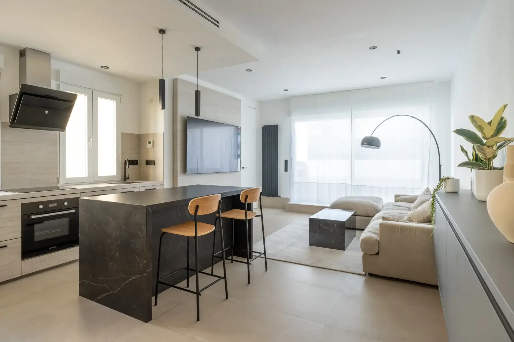

## Cómo ahorrar calefacción en invierno sin aumentar las facturas

El invierno trae consigo el reto de mantener el calor en casa sin que las facturas de calefacción se disparen. **Más del 40% del [consumo energético](https://www.nedgia.es/blog-gas-natural/consumo-gas-casa/)** en los hogares españoles corresponde a la calefacción, lo que supone un impacto económico considerable y un **aumento en las emisiones de carbono**.

En **Bramanti Arquitectos** sabemos que combinar tecnologías innovadoras como la domótica con soluciones de diseño eficiente, como el **estándar Passivhaus**, es clave para un hogar más confortable, económico y sostenible. En este post te explicamos como puedes **a****horrar calefacción con domótica y passivhaus**.

## Domótica: la solución para ahorrar calefacción con tecnología inteligente

La **domótica** es una herramienta poderosa para **optimizar** el uso de la **calefacción en tu hogar**. Al automatizar y personalizar el **control de la temperatura**, puedes **ahorrar energía** sin renunciar al confort.

### Regulación inteligente de la temperatura

Con **termostatos inteligentes**, puedes establecer horarios para calentar tu hogar únicamente cuando sea necesario. Además, puedes **ajustar la temperatura por zonas**, manteniendo diferentes niveles de calor en habitaciones según su uso.

Por ejemplo, puedes **programar una temperatura** más baja en dormitorios durante el día y aumentarla en las zonas comunes mientras están ocupadas.

### Monitoreo y control en tiempo real

Gracias a la **domótica**, puedes **gestionar la calefacción** desde tu **smartphone o tablet**. Algunas de las ventajas incluyen:

- **Encender** **la calefacción** antes de llegar a casa para encontrar un ambiente cálido.
- **Detectar consumos elevados** y **ajustar el sistema al instante**.

### Sensores de movimiento y ventanas abiertas

Los sensores domóticos son capaces de:

- **Apagar automáticamente la calefacción** en habitaciones vacías.
- **Detectar ventanas abiertas** para evitar desperdicio de energía.

## Contacta con nosotros

En **Bramanti Arquitectos**, nos dedicamos a cumplir con los **objetivos de cada proyecto**, pero nuestro principal propósito es la **satisfacción de nuestros clientes**. ¡Nos encantaría conocer tu propuesta!

## Domótica y Passivhaus: claves para un hogar eficiente este invierno

El estándar **Passivhaus** está diseñado para minimizar el consumo energético al combinar estrategias de diseño pasivo y eficiencia avanzada. Descubre en detalle qué es Passivhaus y cómo puede transformar tu hogar en un espacio más sostenible. Entre sus pilares destacan:

- **Aislamiento térmico:** mantiene el calor en el interior del hogar.
- **Ventanas de alto rendimiento:** aprovechan el calor solar durante el día.
- **Estanqueidad y ventilación mecánica:** garantizan un aire limpio y cálido sin pérdidas de energía.

Cuando se combina con la domótica, el Passivhaus se convierte en una solución ideal para reducir la dependencia de sistemas de calefacción tradicionales. En **Bramanti Arquitectos**, desarrollamos proyectos Passivhaus en Madrid que integran tecnología avanzada para ofrecer un confort superior incluso en los inviernos más fríos.

## Cortinas térmicas: una solución práctica para ahorrar calefacción

Además de la domótica, las **cortinas térmicas** son un complemento asequible y efectivo para evitar la pérdida de calor. Estas funcionan como una barrera adicional frente a las ventanas, bloqueando la transferencia de calor al exterior.

Si las **combinas con sistemas domóticos**, puedes **programar su apertura** durante el día para aprovechar el calor solar y cerrarlas automáticamente al anochecer, **maximizando su eficiencia sin esfuerzo**.

### Consejos adicionales para ahorrar calefacción este invierno

Aunque la domótica y el diseño Passivhaus son soluciones de vanguardia, hay medidas adicionales que puedes implementar para mantener el calor en casa y reducir las facturas:

1. **Aprovecha la luz solar:** Mantén persianas y cortinas abiertas durante el día y ciérralas al anochecer.
2. **Sella ventanas y puertas:** Instala burletes para evitar corrientes de aire y pérdida de calor.
3. **Utiliza alfombras gruesas:** Aislan el suelo y ayudan a conservar el calor en las estancias.
4. **Mantén los radiadores despejados:** No los cubras con muebles ni ropa para que el calor circule libremente.
5. **Ajusta el termostato a 20-21 ºC:** Cada grado adicional puede aumentar el consumo energético en un 7%.

## Conclusión: Domótica y diseño para un invierno más eficiente

**Ahorrar calefacción** este invierno no significa renunciar al confort. Con la **combinación de tecnologías avanzadas** como la **domótica**, el **diseño Passivhaus** y soluciones prácticas como las **cortinas térmicas**, puedes disfrutar de un **hogar cálido** y eficiente mientras **reduces tus facturas** y tu **impacto ambiental**. Si quieres saber más sobre qué es **Passivhaus** y sus **beneficios** en este otro post, te lo contamos.

En **Bramanti Arquitectos**, te ayudamos a diseñar y construir viviendas que combinan **sostenibilidad**, tecnología y diseño a medida. Contáctanos para **transformar tu hogar** en un **espacio eficiente** y **acogedor** este invierno.

## Preguntas Frecuentes (FAQs)

### 1. ¿Cuánto puedo ahorrar con un sistema domótico en calefacción?

Puedes reducir hasta un 30% en tus facturas de calefacción al utilizar sistemas domóticos combinados con buenas prácticas de eficiencia energética.

### 2. ¿El estándar Passivhaus funciona en climas fríos como el de Madrid?

Sí, el diseño Passivhaus está pensado para adaptarse a cualquier clima. En invierno, minimiza las pérdidas de calor y aprovecha el calor solar disponible.

### 3. ¿Son costosas las cortinas térmicas?

No, las cortinas térmicas son una solución asequible y rentable que puede complementar perfectamente otras estrategias de ahorro energético.

### 4. ¿Es posible integrar sistemas domóticos en viviendas antiguas?

Sí, actualmente existen soluciones inalámbricas que no requieren grandes obras y son fáciles de instalar en cualquier tipo de vivienda.

### 5. ¿Qué otros elementos ayudan a mejorar el aislamiento térmico?

Además de un buen diseño y ventanas de alta calidad, existen materiales que pueden mejorar significativamente el aislamiento térmico de tu hogar. Si quieres llevar a cabo una reforma integral de tu hogar, contacta con nosotros y te asesoraremos en todo lo necesario.

## Contacta con nosotros

En **Bramanti Arquitectos**, diseñamos y construimos espacios únicos y funcionales, adaptados a tus necesidades. Con nuestro equipo de arquitectos y constructores, nos encargamos de todo, desde la planificación hasta la entrega de llaves.
