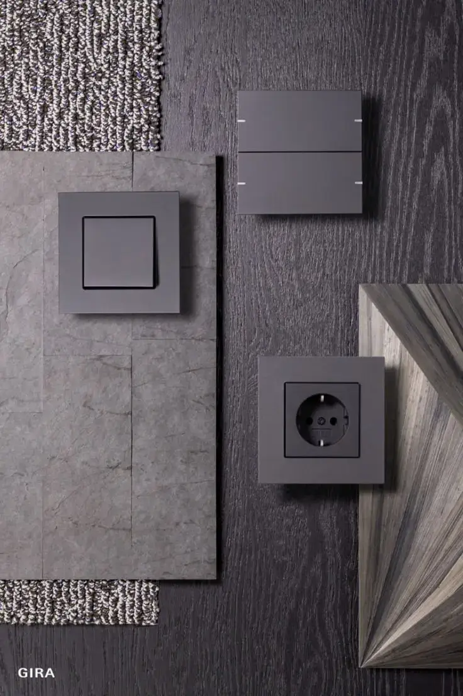

La correcta instalación de enchufes es clave para la **seguridad** y **comodidad** en cualquier **hogar**. Colocar los enchufes a la altura adecuada y en la ubicación correcta evita problemas futuros y mejora la funcionalidad de los espacios. En esta guía, exploraremos los **estándares recomendados**, las **normativas vigentes** y los **mejores lugares** para situarlos en cada estancia.

Si estás reformando tu casa o diseñando una nueva vivienda, contar con un [**estudio de arquitectura en Madrid**](/estudio-arquitectura-madrid/), como [**Bramanti Arquitectos**](/), te permitirá optimizar la distribución eléctrica, asegurando que cada enchufe esté en la posición ideal para **mejorar** la **estética** y **funcionalidad** de tu hogar.

## Factores clave para determinar la altura y ubicación de los enchufes

Antes de instalar enchufes en casa, es fundamental considerar ciertos factores que influyen en su posición. No solo se trata de comodidad, sino también de seguridad y cumplimiento normativo.

### 1. Seguridad y accesibilidad

Ubicar los enchufes en lugares estratégicos minimiza riesgos eléctricos y facilita su uso. En hogares con niños, se recomienda instalarlos a una altura segura o utilizar protectores de enchufes.

### 2. Uso previsto del enchufe

Los enchufes deben adaptarse a su función. Por ejemplo, los destinados a electrodomésticos deben estar cerca del suelo, mientras que los de la encimera en la cocina deben ubicarse a una altura cómoda para conectar pequeños aparatos.

### 3. Normativas eléctricas aplicables

En España, la normativa **Reglamento Electrotécnico de Baja Tensión (REBT)** establece criterios específicos sobre la altura y distribución de los enchufes. Cumplir con estas regulaciones garantiza una instalación segura y eficiente.

Para evitar problemas de diseño, en **Bramanti Arquitectos**, expertos en **reformas integrales en Madrid**, ayudamos a nuestros clientes a distribuir los enchufes correctamente según su estilo de vida y necesidades diarias.

*GIRA*

## ¿Cómo situar los enchufes en casa de manera eficiente?

Distribuir correctamente los enchufes en una vivienda mejora la funcionalidad de cada estancia. A continuación, te damos algunas recomendaciones para optimizar su ubicación.

### 1. Planificación previa

Antes de la instalación, es recomendable hacer un plano con la distribución de los muebles y electrodomésticos para ubicar los enchufes en lugares estratégicos. En este sentido, contar con un **estudio de interiorismo en Madrid**, como **Bramanti Arquitectos**, garantiza que la distribución eléctrica esté integrada en el diseño global del espacio.

### 2. Evitar sobrecargas

Distribuir los enchufes de manera uniforme en una habitación evita la necesidad de usar extensiones y regletas, reduciendo el riesgo de sobrecarga eléctrica.

### 3. Adaptar la ubicación según el tipo de estancia

No todos los espacios requieren la misma distribución de enchufes. En habitaciones, se recomienda colocarlos cerca de la cama y en las zonas de trabajo. En la cocina, deben estar accesibles pero alejados de zonas húmedas.

## ¿Estás planificando una reforma o una nueva construcción?

En **Bramanti Arquitectos**, diseñamos espacios funcionales y optimizamos la distribución eléctrica de tu hogar. **Contáctanos hoy** y hablemos sobre tu proyecto.

[Solicitar valoración de tu reforma integral](/tu-reforma-integral-en-madrid/#valoracion)

## Ubicación correcta de los enchufes según la estancia

Cada habitación tiene necesidades eléctricas distintas. A continuación, analizamos cuál es la altura y ubicación ideal para los enchufes en diferentes estancias del hogar.

### 1. Salón y comedor

En estas áreas, los enchufes deben instalarse a una altura de entre **30 y 40 cm del suelo**. También se recomienda colocar algunos más altos para televisores o equipos de sonido.

### 2. Dormitorios

Los enchufes en el dormitorio deben colocarse en puntos estratégicos. La **altura del enchufe en la mesita de noche** suele ser de **60 cm**, mientras que los situados en el cabecero de la cama deben instalarse a unos **70-75 cm**.

### 3. Pasillos y zonas de paso

Se recomienda instalar enchufes en pasillos a una altura estándar de **30 cm del suelo** para conectar dispositivos temporales como aspiradoras.

## Ubicación de los enchufes en la cocina

La cocina es una de las estancias donde más electrodomésticos se utilizan, por lo que la distribución de los enchufes debe ser planificada cuidadosamente.

### 1. Altura del enchufe en la cocina

Los enchufes de la cocina deben instalarse a una altura mínima de **15 cm del suelo** para los electrodomésticos fijos, como lavadoras y frigoríficos.

### 2. Altura del enchufe en la encimera

Para los pequeños electrodomésticos, se recomienda colocar los enchufes entre **110 y 130 cm** de altura sobre la encimera.

## Normativa sobre la altura y ubicación de los enchufes

La normativa eléctrica en España establece criterios específicos sobre la instalación de enchufes para garantizar seguridad y accesibilidad.

### Altura de interruptores y enchufes según la normativa

El **Reglamento Electrotécnico de Baja Tensión (REBT)** establece que:

- Los **enchufes generales** deben instalarse entre **30 y 40 cm del suelo**.
- Los **interruptores** deben colocarse a una altura de entre **90 y 110 cm**, para que sean accesibles de pie.

## Conclusión: La importancia de una instalación estratégica

Una instalación eléctrica bien diseñada no solo mejora la comodidad, sino que también influye en la estética y funcionalidad de una vivienda. En **Bramanti Arquitectos**, expertos en **arquitectura y reformas integrales en Madrid**, diseñamos cada proyecto teniendo en cuenta la distribución eléctrica, asegurando que todos los enchufes estén ubicados de manera estratégica y cumplan con la normativa vigente.

Si estás reformando tu hogar o construyendo desde cero, **contáctanos** y descubre cómo podemos ayudarte a optimizar el diseño de tu vivienda con una instalación eléctrica eficiente y segura.

[Conoce nuestro servicio de reformas integrales](/reformas-integrales-madrid/)

## Preguntas frecuentes (FAQs)

### 1. ¿A qué altura se deben colocar los enchufes en una casa?

La altura estándar recomendada es de **30-40 cm del suelo**, aunque en algunos casos (como mesitas de noche o encimeras de cocina) pueden colocarse más altos.

### 2. ¿Cuántos enchufes debo instalar en cada habitación?

Se recomienda instalar **al menos 4 enchufes por estancia**, aunque en cocinas y salones puede ser necesario más.

### 3. ¿Dónde colocar los enchufes en una cocina?

Deben instalarse a **15 cm del suelo** para electrodomésticos grandes y a **110-130 cm sobre la encimera** para pequeños electrodomésticos, respetando distancias de seguridad con el fregadero.

### 4. ¿Qué normativa regula la instalación de enchufes en España?

El **Reglamento Electrotécnico de Baja Tensión (REBT)** establece las alturas mínimas y distancias de seguridad para la instalación de enchufes.

### 5. ¿Cómo hacer una instalación de enchufes segura en casa?

Planifica su distribución, evita sobrecargas, usa enchufes con toma de tierra y asegúrate de que cumplen con la normativa vigente.

## ¿Estás reformando tu casa y necesitas una distribución eléctrica bien planificada?

En **Bramanti Arquitectos**, **estudio de arquitectura en Madrid**, diseñamos espacios funcionales y optimizamos cada detalle de tu hogar, desde la iluminación hasta la distribución de enchufes.

[Cuéntanos tu proyecto de reforma integral](/tu-reforma-integral-en-madrid/#valoracion)
