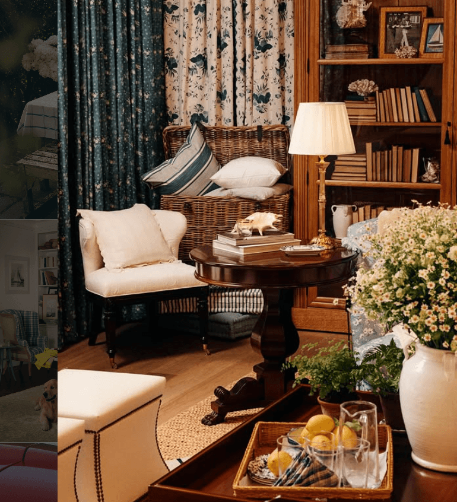
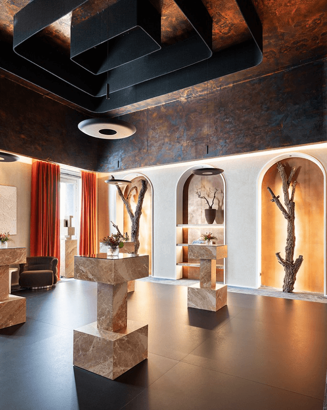
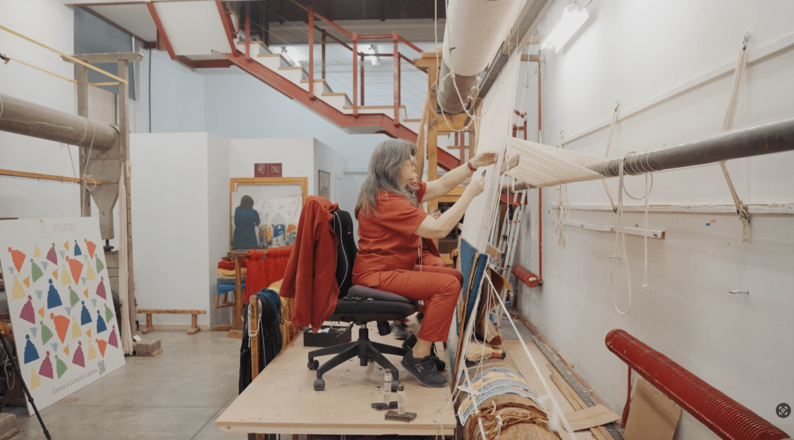
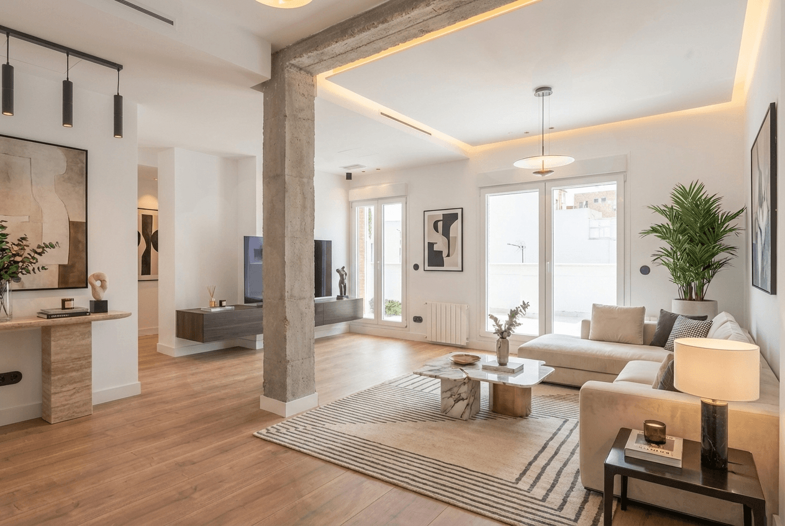
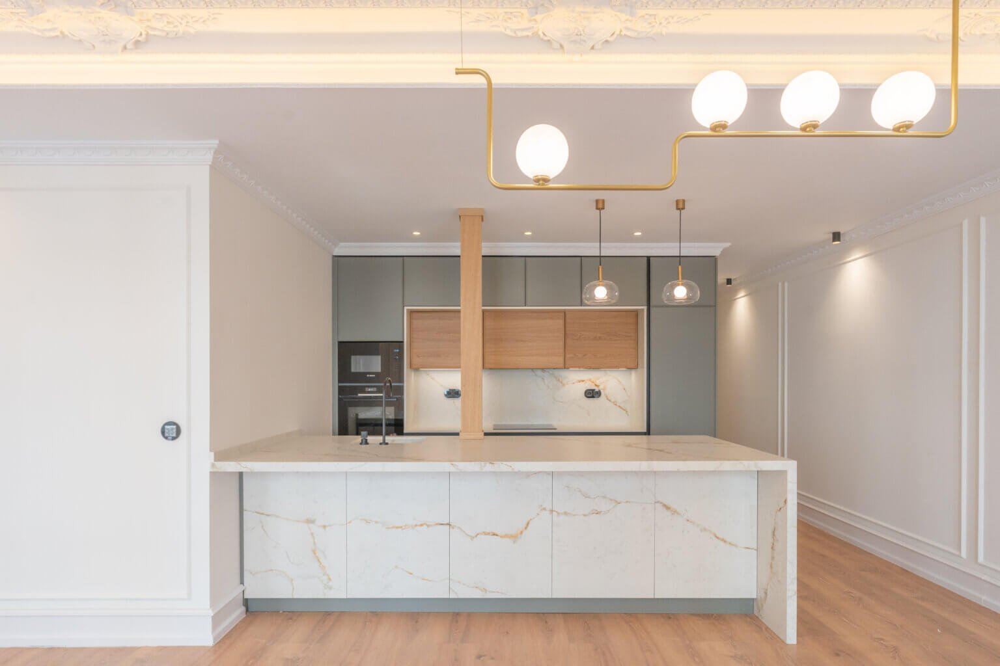

## Arquitectura, Estética y Técnica en Madrid

### Lo que muchos estudios de arquitectura, construcción e interiorismo no entienden en Madrid

Hablar de arte y decoración en el contexto arquitectónico ya no es un lujo ni un añadido superficial. Hoy, el **arte en la arquitectura en Madrid** se ha convertido en una necesidad estratégica para cualquier estudio que aspire a destacar.

En un mercado cada vez más competitivo, donde la técnica se presupone, el verdadero valor diferencial reside en la capacidad de construir una narrativa estética, emocional y cultural en cada proyecto.

El cliente actual ya no busca únicamente una vivienda o un espacio funcional. Busca una experiencia. Busca identidad. Busca sentirse representado en cada rincón de su hogar.

Es precisamente aquí donde entra en juego la integración real y no solo conceptual de arquitectura, construcción e interiorismo. Un enfoque que muy pocos estudios de arquitectura en Madrid dominan de forma completa, y que marca la diferencia entre un espacio correcto y un espacio memorable.

## Cómo decidir tu reforma integral en Madrid desde el arte

### El arte como eje conceptual del proyecto arquitectónico

Uno de los errores más habituales al afrontar una reforma integral es pensar que el diseño llega al final del proceso. Primero se construye, luego se decora.

Pero la realidad es justo la contraria.

El arte no es un añadido. Es el punto de partida.

Un proyecto arquitectónico con vocación artística nace de una idea matriz que articula cada decisión posterior. Esta visión permite construir espacios coherentes, donde cada elemento responde a una intención clara.

Diseñar es comunicar. Y como todo lenguaje, la arquitectura tiene su propia gramática:

- **La luz**, como herramienta narrativa
- **Los materiales**, como expresión sensorial
- **Las proporciones**, como generadoras de armonía
- **El vacío**, como elemento activo

Cuando estas variables se trabajan desde una sensibilidad artística, el resultado deja de ser un espacio construido para convertirse en una auténtica obra habitable.

## Personal Shopper Inmobiliario y Diseño Internacional con Ralph Lauren Home

### La mente creativa detrás del proyecto

El verdadero diferencial no está en el resultado final, sino en la mente que lo proyecta.

Un estudio que integra arte y arquitectura:

- Interpreta referencias culturales

- Integra disciplinas creativas externas

- Construye conceptos antes que espacios

- Diseña experiencias, no solo estructuras

Este enfoque convierte cada proyecto en algo irrepetible. Los grandes estudios lo entienden igual que nosotros. Es decir, que se puede expandir el potencial de un espacio sin derrochar dinero, pero observando y analizando nuestro lado más artístico. Así lo entiende uno de nuestros colaboradores, Ralph Lauren Home, con los que hemos trabajado estrechamente en nuestro estudio para ofrecer la mayor excelencia a nuestros clientes. Aquí tienes un guiño de cómo conciben esta idea, que idéntica a cómo la concebimos nosotros: **[Arte para el hogar | Ralph Lauren® ES](https://www.ralphlauren.es/es/home-art/707223)**  

De hecho, si te interesa, lee más sobre el tema en nuestro post dedicado a la Milano Design Week, en la abordamos a fondo nuestro entendimiento sobre el Personal Shopper Internacional de Diseño.

## Reforma integral en Madrid desde un enfoque práctico, eficiente y coherente

### Ventajas de un enfoque multidisciplinar

Cuando un estudio controla arquitectura, construcción e interiorismo, el proyecto evoluciona de forma natural, sin fricciones ni pérdidas de intención.

Esto se traduce en:

- Coherencia estética total desde el concepto hasta el último detalle
- Optimización de tiempos al eliminar intermediarios
- Control económico real durante todas las fases
- Mayor precisión en la ejecución del diseño

Pero, sobre todo, permite algo clave: que la idea original no se diluya.

La coordinación entre arquitectos, diseñadores, ingenieros y jefes de obra genera un lenguaje común donde el arte, la técnica y la funcionalidad conviven en equilibrio.

### ¿Tienes un proyecto en mente?

Convierte tu idea en un espacio único con un enfoque que combina arquitectura, arte y diseño.

[Habla con Bramanti Arquitectos hoy mismo](https://tally.so/r/9q7DyY)

## Casa Decor: el termómetro del interiorismo en Madrid

### Tendencias clave observadas

Hablar de tendencias en arte y decoración implica necesariamente mirar hacia Casa Decor, considerada la mayor exposición de interiorismo en Madrid y una referencia nacional.

Como expertos, nuestros ojos observan a esta feria desde una óptica analítica. También nos inspiramos para estar actualizados de las últimas tendencias del sector.

**Materialidad natural**

- Uso intensivo de piedra, madera y fibras orgánicas

- Acabados imperfectos que refuerzan lo artesanal

- Conexión directa con el entorno

**Espacios emocionales**

- Iluminación cálida y envolvente

- Distribuciones abiertas pero íntimas

- Uso del color como herramienta psicológica

**Arte integrado**

- Obras concebidas como parte del espacio

- Murales, textiles y piezas únicas

- Colaboración con artistas y artesanos

**Lujo silencioso**

- Elegancia sin ostentación

- Materiales de alta calidad sin exceso decorativo

- Minimalismo sofisticado

*Casa Decor 2026. Fotografía de Nacho Uribesalazar*

Estas tendencias refuerzan la idea de que el interiorismo ya no es decoración, sino una extensión del pensamiento arquitectónico. En nuestro Estudio estamos alineados con todo ello. Por ejemplo:  

- Apostando por las molduras artesanales a mano en **[Casa Elara](/casa-elara/)**

- Proponiendo un minimalismo actualizado con el brutalismo de **[Casa Silva](/nuestras-creaciones/casa-silva/)**

- Ofreciendo un espacio donde la curva y los colores reinan en **[Casa Santos Dumont](/nuestras-creaciones/casa-santos-dumont/)**

## Colaboración con la Real Fábrica de Tapices: tradición y contemporaneidad

### Explorando el potencial de la artesanía

La colaboración con la **[Real Fábrica de Tapices](/arquitectura-artesania-diseno-medida-real-fabrica-tapices/)** representa un punto de encuentro entre historia y diseño contemporáneo.

Integrar artesanía en proyectos arquitectónicos aporta:

- Exclusividad absoluta
- Valor cultural y patrimonial
- Riqueza material única

Además, permite:

- Diseñar espacios en torno a piezas textiles
- Integrar tapices como elementos arquitectónicos
- Reinterpretar técnicas tradicionales en contextos modernos

El resultado es un diálogo entre pasado y presente que enriquece profundamente el proyecto.

*Real Fábrica de Tapices*

## Milano Design Week: el diseño como experiencia inmersiva internacional

### Personal Shopper internacional de diseño

El diseño no se limita al estudio. Se construye también viajando, observando y experimentando.

Un ejemplo es el trabajo como personal shopper de diseño en la Milano Fashion Week, donde el cliente participa activamente en la selección de piezas para su proyecto.

Esto permite:

- Acceder a tendencias antes de su llegada al mercado
- Conectar directamente con diseñadores y firmas
- Seleccionar piezas únicas

El resultado es un nivel de personalización superior y una experiencia completamente inmersiva.

### Diseñamos espacios con identidad

Cada proyecto es único, pensado para emocionar y perdurar en el tiempo.

[Conoce nuestro método de trabajo y da el primer paso hacia un diseño excepcional.](https://tally.so/r/9q7DyY)

## Reforma y venta de Casa Silva - Ático en el Barrio Salamanca con 21 metros cuadrados de terraza

### Naturalismo clásico reinterpretado en el Brutalismo Moderno

Casa Silva nace de una inspiración clara: el naturalismo clásico, que se define grosso modo como:

- Integración total con el entorno

- Uso de materiales nobles

- Búsqueda de atemporalidad

**Las claves del proyecto**

- Expandir todo lo posible la increíble luz de **este Ático en el Barrio Salamanca con 21 metros cuadrados de terraza**.

- **Acabados naturales** como elementos protagonista

- **Maderas cálidas** que aportan confort

- **Colores neutros** que refuerzan la serenidad

- **Tecnología** con la domótica integrada y personalizable

El resultado es una vivienda que transmite calma, elegancia y equilibrio. Un espacio que no sigue modas, sino que perdura.

## Reforma y venta de Casa Elara

### Una reforma integral basada en la Historia detrás residencial contemporáneo

En contraposición, Casa Elara explora un lenguaje mucho más radical: el brutalismo residencial.

**Concepto arquitectónico**

- Volumen como protagonista

- Materialidad expuesta

- Estética contundente

**Claves del proyecto**

- Uso de **hormigón visto**

- Geometrías marcadas

- Contraste entre masa y vacío

**Experiencia espacial**

Casa Elara no busca agradar a todos. Busca impactar. Es una declaración de intenciones, una obra que desafía lo convencional.

## El futuro pertenece a los estudios con visión artística

La evolución del sector es clara. La técnica sin errores y a precio ajustado, es necesario, pero ya no es suficiente.

El futuro pertenece a aquellos estudios capaces de:

- Integrar disciplinas

- Pensar desde el Arte

- Construir con coherencia

- Diseñar con intención

La combinación de arquitectura, construcción e interiorismo, unida a una visión artística sólida, no solo mejora el resultado final. Lo transforma por completo.

### Descubre cómo transformar tu espacio

Explora nuevas posibilidades para tu vivienda o negocio con soluciones creativas y personalizadas.

[Habla con nuestro equipo y empieza a diseñar tu proyecto ideal](https://tally.so/r/9q7DyY)
