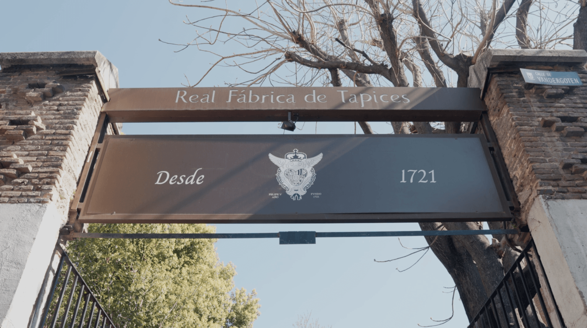
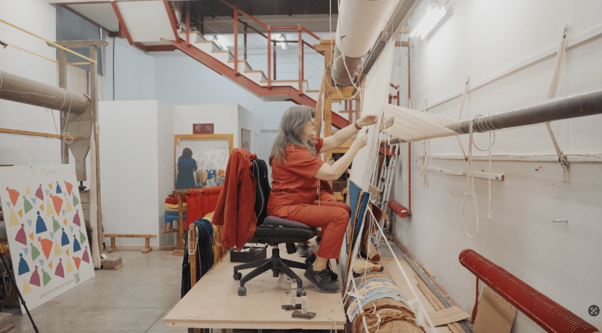

## Cuando el proyecto exige algo más que diseño

Hay proyectos que no se resuelven.  
Se interpretan.

En la arquitectura residencial de alto nivel, el verdadero reto no está en transformar un espacio, sino en entenderlo. En leer lo que ya existe y decidir, con precisión, qué merece permanecer y qué debe evolucionar.

En **[Bramanti Arquitectos](/)**, ese enfoque define cada proyecto. Y es precisamente en ese punto donde la arquitectura comienza a dialogar con la artesanía.

## Una cuestión de criterio

Durante más de dos años y medio, el estudio ha trabajado en una vivienda con historia, abordando el proyecto desde una mirada que va más allá de la intervención convencional.

> “El objetivo no era simplemente transformarla, sino entenderla y darle continuidad a través del diseño.”

La exigencia no venía solo del cliente, sino del propio proyecto.  
Cada decisión debía estar a la altura del conjunto.

> “Este tipo de encargo no se resuelve mirando catálogos. O encuentras quién lo puede hacer o no lo haces.”

## Cuando la arquitectura necesita oficio

Es en ese punto donde aparece la colaboración con la [**Real Fábrica de Tapices**](https://realfabricadetapices.com/).

No como un gesto estético, sino como una respuesta necesaria.

Fundada en el siglo XVIII, la fábrica continúa hoy produciendo tapices y alfombras de forma ininterrumpida, manteniendo procesos que combinan tradición y precisión técnica.

Pero lo que realmente la diferencia no es su historia, sino su capacidad de adaptación al proyecto contemporáneo.

> “Aquí no eliges entre opciones. Se puede diseñar exactamente lo que el cliente necesita.”

## El valor del proceso

En un contexto dominado por la inmediatez, el proceso artesanal introduce otra escala de tiempo.

Todo comienza con el dibujo, desarrollado a tamaño real.  
Si la pieza mide seis metros, el diseño también.

> “Se extiende en el suelo para entender la proporción y encajar cada elemento antes de trasladarlo al telar.”

A partir de ahí, la ejecución se desarrolla hilo a hilo.  
La urdimbre se construye manualmente y el diseño se transfiere con una precisión que no admite margen de error.

Cada nudo forma parte de un sistema donde el resultado no puede separarse del proceso.

*Entrada a la Real Fabrica de Tapices.*

## Diseñar sin concesiones

El encargo: una pieza textil para una escalera de gran formato.  
Seis metros de longitud. Geometría precisa. Integración total con el lenguaje arquitectónico del proyecto.

> “Cada elemento de la vivienda tenía que estar al mismo nivel de exigencia.”

La escala obligó a dividir la producción en varios telares, trabajando de forma simultánea.

> “Un metro cuadrado por persona puede llevar alrededor de siete días. Es un proceso lento, pero necesario.”

Aquí, el tiempo no es una limitación.  
Es parte del valor.

## El detalle como estructura

En proyectos de este nivel, el detalle deja de ser decorativo.

Se convierte en estructura.  
En lenguaje.

La incorporación de elementos diseñados y producidos específicamente para el espacio permite alcanzar una coherencia que no puede lograrse desde soluciones estándar.

La arquitectura no termina en los planos.  
Se construye también en lo táctil.

*Nuestra alfombra en proceso de creación*

## Arquitectura de lujo en Madrid: más allá del diseño

En el contexto de la **arquitectura de lujo en Madrid**, la diferencia no está únicamente en el resultado, sino en el proceso que lo hace posible.

Elegir con quién trabajar, cómo desarrollar cada pieza y hasta qué punto llevar el detalle son decisiones que definen el proyecto tanto como el diseño.

## Una forma de hacer

Nuestro encargo a la [**Real Fábrica de Tapices**](https://realfabricadetapices.com/) no responde a una tendencia, sino a una manera de entender la arquitectura.

Una forma de trabajar donde el diseño, la técnica y el oficio se alinean.

Porque cuando todo está definido de antemano, el resultado también lo está.

## ¿Buscas un proyecto donde cada decisión cuente?

Si valoras el diseño a medida, la precisión y la colaboración con oficios especializados, podemos ayudarte a desarrollar un proyecto verdaderamente singular.
