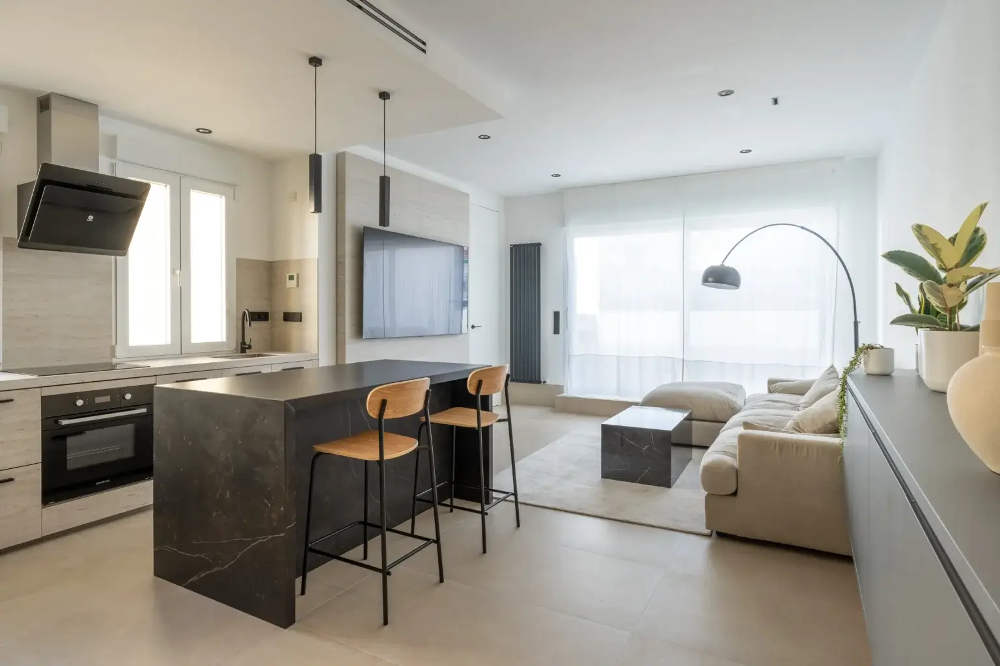

La ciudad de [Madrid](https://www.madrid.es/portal/site/munimadrid) es un referente clave en el panorama de la arquitectura y la construcción en España. Desde rehabilitaciones de edificios históricos en el centro hasta innovadores proyectos de obra nueva en barrios emergentes, la demanda de servicios arquitectónicos de calidad es constante. Elegir al arquitecto adecuado puede marcar la diferencia entre una obra que fluye sin contratiempos y una llena de obstáculos.

En nuestro estudio de arquitectura, contamos con una amplia experiencia en proyectos residenciales, comerciales y urbanísticos, todos adaptados a las necesidades particulares de cada cliente y siempre cumpliendo con la normativa madrileña. A lo largo de este artículo te guiaremos por todo lo que necesitas saber para llevar a cabo tu proyecto con éxito. Además, enlazaremos a otros artículos de nuestro blog donde abordamos temas específicos como licencias, presupuestos o estilos arquitectónicos actuales.

## ¿Por qué Madrid es un epicentro de arquitectura y construcción?

Madrid se encuentra en plena transformación urbana. Nuevos desarrollos residenciales, ampliación de infraestructuras, rehabilitación de barrios históricos y el auge de la arquitectura sostenible han convertido a la capital en un hervidero de oportunidades para quienes buscan construir o reformar.

### Zonas en auge y estilo arquitectónico madrileño

Distritos como Chamartín, Chamberí, Retiro o zonas emergentes como Valdebebas y El Cañaveral están viendo cómo la arquitectura moderna se integra con el tejido urbano existente, ofreciendo soluciones tanto estéticas como funcionales. Este dinamismo urbano implica también una fuerte exigencia en cuanto a normativa, plazos y profesionalidad. Por eso es clave contar con un estudio de arquitectura en Madrid que conozca a fondo el contexto y sepa cómo anticiparse a cualquier obstáculo técnico o legal.

Si estás explorando oportunidades de inversión inmobiliaria o necesitas asesoramiento personalizado, en nuestro blog ya hemos publicado un análisis sobre las mejores zonas de Madrid para construir o rehabilitar ([**ver artículo**](/las-mejores-zonas-para-vivir-en-madrid-en-2024-guia-completa/): «Zonas con potencial para construir en Madrid»).

## El papel del arquitecto en un proyecto de construcción

Muchas personas aún piensan que el arquitecto solo dibuja planos. En realidad, su trabajo va mucho más allá. En nuestro estudio acompañamos a nuestros clientes desde la concepción de la idea hasta la entrega final de la obra. El arquitecto es el nexo entre la visión del cliente y la realidad física del proyecto.

### Funciones clave del arquitecto en Madrid

En Madrid, una parte fundamental del trabajo del arquitecto es gestionar correctamente las licencias urbanísticas, coordinar con aparejadores, ingenieros y constructores, y supervisar que la obra se ejecute con los estándares técnicos, estéticos y legales requeridos. También ofrecemos asesoramiento integral para optimizar la eficiencia energética, cumplir con las ordenanzas municipales y maximizar el aprovechamiento de cada metro cuadrado.

Ya sea una reforma integral, una rehabilitación energética o una vivienda unifamiliar de obra nueva, contar con un arquitecto que conozca los procedimientos locales puede ahorrarte muchos dolores de cabeza. En nuestro artículo sobre «**[El proceso completo de reforma en Madrid](/reformas-integrales-en-madrid/)**» explicamos paso a paso cómo lo hacemos y qué debes tener en cuenta en cada fase del proyecto.

## Tipos de proyectos más comunes en Madrid

Madrid ofrece una gran diversidad de oportunidades en arquitectura y construcción. En nuestro día a día, trabajamos en tres grandes categorías de proyectos que se repiten constantemente en la capital.

### Reformas integrales en viviendas

Muchos propietarios deciden reformar por completo sus pisos antiguos, especialmente en zonas como Lavapiés, Malasaña o el centro histórico. Estas reformas suelen requerir una actualización completa de instalaciones eléctricas y de fontanería, así como mejoras en aislamiento térmico y distribución de espacios. Es por esto que el tener una correcta planificación y una buena elección del equipo técnico son esenciales para evitar sobrecostes o retrasos.

### Obra nueva en zonas periféricas

Barrios como Montecarmelo, Arroyofresno o El Cañaveral están atrayendo cada vez más a familias que buscan viviendas unifamiliares modernas con jardín. Estos proyectos requieren una planificación integral que va desde el diseño arquitectónico y paisajístico hasta la tramitación urbanística completa. Nuestro estudio ofrece un servicio llave en mano para este tipo de obras.

## Conoce nuestros principales proyectos en Madrid

Desde reformas integrales hasta proyectos de obra nueva, en Bramanti Arquitectos combinamos diseño, técnica y funcionalidad para transformar cada espacio en un hogar único. Descubre cómo trabajamos y qué nos hace diferentes en nuestros proyectos en Madrid.

[Alguno de nuestros proyectos principales](/proyectos/)

## Normativas y licencias en la construcción madrileña

La normativa urbanística en Madrid es compleja y está en constante actualización. Contar con un equipo que sepa interpretarla y aplicarla es vital para garantizar la viabilidad de tu proyecto.

### Requisitos según tipo de obra

Cada tipo de intervención requiere una licencia específica: licencia de obra menor, de obra mayor, comunicación previa, declaración responsable… Saber cuál se necesita y qué documentación hay que presentar puede resultar confuso sin asesoramiento profesional.

## Evita sanciones innecesarias

Una gestión deficiente o la omisión de permisos puede derivar en sanciones económicas o incluso en la paralización de la obra. En nuestro estudio nos encargamos de todo el proceso de tramitación para que nuestros clientes puedan estar tranquilos.

## Tendencias en arquitectura moderna en Madrid

La arquitectura está en constante evolución, y Madrid no es la excepción. Estar al día con las últimas tendencias permite diseñar espacios más confortables, sostenibles y atractivos tanto a nivel funcional como estético.

### Sostenibilidad y eficiencia energética

Cada vez más clientes buscan soluciones ecoeficientes: fachadas ventiladas, cubiertas verdes, energía solar integrada, domótica para el ahorro energético… En nuestro estudio aplicamos los principios de arquitectura pasiva y diseño bioclimático, adaptados a la normativa y clima de Madrid.

### Materiales y estilos más demandados

El minimalismo sigue siendo tendencia, pero también vemos un crecimiento del estilo industrial, especialmente en oficinas y locales comerciales. En viviendas, predominan los materiales naturales, los tonos cálidos y la flexibilidad en los espacios.

Si quieres inspiración sobre estos temas, visita nuestro artículo «**[Tendencias en diseño de interiores 2025](/top-5-lamparas-de-mesa-modernas/)**«, donde exploramos cómo combinar funcionalidad, estética y sostenibilidad.

## Queremos conocer tu idea de proyecto

Te ofreceremos asesoramiento personalizado para que crear el hogar de tus sueños en Madrid.
