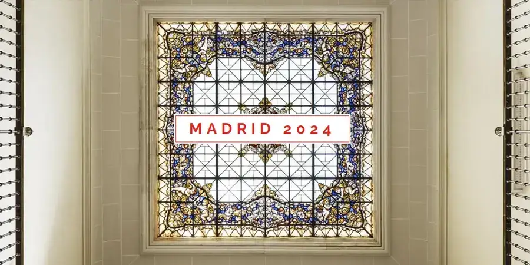
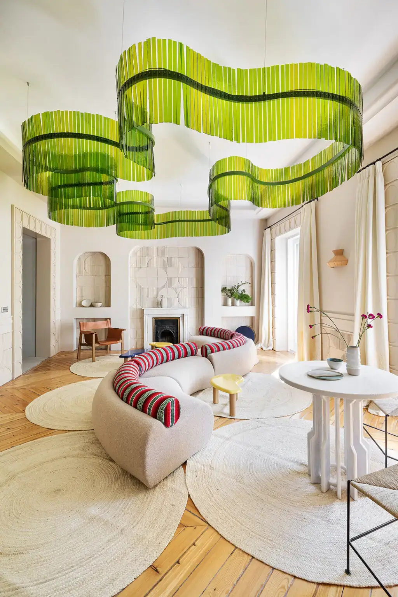

## ¿Qué es Casa Decor?

[Casa Decor](https://casadecor.es/) es un evento anual de **interiorismo, diseño y tendencias** que se celebra en Madrid desde 1992. Se trata de una exposición única en la que diferentes profesionales del interiorismo decoran un edificio emblemático de la ciudad,creando espacios únicos y originales.​

*Página web Casa Decor*

## Casa Decor 2024

[Casa Decor 2024](https://casadecor.es/madrid-2024/) ha abierto sus puertas, invitándonos a sumergirnos en un universo de diseño donde la creatividad y la innovación se dan la mano gracias a interioristas y **arquitectos profesionales** de todo el mundo. Este año, la exposición nos ofrece un viaje fascinante a través de un sinfín de estilos decorativos, desde los más clásicos y atemporales hasta **diseños arquitectónicos** de lo más vanguardistas y rompedores.

Recorriendo los espacios de Casa Decor 2024, nos encontramos con ambientes que reflejan la diversidad de gustos y personalidades. Los amantes del [estilo nórdico](https://www.elledecor.com/es/decoracion/g34436238/salones-estilo-nordico-ideas-decoracion/) se deleitarán con espacios minimalistas y acogedores, donde la madera y los colores claros crean una atmósfera de paz y armonía. Los apasionados por el [estilo industrial](https://www.elmueble.com/ideas/decoterapia/estilo-industrial-10-razones-para-) disfrutarán de lofts con vigas vistas, paredes de ladrillo y elementos metálicos que aportan un toque de carácter, personalidad y **diseño urbano.**

*Página web Casa Decor*

## TENDENCIAS QUE PUEDES ENCONTRAR:

Casa Decor no solo es un escaparate de estilos decorativos y **arquitectura comercial**, sino también un laboratorio de tendencias e **innovación arquitectónica**. En esta edición,podemos descubrir las propuestas más innovadoras de los mejores interioristas del panorama nacional e internacional.Entre las tendencias que destacan encontramos:

### El auge de la sostenibilidad

Cada vez más, los proyectos decorativos integran materiales reciclados y técnicas eco-amigables, creando espacios respetuosos con el medio ambiente y basados en la [**construcción sostenible.**](https://www.aedashomes.com/blog/definicion-construccion-sostenible-2/)

### La conexión con la naturaleza

Los espacios exteriores ganan protagonismo, con jardines verticales, terrazas en el cielo y oasis urbanos que nos invitan a reconectar con la naturaleza.

### La domótica y la inteligencia artificial

La tecnología se integra en el hogar, creando espacios inteligentes que se adaptan a nuestras necesidades y preferencias. Combinando **arquitectura contemporánea** y **arquitectura de alta calidad** y futurista,

Casa Decor 2024 es una fuente de inspiración inagotable para todos aquellos que buscan darle un nuevo aire a su hogar. Como estudio de arquitectura, recorrer sus espacios nos permite descubrir nuevas tendencias, conocer las últimas propuestas en mobiliario y decoración, y, sobre todo, despertar nuestra creatividad para transformar nuestros propios **proyectos arquitectónicos** en espacios y lugares únicos y especiales.

*Periódico El Mundo*

## No te pierdas la oportunidad de visitar CasaDecor 2024 y vivir una experiencia única en el mundo del diseño.

[Descubrir más](https://casadecor.es/)
