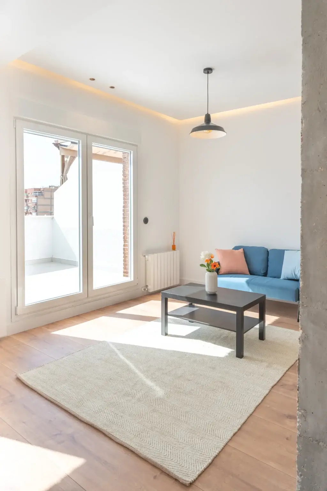
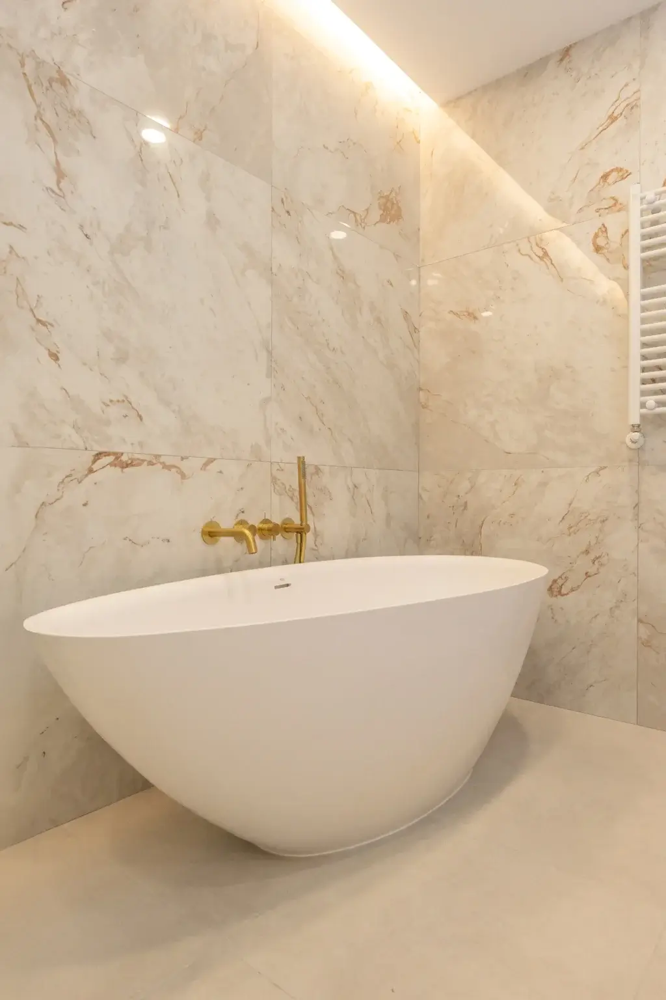
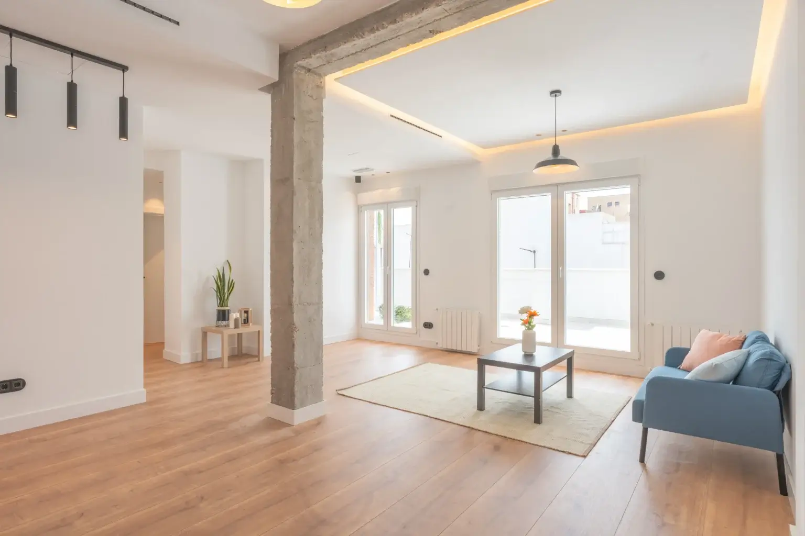
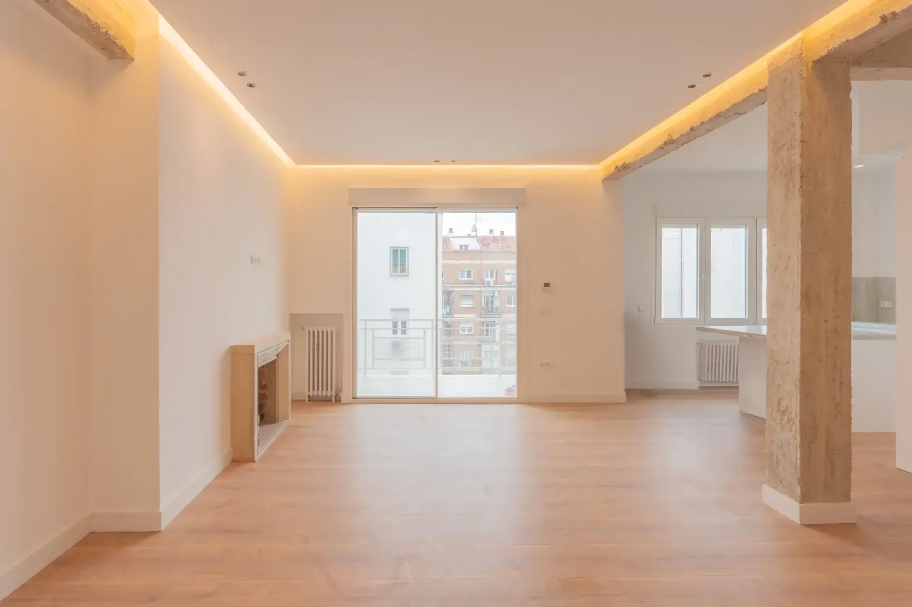
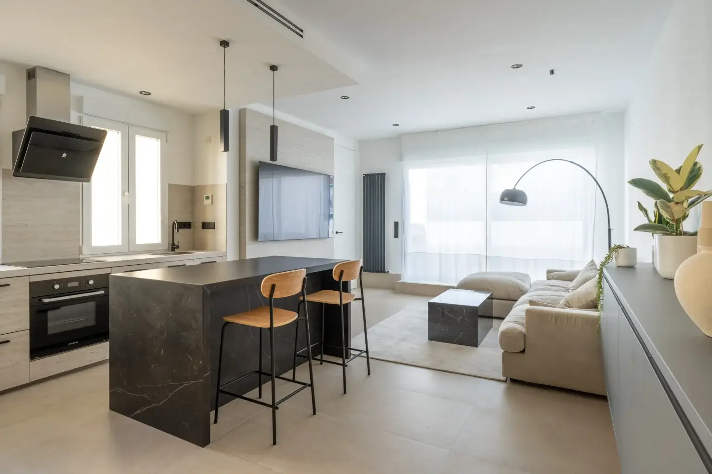
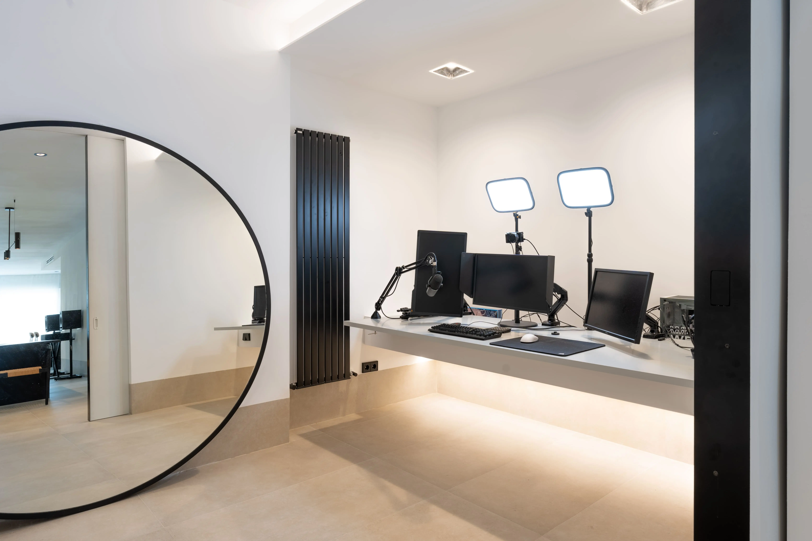

## La Importancia de una Buena Iluminación en el Diseño de Interiores

La **iluminación adecuada** es uno de los pilares fundamentales en el diseño de interiores. En **Bramanti Arquitectos**, hemos comprobado cómo una buena planificación de la luz puede transformar una estancia, haciéndola más **acogedora**, **espaciosa** y **funcional**. Más allá de su aspecto funcional, la iluminación tiene un papel fundamental en el **bienestar** y la **comodidad del hogar**. En esta guía, exploraremos cómo **iluminar tu hogar para hacerlo más acogedor** con recomendaciones sobre **temperatura de color**, **distribución de fuentes de luz**, y el uso de la **domótica** para una **iluminación moderna** y **eficiente**.

## Por Qué una Buena Iluminación Hace Más Acogedora una Estancia

Una buena **iluminación** es clave para crear **espacios** que resulten **acogedores** y **funcionales**. Una correcta **combinación** de luces permite destacar **detalles arquitectónicos**, mejorar el confort visual y definir ambientes que se adapten a distintas actividades. Por ejemplo, una **luz cálida** en el salón invita a la relajación, mientras que una **luz neutra** en la cocina mejora la concentración. También, estudios demuestran que el tipo e **intensidad de luz** impactan en el estado de ánimo, haciendo de la iluminación un aspecto **esencial** para el bienestar diario.

## Tipos de Luz en el Diseño de Interiores: General, de Ambiente y de Tarea

Para lograr una iluminación acogedora, es fundamental combinar varios tipos de luz. Cada uno cumple una función específica que, al integrarse, crea una atmósfera equilibrada y cómoda:

### Luz General

La luz general es la base de la iluminación en una estancia. Normalmente se consigue con plafones o focos de techo, que deben distribuirse bien para evitar sombras indeseadas. Optar por luces regulables en esta categoría ayuda a ajustar el nivel de iluminación según el momento del día y la actividad.

### Luz de Ambiente

Este tipo de luz aporta calidez y profundidad, creando una atmósfera relajante. Las lámparas de pie o mesa emiten una luz difusa, ideal para definir zonas de confort dentro de un espacio, como una zona de lectura en el salón o un rincón en el dormitorio.

### Luz de Tareas

Este tipo de iluminación es ideal para realizar actividades específicas, como leer, trabajar o cocinar. Las lámparas de escritorio, apliques de pared y luces empotradas sobre superficies cumplen bien esta función, ofreciendo una luz focalizada que no interfiere con el resto del ambiente.

## Elección de la Temperatura de Color para una Atmósfera Cálida

La temperatura de color de la luz, medida en grados Kelvin (K), es fundamental para definir la atmósfera de un espacio:

- **Luz cálida (2700K – 3000K)**: Ideal para crear ambientes acogedores en salones y dormitorios.
- **Luz neutra (4000K**): Recomendada para zonas donde se requiere concentración, como cocinas y estudios.
- **Luz fría (5000K y más)**: Suele usarse en áreas de trabajo o zonas con alta actividad.

Para crear una atmósfera cálida en casa, lo ideal es emplear luces cálidas en las áreas de descanso. También se puede combinar una lámpara de pie cálida con una luz de techo neutra, generando equilibrio visual y confort.

## Cómo Distribuir las Fuentes de Luz en una Estancia

Una correcta distribución de las luces es esencial para crear un espacio cómodo y acogedor. Aquí algunos puntos clave:

1. **Centrar la Luz General**: Ubicar la luz general en el centro o en las zonas de circulación de la estancia, usando lámparas colgantes o luces de techo regulables. Esto permite adaptar la intensidad de luz, desde una iluminación ambiental hasta una luz funcional.
2. **Crear Capas de Luz:** Añadir luces a diferentes alturas (techo, de pie y de mesa) crea un efecto de profundidad y dinamismo, logrando un espacio más envolvente.
3. **Distribución para Espacios Abiertos:** En estancias grandes o abiertas, distribuye las luces para definir zonas: una de descanso, una de trabajo y una de comedor. Usar lámparas de pie, apliques y luces de techo independientes facilita esta división de espacios.

## Iluminación Indirecta: Técnica para Crear Espacios Envolventes

La **iluminación indirecta** es ideal para crear un ambiente acogedor. Este tipo de iluminación se logra proyectando luz hacia techos, paredes o elementos decorativos. La luz reflejada genera una atmósfera suave y sin sombras fuertes, ideal para reducir la fatiga visual y aportar serenidad.

Para lograr este efecto, se pueden usar **tiras de LED empotradas** en techos o detrás de muebles. Este tipo de iluminación es muy eficaz en **espacios de descanso**, como el **salón** o el **dormitorio**.

## Luz Natural vs. Luz Artificial: Cómo Aprovechar Cada Fuente

Aprovechar la luz natural es clave para hacer el hogar **más acogedor** y **sostenible**. Para maximizar su entrada, usa cortinas ligeras o estores y coloca espejos estratégicamente para reflejar la luz. Por otro lado, **la luz artificial** es **fundamental** para tener control del ambiente y adaptarlo a cualquier hora del día, logrando una **combinación equilibrada** que favorezca el **confort visual** y **estético**.

## Cómo Elegir Lámparas y Apliques según el Estilo de la Estancia

Las lámparas y apliques son piezas clave para un diseño armónico. Escogerlas según el estilo de la estancia realza su carácter y añade personalidad:

1. **Estilo Moderno**: Lámparas de líneas rectas en metal o acero aportan sofisticación.
2. **Estilo Clásico o Rústico**: Lámparas de araña y apliques de madera o hierro, perfectas para ambientes cálidos.
3. **Estilo Industrial**: Lámparas colgantes y bombillas visibles en metal y vidrio.
4. **Estilo Escandinavo**: Lámparas sencillas en tonos neutros, ideales para estancias serenas.

## Nuestras mejores recomendaciones:

1. **Usa luz cálida para crear ambientes acogedores**.
2. **Combina diferentes tipos de luz: general, de ambiente y de tarea.**
3. **Distribuye las fuentes de luz para crear capas.**
4. **Aprovecha la luz natural al máximo**.
5. **Usa iluminación indirecta para suavizar el ambiente.**
6. **Instala reguladores de intensidad para adaptar la luz.**
7. **Integra domótica para controlar la iluminación de manera inteligente.**
8. **Escoge lámparas y apliques según el estilo de la estancia.**
9. **Opta por tecnología LED para una iluminación sostenible.**
10. **Equilibra luz natural y artificial para un ambiente ideal.**

## Preguntas Frecuentes

### ¿Cuál es la temperatura de color ideal para una estancia acogedora?

Para un ambiente cálido, se recomienda una temperatura de color entre 2700K y 3000K, ideal para salones y dormitorios.

### ¿Qué es la iluminación indirecta y cómo se aplica en el diseño de interiores?

La iluminación indirecta proyecta luz hacia superficies, creando un ambiente suave y sin sombras, ideal para el descanso.

### ¿Por qué es útil integrar domótica en la iluminación?

La domótica permite controlar la intensidad y color de la luz, personalizando el ambiente y optimizando el consumo energético.

### ¿Qué ventajas tiene la tecnología LED en el hogar?

La tecnología LED es eficiente, tiene larga vida útil y permite diversas temperaturas de luz, siendo versátil y sostenible.

### ¿Cómo aprovechar mejor la luz natural en una estancia?

Para maximizar la luz natural, usa cortinas ligeras y coloca espejos estratégicos para una distribución uniforme.

## Contacta con nosotros

En **Bramanti Arquitectos**, diseñamos y construimos espacios únicos y funcionales, adaptados a tus necesidades. Con nuestro equipo de arquitectos y constructores, nos encargamos de todo, desde la planificación hasta la entrega de llaves.
