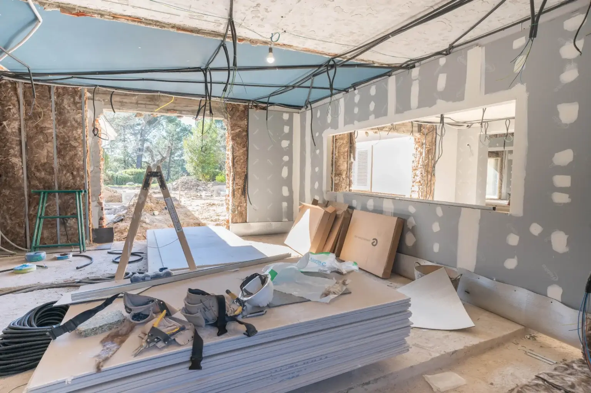

## Las 10 claves que debes tener en cuenta antes de reformar una vivienda en Madrid

**Reformar una vivienda en Madrid con un estudio de arquitectura implica mucho más que actualizar un espacio:** es una intervención estructural, funcional y estética que debe responder tanto al contexto urbano como a las necesidades reales de quienes la habitan. Para que el resultado esté a la altura de esa visión, hay una serie de claves esenciales que conviene tener en cuenta desde el inicio. Estas son, desde el enfoque profesional de la arquitectura, las decisiones que marcarán la diferencia en cualquier proceso de reforma.

### 1. Entender el potencial real del inmueble

No todas las viviendas ofrecen las mismas posibilidades. Aspectos como la orientación, la estructura, la altura libre o la compartimentación influyen decisivamente en el proyecto. Un estudio de arquitectura es capaz de detectar oportunidades espaciales que van más allá de lo evidente.

### 2. Tener claridad en las necesidades del usuario

Reformar sin un programa funcional definido es uno de los errores más comunes. Antes de diseñar hay que entender cómo se vive el espacio: cuántas personas lo habitan, qué rutinas tienen, qué momentos se quieren priorizar (cocinar, trabajar, descansar, recibir…).

### 3. Evaluar el grado de intervención necesario

¿Reforma integral o parcial? ¿Reconfiguración de espacios o actualización de acabados? Determinar el alcance desde el inicio permite definir tiempos, recursos y permisos con mayor precisión.

### 4. Conocer las limitaciones normativas y técnicas

Madrid tiene un marco urbanístico exigente, especialmente en zonas protegidas o edificios antiguos. La normativa puede condicionar alturas, materiales, aperturas o instalaciones. Ignorarla puede suponer bloqueos en el proceso o sanciones.

### 5. Considerar el estado de las instalaciones existentes

Fontanería, electricidad, climatización o telecomunicaciones suelen necesitar renovación en edificios de más de 20 años. La intervención arquitectónica debe integrarse con la actualización técnica para garantizar funcionalidad, eficiencia y seguridad.

### 6. Planificar una distribución coherente con el espacio disponible

El diseño arquitectónico permite repensar la lógica interna de la vivienda, optimizando la relación entre espacios privados, zonas comunes, recorridos y almacenamiento. Cada metro cuadrado debe estar justificado.

### 7. Valorar la eficiencia energética y el confort térmico-acústico

Una reforma bien planteada puede mejorar drásticamente la eficiencia energética de la vivienda. Esto no solo reduce el consumo, sino que mejora la calidad de vida en el día a día. Materiales, aislamientos y sistemas pasivos son clave.

### 8. Seleccionar materiales con criterios de durabilidad y coherencia estética

No se trata solo de “bonito” o “caro”: se trata de usar materiales adecuados al uso, el entorno y el estilo de vida. La arquitectura trabaja con el tiempo como variable, y eso exige decisiones responsables.

### 9. Asumir que el proceso requiere tiempo y planificación

Una reforma bien ejecutada no se improvisa. Desde el proyecto hasta la obra, hay fases técnicas, administrativas y constructivas que deben respetarse para garantizar resultados de calidad.

### 10. Trabajar con un equipo que interprete, proyecte y ejecute con visión global

Contar con un estudio que dirija todo el proceso —desde el análisis previo hasta la entrega de obra— asegura coherencia, control y resultados ajustados al planteamiento inicial.

## La reforma de tu vivienda merece algo más que una obra

En Bramanti Arquitectos trabajamos cada reforma como un proyecto arquitectónico completo, no como una simple obra. Nuestro objetivo no es solo renovar un espacio, sino transformarlo con sentido, diseño y método.

## ¿Por qué reformar con un estudio de arquitectura en lugar de una empresa de reformas?

Aunque a menudo se agrupan bajo el mismo concepto, una reforma llevada a cabo por una empresa de reformas y una reforma desarrollada por un estudio de arquitectura son procesos fundamentalmente distintos en su enfoque, su profundidad y, sobre todo, en sus resultados.

Una empresa de reformas tiende a organizar la obra desde una lógica constructiva: cambia lo que se ve, mejora lo que se puede, y adapta lo existente. Es una solución útil para quien busca rapidez, estandarización o actualizaciones puntuales. Pero cuando el objetivo es transformar la vivienda desde su esencia, con criterios de diseño, funcionalidad y coherencia espacial, la intervención arquitectónica se vuelve indispensable.

Un estudio de arquitectura como [**Bramanti Arquitectos**](/nosotros/) parte de una visión global. No se trata solo de ejecutar obras, sino de proyectar espacios que respondan a una forma de vivir. Esto implica:

- **Leer el espacio existente** con mirada crítica y creativa.
- **Redibujar la relación entre funciones, luz natural, estructura y circulación**.
- **Seleccionar materiales no solo por su estética, sino por su durabilidad, comportamiento térmico, textura y coherencia con el proyecto**.
- **Dirigir técnicamente el proceso para garantizar calidad en cada decisión, desde los planos hasta los acabados**.

El resultado no es solo una vivienda reformada. Es un lugar que habla el lenguaje de quien lo habita, proyectado con intención y ejecutado con precisión. Esa es la diferencia entre una reforma y un proyecto arquitectónico.

### Reformar con un estudio de arquitectura en dejar de parchear espacios y empezar a diseñar cómo se quiere vivir.

## El proceso de reforma arquitectónica paso a paso

Una reforma arquitectónica no empieza con el ruido de obra, sino con una conversación. Detrás de cada vivienda transformada hay un proceso meticuloso que combina creatividad, análisis técnico y planificación estratégica. En Bramanti Arquitectos trabajamos bajo una metodología clara, orientada a acompañar al cliente con rigor y sensibilidad en cada fase:

### 1. Escucha y análisis del espacio

El punto de partida siempre es entender dos cosas: el estado actual del inmueble y las necesidades reales de quien lo habita. Visitamos la vivienda, analizamos su potencial y conversamos en profundidad con el cliente para alinear visión, expectativas y estilo de vida.

### 2. Desarrollo del concepto arquitectónico

Antes de proyectar, conceptualizamos. Pensamos en la luz, el aire, los recorridos, la escala, la atmósfera deseada. Se crean los primeros esquemas de distribución, referencias visuales, moodboards y propuestas de materiales.

### 3. Proyecto técnico y documentación administrativa

Una vez definido el concepto, desarrollamos el proyecto técnico completo, incluyendo planos, memorias, cálculos y toda la documentación necesaria para tramitar licencias ante el Ayuntamiento de Madrid. La parte normativa no es un trámite más: es una capa que integramos desde el diseño.

## 4. Presupuesto y planificación de obra

Con el proyecto ejecutivo definido, elaboramos o validamos el presupuesto detallado de ejecución y establecemos el calendario de obra. Esto permite al cliente tener una visión realista y transparente del alcance económico y temporal del proyecto.

## 5. Dirección y seguimiento de obra

Durante la fase de obra, el estudio sigue implicado en todo momento. Supervisamos cada partida, resolvemos imprevistos con criterio técnico y cuidamos que las decisiones constructivas respeten el diseño original. La dirección facultativa no es solo control: es garantía de calidad.

## 6. Entrega y cierre con visión de conjunto

La obra no se da por terminada hasta que cada detalle está resuelto y revisado. Hacemos visitas finales con el cliente, comprobamos acabados, instalaciones y ajustes, y aseguramos que la vivienda responda a lo proyectado tanto en funcionalidad como en estética.

*Reforma Integral de proyecto. 2024.*

## Factores que influyen en el presupuesto final de una reforma en Madrid

En el ámbito de las reformas arquitectónicas, hablar de presupuesto no es hablar de una cifra cerrada, sino de una consecuencia directa del proyecto que se plantea. El coste de reformar una vivienda en Madrid puede variar de forma considerable según múltiples variables, y en un estudio como Bramanti Arquitectos, cada una de ellas se valora con precisión, en función del tipo de transformación que se busca.

Estos son los principales factores que inciden en la inversión necesaria:

### 1. El alcance del proyecto

No es lo mismo una reforma parcial (por ejemplo, cocina y baños) que una reconfiguración integral de la vivienda. Cambiar distribuciones, instalaciones, sistemas estructurales o abrir huecos implica una inversión mayor, pero también una transformación más profunda.

### 2. El estado inicial del inmueble

Viviendas en mal estado de conservación, con instalaciones antiguas o patologías constructivas, requieren actuaciones técnicas adicionales que condicionan el presupuesto y alargan los plazos.

### 3. La calidad de los materiales seleccionados

Trabajar con materiales naturales, sostenibles o de alta gama implica una inversión diferente a soluciones estándar. Pero también ofrece mayor durabilidad, confort y coherencia estética. En nuestro caso, siempre asesoramos al cliente con criterios funcionales, técnicos y sensoriales.

### 4. La complejidad técnica del diseño

Diseños a medida, soluciones estructurales innovadoras o integración de tecnología domótica requieren una ejecución más especializada y, por tanto, mayor carga técnica y económica.

### 5. La superficie y tipología de la vivienda

El tamaño importa, pero también la forma. Reformar un ático abuhardillado no plantea las mismas exigencias técnicas ni constructivas que una planta baja con jardín, por ejemplo. Cada tipo de vivienda en Madrid presenta sus propios retos.

### 6. Ubicación y normativa urbanística del barrio

Las licencias y restricciones son distintas en cada zona. Edificios catalogados, cascos históricos o zonas de conservación específica requieren proyectos más detallados y trámites más exigentes, lo que se refleja en los tiempos y recursos invertidos.

#### El presupuesto de una reforma no se calcula con una plantilla. Se proyecta con intención. En arquitectura, cada decisión de diseño implica una consecuencia económica que debe ser gestionada con criterio, experiencia y visión.
