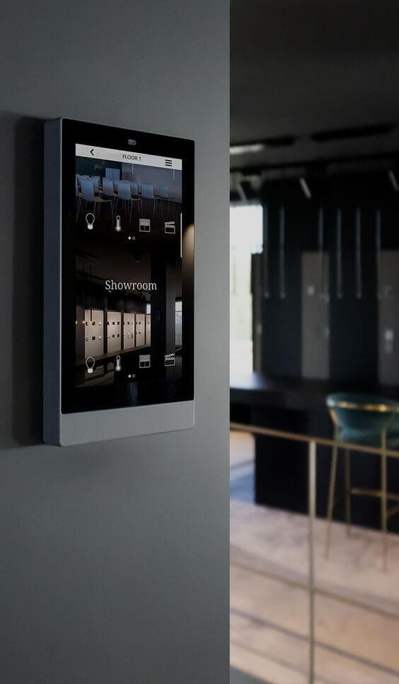
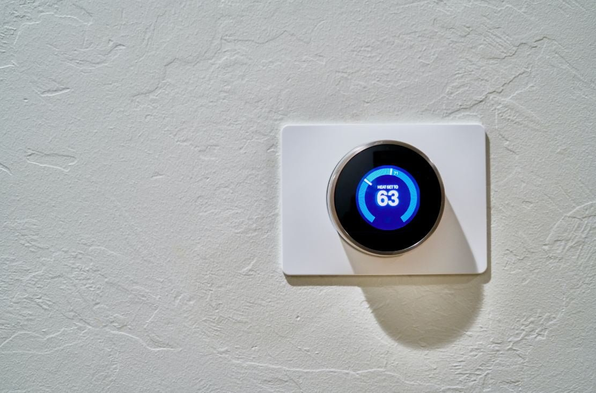
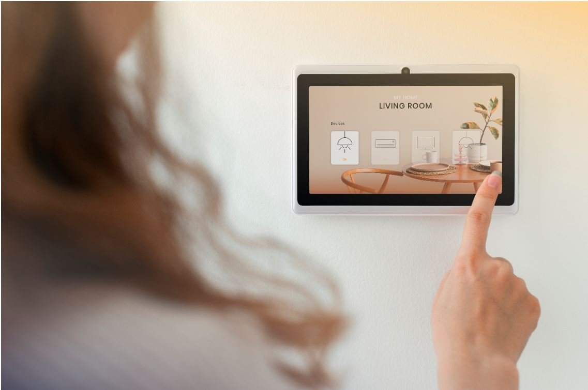

## Descubrid cómo la domótica eleva la experiencia de vivir en armonía con la tecnología y la arquitectura en nuestro estudio en Madrid.

En **Bramanti Arquitectos**, la búsqueda de la excelencia en diseño y funcionalidad va más allá de la estética arquitectónica. Nos enorgullece presentar la integración a nuestros servicios de la **domótica**, una innovadora solución tecnológica que transforma una casa en **un hogar inteligente y eficiente**.

## ¿Qué es la Domótica y cómo Transforma vuestro Hogar?

La **domótica** implica la **automatización de sistemas y dispositivos dentro del hogar**, desde el control de iluminación y temperatura hasta la gestión de seguridad y entretenimiento. En Bramanti Arquitectos, consideramos la domótica como una herramienta esencial para mejorar la calidad de vida y **la eficiencia energética** en cada proyecto.

### Contacta con nosotros y empecemos a dar forma a tus ideas.

## Integración Perfecta con el Diseño Arquitectónico

La clave para **una implementación exitosa de la domótica** es la integración perfecta con el diseño arquitectónico. En colaboración con vosotros, nuestros clientes, identificamos las necesidades específicas y diseñamos **soluciones** que no solo son funcionales sino que también se integran armoniosamente en **la estética de vuestro hogar**.

## Beneficios de la Domótica en Bramanti Arquitectos:

- **Eficiencia Energética:** La capacidad de controlar la iluminación y la climatización de manera inteligente con la domótica permite un uso más eficiente de la energía, reduciendo así el impacto ambiental.
- **Seguridad Avanzada:** Sistemas de seguridad conectados y cámaras inteligentes proporcionan una tranquilidad adicional, permitiéndoos supervisar y controlar la seguridad de vuestro hogar desde cualquier lugar.
- **Confort Personalizado:** La domótica permite la creación de ambientes personalizados según vuestras preferencias individuales, desde escenarios de iluminación hasta ajustes de temperatura.

### ¡Descubre alguno de nuestros proyectos más destacados!

[Descubre los proyectos](/nuestras-creaciones/)

## La Experiencia Bramanti Arquitectos:

En cada proyecto que emprendemos, la **domótica** se convierte en una extensión natural de nuestra filosofía de diseño. Buscamos ofrecer no solo espacios visualmente impresionantes, sino también **hogares inteligentes** que se adapten y **evolucionen** junto a vuestras necesidades.

## Descubrid el Futuro de la Vivienda Inteligente:

Explorad cómo la **domótica** redefine la **experiencia** de vivir. Conoced más sobre nuestras soluciones inteligentes en **el diseño arquitectónico**.

Contactad con nosotros y descubrid cómo podemos **personalizar la domótica** en vuestro futuro hogar. Haced de la **tecnología** una parte esencial de vuestra vida cotidiana con **Bramanti Arquitectos**.

[Nuestra web](/)
