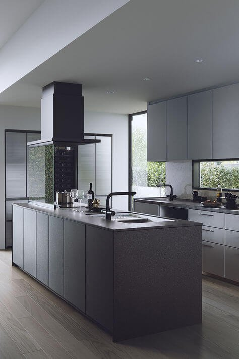
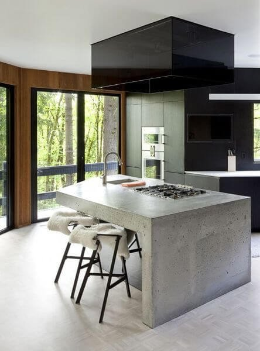
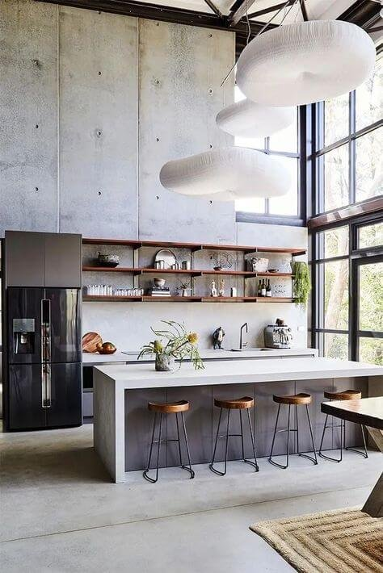

## Cómo el Microcemento logra transformar Cocinas en Espacios Elegantes y Modernos.

En el mundo de la arquitectura y el diseño de interiores, la búsqueda de materiales versátiles y contemporáneos es constante. Uno de los materiales que ha ganado un **protagonismo** especial en los últimos tiempos es el **microcemento**. En Bramanti Arquitectos, comprendemos la importancia de elegir los materiales adecuados para cada proyecto, y el microcemento se ha convertido en una elección destacada, especialmente en **cocinas** y remodelaciones.

## ¿Qué es el Microcemento?

El **microcemento** es un material innovador que se ha convertido en un aliado indispensable para vosotros que buscáis transformar vuestros espacios de manera **elegante** y **moderna**. Se trata de un revestimiento continuo y sin juntas que puede aplicarse sobre una variedad de superficies, incluyendo pisos, paredes, encimeras y más. Su característica más notable es su acabado liso y su aspecto contemporáneo, lo que lo convierte en una elección ideal para aquellos que deseáis un **diseño minimalista y vanguardista**.

### Contacta con nosotros y empecemos a dar forma a tus ideas.

## La Importancia del Microcemento en Cocinas

Cuando se trata de cocinas, el microcemento ofrece numerosas **ventajas**. Su superficie continua y sin juntas es fácil de limpiar, lo que lo convierte en una **elección práctica** para un área donde la higiene es fundamental. Además, su aspecto elegante y moderno puede transformar una cocina en un espacio sofisticado y acogedor. En Bramanti Arquitectos, consideramos que **el microcemento no solo es estéticamente atractivo, sino también funcional y duradero**, lo que lo hace perfecto para cocinas de todo tipo.

## Remodelaciones con Microcemento

Al emprender una **remodelación**, la elección de materiales es **esencial**. El microcemento ofrece la ventaja de poder aplicarse directamente sobre superficies existentes, lo que lo convierte en una opción eficiente para la renovación de espacios. Ya sea para actualizar pisos, paredes o encimeras, el microcemento puede transformar una habitación sin necesidad de realizar grandes cambios estructurales. Esto **reduce costos y tiempos de obra**, lo que resulta beneficioso tanto estéticamente como en términos de comodidad.

### ¡Descubre alguno de nuestros proyectos más destacados!

[Visitar](/proyectos/)

## Bramanti Arquitectos: Creando Espacios Únicos con Microcemento

En Bramanti Arquitectos, nos apasiona la arquitectura y el diseño de interiores. Consideramos que **la elección de materiales es esencial para lograr espacios únicos y funcionales.** El microcemento se ha convertido en una herramienta esencial en nuestra caja de recursos, permitiéndonos **transformar cocinas y espacios con elegancia y modernidad**. Colaboramos estrechamente con vosotros para comprender vuestras necesidades y visiones, y el microcemento nos permite **materializar esas ideas de manera impactante**.

## Descubrid la Magia del Microcemento

Si estáis considerando una remodelación o diseño de cocina, os invitamos a descubrir la magia del **microcemento**. En Bramanti Arquitectos, estamos aquí para **asesoraos y convertir vuestras ideas en realidad**. El microcemento es mucho más que un material; es una oportunidad para **transformar vuestros espacios en algo verdaderamente especial**.

¡Contactadnos y comenzaremos a dar forma a vuestras ideas con la elegancia y modernidad del microcemento!

[Nuestra web](/)
