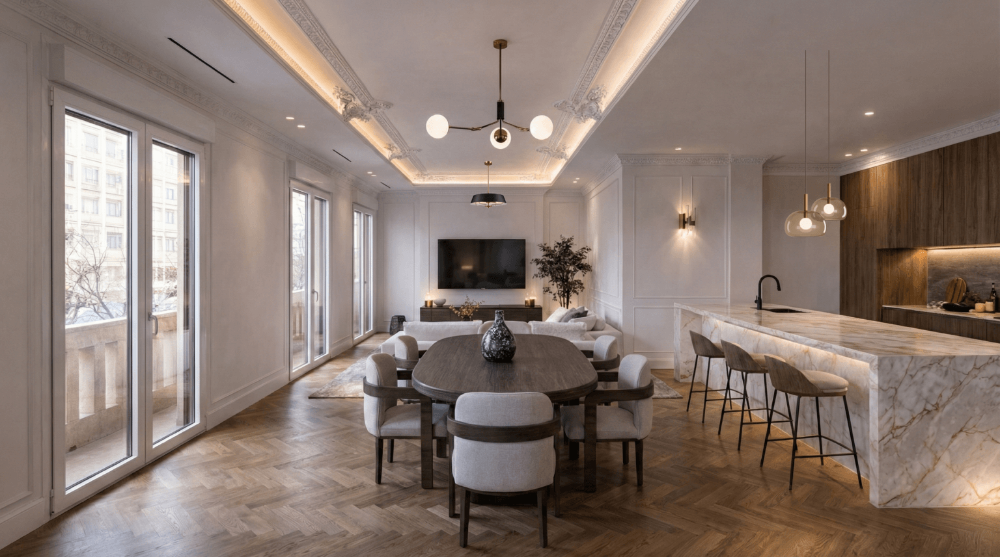

El papel del arquitecto ha evolucionado mucho más allá del diseño de planos.

Hoy, su función es clave para coordinar arquitectura, construcción e interiorismo, garantizando que cada decisión tenga sentido desde el inicio.

## Arquitecto, constructor e interiorista: por qué necesitas una visión integral para crear tu hogar

Cuando piensas en diseñar tu vivienda, probablemente imaginas a un arquitecto dibujando planos. Sin embargo, la realidad es mucho más compleja. El proceso de crear un hogar no es estanco**: requiere la coordinación precisa entre arquitectura, construcción e interiorismo**. Separar estos elementos no solo fragmenta el proyecto, sino que puede aumentar costes, tiempos y errores.

Hoy, el verdadero valor no está en contratar múltiples profesionales por separado, sino en contar con un equipo que integre todas las disciplinas desde el inicio. Porque una vivienda no es solo un espacio construido: es una experiencia que debe pensarse, ejecutarse y vivirse de forma coherente.

En Bramanti Arquitectos, esta visión es el núcleo del proceso: arquitectura, construcción e interiorismo trabajan como un todo, permitiendo tomar mejores decisiones desde el primer momento y garantizar un resultado que realmente refleje quién eres.

## El problema de fragmentar el diseño de tu vivienda

### Cuando arquitectura, construcción e interiorismo no hablan entre sí

Uno de los errores más comunes al abordar una vivienda es dividir el proceso en fases independientes:

- Primero el arquitecto

- Luego el constructor

- Después el interiorista

A priori, parece lógico. En la práctica, genera fricciones constantes, y el resultado lo sufres tú, en tu bolsillo y en tu día a día al ver tus paredes.

### Problemas reales que encarecen tu proyecto

Si el arquitecto no construye, no tiene toda la información.

Esto se traduce en:

- Presupuestos poco ajustados a la realidad

- Decisiones de diseño difíciles de ejecutar en obra

- Cambios constantes durante la construcción

- Incremento de costes imprevistos

Un arquitecto que no construye, inevitablemente diseña desde la teoría.  
Y la teoría, en obra, casi siempre cambia.

Por otro lado, si el interiorismo entra tarde en el proceso:

- Se pierden oportunidades de diseño desde la base

- Los espacios no se optimizan al máximo

- Los materiales, colores y texturas no dialogan entre sí

- El resultado final pierde coherencia

El problema no es solo estético. Es estratégico.

Porque cada decisión aislada tiene un impacto directo en el coste, en el tiempo y en el resultado final.

## Caso real: Proyecto Alcalá 124.

### Una vivienda con historia: intervenir sin borrar el pasado

## Alcalá no es solo una dirección

Si te interesa vivir en un espacio donde historia, arquitectura y diseño contemporáneo conviven con este nivel de detalle, contacta con nuestro equipo ahora.

Es un edificio que condensa más de un siglo de historia en el corazón de Madrid.

A principios del siglo XX, uno de sus pisos fue hogar de **Tomás Duch Belmonte**, pionero del cine español y operador de cámara en *El misterio de la Puerta del Sol*, considerada la primera película sonora del país.

Durante la República y la Guerra Civil, sus viviendas se transformaron en espacios de formación: academias de taquigrafía, matemáticas, aviación y hasta una Escuela Popular de Guerra. En el ático D, según los anuncios de la época, se preparaban soldados y pilotos.

El edificio fue bombardeado e incendiado. Y, como ocurre tantas veces en Madrid, su estructura original se fragmentó después en viviendas más pequeñas mediante divisiones ligeras, dejando cicatrices físicas aún visibles hoy.

En los años treinta, también funcionó como pensión de “señora distinguida”, acogiendo a huéspedes internacionales y figuras del ámbito cultural. El artista **Miguel Utrillo** relata cómo vivió aquí junto al doctor Juan Catasús, y cómo el escritor **Josep Pla** se alojó en la casa de doña Antonia Moreno, en este mismo edificio.

La vivienda sobre la que intervenimos no parte de cero.  
Se construye sobre una memoria compleja: cine, guerra, educación y vida literaria.

Y precisamente por eso, el objetivo no era solo reformar.  
Era **reinterpretar ese pasado desde una mirada contemporánea**, sin perder su identidad.

### Una vivienda pensada desde tres dimensiones: arquitectura, construcción e interiorismo

El proyecto de Alcalá 124 es un ejemplo claro de cómo una visión integral transforma por completo el resultado.

No se trataba solo de reformar una vivienda.  
Se trataba de construir una experiencia.

### Desde la arquitectura: orden, proporción y visión espacial

La intervención arquitectónica parte de una premisa clara:  
**devolver coherencia a un espacio que había sido fragmentado con el tiempo.**

Para ello, se trabajó en:

- Redistribución completa para recuperar la entrada de luz natural
- Jerarquización de estancias
- Búsqueda de proporciones equilibradas
- Respeto por elementos protegidos, como la fachada original

Uno de los gestos más importantes fue la recuperación del lenguaje clásico a través de las **escayolas presentes en toda la vivienda**, reinterpretadas desde una visión actual.

Cada decisión arquitectónica no solo respondía a lo estético, sino a una pregunta clave: ***¿Cómo se va a vivir este espacio hoy?***

## Desde la construcción: precisión técnica al servicio del diseño

Aquí es donde la visión integral marca la diferencia.

El proyecto exigía una ejecución extremadamente cuidada para materializar cada decisión arquitectónica sin desviaciones.

Se trabajó en:

- Ejecución precisa de molduras y escayolas en toda la vivienda
- Integración de foseados en techos con iluminación LED
- Instalación de piedra amazónica en baños
- Encimera de **Neolith Abu Dhabi**, combinando resistencia y estética
- Carpinterías y detalles constructivos alineados con el diseño global

Además, se incorporó un sistema de **domótica integral**, permitiendo controlar iluminación, ambiente y escenas en toda la vivienda.

Nada se dejó al azar.  
Cada detalle estaba pensado desde el inicio para ser construido exactamente así.

Esto reduce errores, evita sobrecostes y garantiza coherencia.

## Desde el interiorismo: una vivienda que se siente, no solo se ve

El interiorismo no fue una capa añadida. Fue parte del concepto desde el inicio.

El resultado:

- Cada habitación cuenta con baño en suite
- Paleta de materiales coherente y elegante
- Integración de texturas: piedra, madera, acabados minerales
- Diseño de iluminación que refuerza la arquitectura

Todo responde a una misma lógica: crear una experiencia habitable, no solo un espacio bonito.

Porque una vivienda no termina cuando se construye.  
Termina cuando **conecta con quien la habita**.

### ¿Quieres diseñar tu vivienda sin imprevistos ni sobrecostes innecesarios?

Solicita tu presupuesto de reforma integral y empieza tu proyecto con un equipo que integra arquitectura, construcción e interiorismo desde el primer día.

[Recibe ahora tu propuesta gratuita](https://tally.so/r/9q7DyY)

## El arquitecto como director de orquesta

### Coordinar todos los oficios para un resultado impecable

En un proyecto bien ejecutado interviene una red compleja de profesionales, cada uno con un papel específico en la materialización del diseño:

- Albañilería especializada
- Carpintería a medida y ebanistería
- Cerrajería y soluciones metálicas
- Artesanos y especialistas en acabados
- Equipos de pintura y tratamientos decorativos
- Técnicos de iluminación
- Interiorismo y diseño

Cada uno aporta conocimiento, técnica y experiencia.  
Pero una vivienda no se construye sumando oficios, sino **integrando decisiones**.

Cuando no existe una dirección clara, cada profesional interpreta el proyecto desde su propio criterio.  
Y es ahí donde surgen los desajustes: encuentros que no encajan, materiales que no dialogan, soluciones improvisadas en obra.

El papel del arquitecto es evitar precisamente eso.

Actúa como nexo entre diseño y ejecución, asegurando que cada detalle se entienda, se respete y se construya tal y como fue concebido.  
No solo coordina tiempos. Coordina intención.

Anticipa conflictos antes de que aparezcan.  
Alinea a todos los equipos bajo una misma visión.  
Y garantiza que cada intervención, por pequeña que sea, contribuya al resultado global.

Porque cuando todos trabajan en la misma dirección, el proyecto fluye.

Los tiempos se optimizan.  
Los errores se reducen.  
Y el resultado no solo es más preciso, sino también más coherente y duradero.

Ahí es donde se marca la diferencia.

Entre una obra que simplemente se ejecuta… y una vivienda que ha sido cuidadosamente pensada, coordinada y construida para perdurar.

### La diferencia entre construir una casa y crear un hogar

Cuando arquitectura, construcción e interiorismo están alineados:

- Las decisiones son coherentes

- Los tiempos se optimizan

- Los costes se controlan

- El resultado tiene identidad

Y, sobre todo, el espacio refleja a quien lo habita.

## Una nueva forma de entender la arquitectura

Diseñar una vivienda no debería ser un proceso fragmentado.

Debería ser una experiencia coordinada, estratégica y personalizada.

Elegir a **Bramanti Arquitectos** significa:

- Ahorrar tiempo

- Reducir costes imprevistos

- Tomar decisiones con toda la información

- Crear un hogar que refleje tu personalidad

Porque tu casa no es solo un proyecto.  
Es una extensión de quién eres.

### Tu casa no debería ser una suma de decisiones aisladas.

Cuéntanos tu proyecto y te ayudamos a diseñarlo con una visión integral, cuidando cada detalle desde la idea inicial hasta el último acabado.

[Solicita gratis tu presupuesto ahora](https://tally.so/r/9q7DyY)
