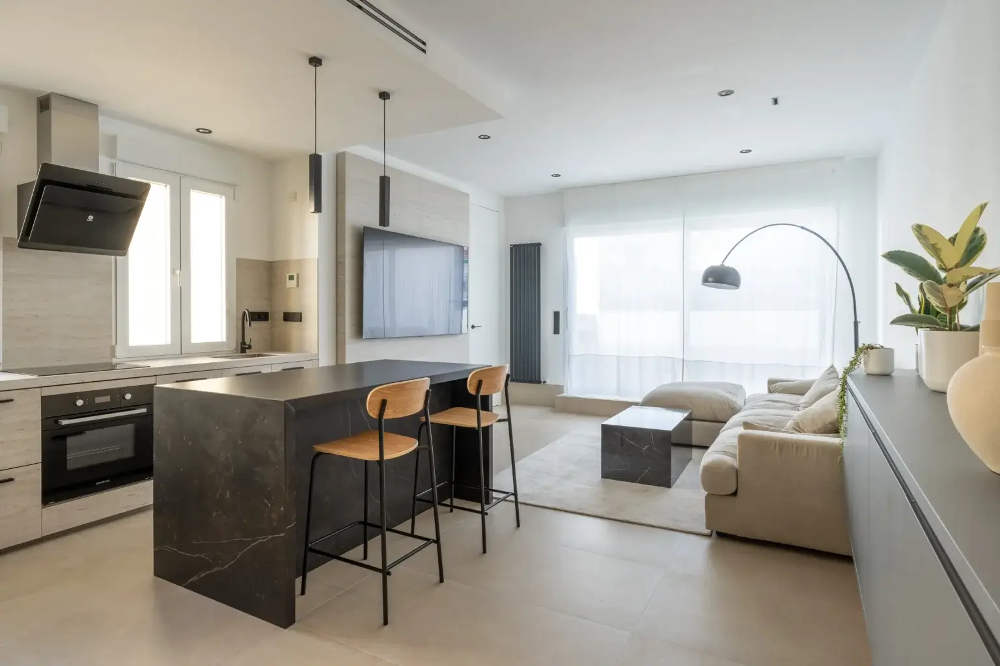

Elegir al arquitecto adecuado en Madrid es una decisión fundamental para el éxito de cualquier proyecto de construcción o reforma. No solo influye en el diseño y funcionalidad del espacio, sino también en los costes, tiempos y cumplimiento de la normativa. Esta guía te proporcionará toda la información que necesitas para tomar una decisión segura, informada y adaptada a tus necesidades.

## 1. Comprender el papel de un arquitecto

***Funciones principales de un arquitecto*** Un arquitecto es el profesional encargado de diseñar, planificar y supervisar obras arquitectónicas. Su labor va más allá del diseño estético; implica también la funcionalidad, sostenibilidad y legalidad de cada proyecto.

***Diferencia entre arquitecto, aparejador y decorador*** Mientras que el arquitecto diseña y dirige la obra, el aparejador (o arquitecto técnico) gestiona la ejecución técnica, y el decorador se centra en la estética interior. Conocer estas diferencias te permitirá elegir al profesional adecuado según tus necesidades.

## 2. Saber qué tipo de proyecto vas a realizar

Obra nueva, reforma integral o rehabilitación, cada tipo de proyecto requiere conocimientos específicos. La obra nueva parte de cero, la reforma integral modifica gran parte de un inmueble existente, y la rehabilitación se enfoca en restaurar o actualizar elementos deteriorados.

## 3. Certificaciones y colegiación profesional

***Verifica que esté colegiado en el COAM*** Es esencial comprobar que el arquitecto esté registrado en el **[Colegio Oficial de Arquitectos de Madrid (COAM)](https://www.coam.org/)**. Esto garantiza su formación, ética profesional y acceso a seguros de responsabilidad civil.

***Comprobación de títulos y especializaciones*** Solicita sus credenciales académicas y especializaciones. Un arquitecto especializado en eficiencia energética, por ejemplo, puede aportar mucho valor en proyectos sostenibles.

## ¿Tienes un proyecto en mente en Madrid?

En Bramanti Arquitectos trabajamos cada reforma integral con un enfoque técnico y humano, combinando diseño contemporáneo con soluciones eficientes adaptadas a cada cliente.

## 4. Experiencia y portafolio de proyectos

***Por qué es clave revisar** **[proyectos](/proyectos/)** **anteriores*** El portafolio muestra el estilo, la calidad y el enfoque del arquitecto. Revisarlo te ayuda a visualizar si se adapta a tu visión.

***Sectores o estilos en los que se especializa*** Algunos arquitectos se centran en viviendas unifamiliares, otros en oficinas o espacios comerciales. También hay quienes destacan en estilos como el minimalismo, clásico o industrial. Asegúrate de que tu arquitecto tenga experiencia en el tipo de proyecto que deseas.

## 5. Valoraciones, referencias y opiniones de clientes

***Por qué las opiniones reales marcan la diferencia***

Nada habla mejor de un arquitecto que la experiencia directa de sus clientes. Las valoraciones públicas son una fuente valiosa de información sobre la profesionalidad, puntualidad, calidad del trabajo y trato humano del estudio. Te ofrecen una mirada objetiva antes de tomar una decisión.

***Dónde y cómo buscar reseñas fiables***

Plataformas como Google Maps, Houzz o Habitissimo permiten consultar reseñas verificadas de antiguos clientes. Lee tanto las valoraciones positivas como las críticas constructivas, y presta atención a cómo responde el arquitecto a los comentarios. Una actitud abierta, cercana y resolutiva es una señal de compromiso.

***La confianza también se transmite boca a boca***

Las recomendaciones de familiares, amigos o vecinos que hayan trabajado con un arquitecto en Madrid siguen siendo un indicador muy fiable. Aprovecha estas referencias cercanas para conocer cómo fue la experiencia real: ¿escucharon sus necesidades? ¿cumplieron plazos y presupuesto? ¿hubo seguimiento post-obra?

### En Bramanti Arquitectos, nos enorgullece contar con la confianza de quienes han trabajado con nosotros. Si quieres conocer lo que opinan nuestros clientes, puedes leer sus testimonios en nuestra web o pedirnos referencias directamente.

*Proyecto Werlyb*

## Las reseñas de nuestros clientes:

## Queremos conocer tu idea de proyecto

En Bramanti Arquitectos trabajamos contigo para no tengas que preocuparte de nada, salvo de disfrutar todo el proceso.
