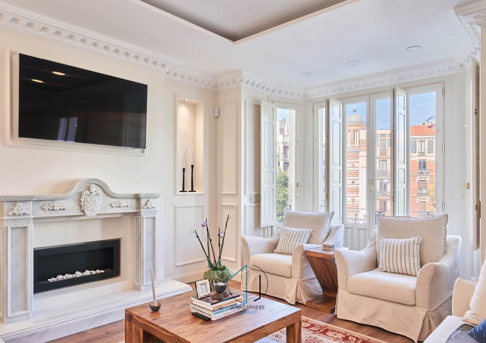
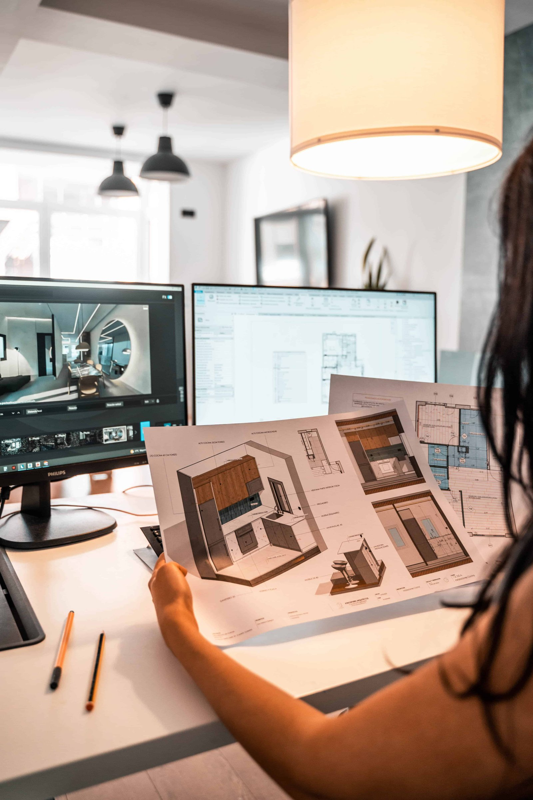

## Estudio de Arquitectura en Madrid

En el dinámico paisaje arquitectónico de Madrid, encontrar el **estudio de arquitectura adecuado** es crucial para llevar a cabo proyectos visionarios y funcionales. En **Bramanti Arquitectos**, nos destacamos como una de las principales empresas de arquitectura en Madrid, comprometidos con la **excelencia en diseño** y la transformación de espacios.

*Proyecto Felipe II*

## Nuestra metodología

Somos un equipo de arquitectos apasionados que abrazan la **innovación** y la **funcionalidad en cada proyecto**. Desde reformas cautivadoras hasta diseños arquitectónicos de vanguardia, nuestro estudio ofrece una gama completa de servicios para **satisfacer las necesidades** únicas de cada cliente.

## Por qué debes elegir nuestro estudio de arquitectura en Madrid

- 1. *Reformas que Inspiran:* Nuestra experiencia en reformas va más allá de la mera renovación. Transformamos espacios con una visión audaz y una **atención meticulosa a los detalles**. 2. *Los Mejores Estudios de Arquitectura en Madrid:* Nos enorgullecemos de estar entre los estudios de arquitectura más destacados de Madrid. Nuestro ***[portafolio](/proyectos/)*** diverso refleja nuestra dedicación a la excelencia y la creatividad.

### Contacta con nosotros y empecemos a dar forma a tus ideas.

## Estudio de Arquitectura en Madrid Capital:

Ubicados estratégicamente en el *[**corazón de la capital**](https://maps.google.com/maps/dir//Urbanizaci%C3%B3n+Los+Sat%C3%A9lites+Av.+de+los+Satelites+28222+Majadahonda+Madrid/@40.4568084,-3.905476,14z/data=!4m5!4m4!1m0!1m2!1m1!1s0xd41855a57db5657:0xf42f511b1ae2d4ac)*, estamos profundamente arraigados en la comunidad arquitectónica de Madrid. Esto nos permite abordar proyectos con un **conocimiento auténtico** del entorno local y las regulaciones específicas de la ciudad.

## Colaboración Transparente y Personalizada:

En Bramanti **Arquitectos**, creemos en la importancia de la comunicación abierta. Colaboramos estrechamente con nuestros clientes para entender sus visiones y garantizar que cada proyecto se ajuste a sus necesidades únicas.

### ¡Descubre alguno de nuestros proyectos más destacados!

[Visitar](/nuestras-creaciones/)

## Nuestros Proyectos Destacados:

1. *[Promoción](/landing-los-satelites/) **[Los Satélites](/landing-los-satelites/)**:* Una vivienda situada en la nueva y exclusiva urbanización Los Satélites, Majadahonda. Sin duda, un proyecto que responde al equilibrio perfecto entre lujo y funcionalidad para tu día a día. Si quieres saber más, ***[accede a través de este enlace.](/landing-los-satelites/)***
2. *[**Proyecto Felipe II**](/avenida-felipe-ii/): La reforma de esta vivienda ha renovado su estilo clásico a partir de toques modernos. Se ha conseguido una **estética elegante** y **sofisticada** con la combinación de muebles de diseño contemporáneos y elementos clásicos como las molduras. La luminosidad y amplitud del espacio se ha mejorado con la elección de una paleta de colores claros y un amueblamiento cuidadosamente seleccionado.*

## Conclusión:

En **Bramanti Arquitectos**, no solo creamos edificaciones; damos vida a visiones. Si buscas un estudio de arquitectura en Madrid que combine la creatividad con la funcionalidad, no dudes en ponerte en **contacto con nosotros**.

¿Quieres dar vida a tu proyecto arquitectónico en Madrid? ¡**Contáctanos hoy mismo** y juntos hagamos realidad tu idea!

[Nuestra web](/)
