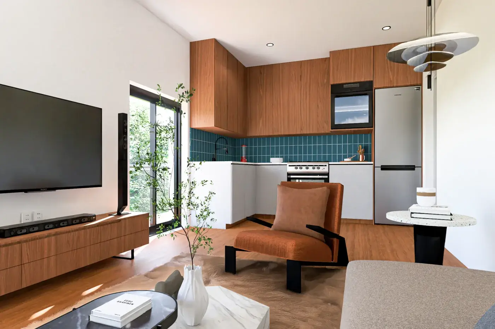
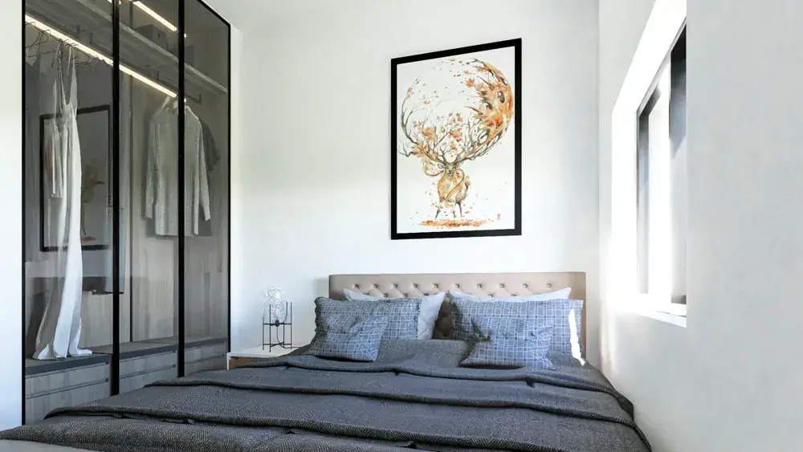
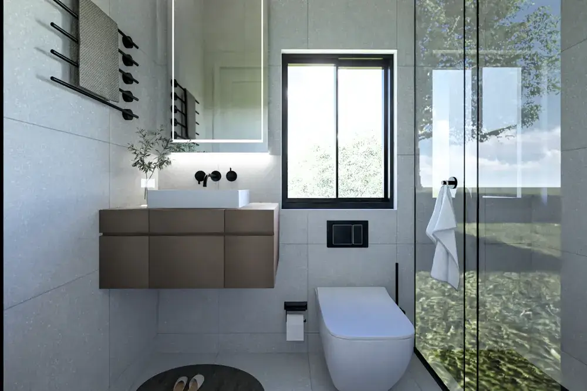

BRAMANTI ARQUITECTOS · REFORMA REALIZADA · MADRID

Una reforma integral empieza con una pregunta: ¿qué necesita cambiar para que la vivienda funcione mejor en el día a día? Infanta Mercedes es una reforma integral realizada por Bramanti Arquitectos en Madrid. El proyecto partió de una vivienda compartimentada y abordó la relación entre cocina, zona de estar, almacenamiento e interiorismo, con una reflexión conjunta sobre cómo habitar la casa.

Las visualizaciones muestran una cocina abierta hacia el salón, armarios incorporados al diseño de los dormitorios y una combinación de tonos claros, acabados de apariencia de madera y detalles oscuros. Aunque la reforma está realizada, las imágenes de este artículo son renders del proyecto, no fotografías del resultado final. Permiten explicar sus decisiones de diseño sin atribuir a una visualización la condición de fotografía de obra terminada.

**EN ESTE ARTÍCULO**

1. Reformar una vivienda compartimentada: empezar por las necesidades
2. Cocina y salón: estudiar su relación antes de abrir espacios
3. Distribución: valorar los recorridos y la privacidad
4. Almacenamiento integrado en los dormitorios
5. Colores y acabados: una propuesta coherente entre ambientes
6. Iluminación y mobiliario: decisiones que se relacionan
7. Del proyecto de reforma a las decisiones de obra
8. Preguntas útiles antes de plantear una reforma integral
9. Tu vivienda necesita su propio proyecto

01 /

## Reformar una vivienda compartimentada: empezar por las necesidades

Cuando una casa deja de encajar con sus habitantes, el problema puede aparecer de muchas formas: habitaciones que apenas se utilizan, falta de almacenamiento, una cocina desconectada del resto de la vivienda o recorridos que dificultan las tareas cotidianas. Identificar esas situaciones ayuda a definir el encargo con más precisión que una lista de acabados deseados.

El proyecto de Infanta Mercedes se planteó revisar la distribución existente y dar protagonismo a los espacios comunes. Ese objetivo ordenó las decisiones y permite explicar las preguntas que guiaron el diseño: qué actividades deben compartir espacio, cuáles necesitan independencia y qué elementos deben estar cerca unos de otros.

Antes de decidir una nueva distribución, resulta útil separar tres niveles de necesidades:

- Lo imprescindible: aquello que hoy dificulta el uso de la vivienda y debe resolverse.
- Lo deseable: mejoras que aportan comodidad, pero admiten alternativas.
- Lo que puede cambiar: usos futuros que interesa tener presentes sin condicionar toda la casa.

Esta distinción ayuda a comparar propuestas. Una distribución puede resultar atractiva en una imagen y, sin embargo, no responder a la forma de cocinar, trabajar, descansar o recibir visitas de quienes van a utilizarla.

02 /

## Cocina y salón: estudiar su relación antes de abrir espacios

En los renders de Infanta Mercedes, la cocina se dispone en L y se abre hacia la zona de estar. La perspectiva conjunta permite observar cómo conviven el mobiliario de cocina, el sofá y el mueble del televisor dentro de la propuesta.

Los frentes blancos y de apariencia de madera se combinan con una encimera clara y un frente azul verdoso. Esa composición da identidad a la cocina y, al mismo tiempo, mantiene una relación visual con los tonos del salón.

*Infanta Mercedes · Render del proyecto de cocina y salón; no es una fotografía de obra terminada.*

Al valorar una solución semejante, conviene pensar más allá de la imagen del espacio abierto. La posición de los electrodomésticos, las superficies de apoyo, el almacenamiento y la circulación influyen en su uso. También interesa decidir qué se verá desde el sofá y cómo se mantendrá el orden cuando la cocina forme parte del ambiente de estar.

Abrir la cocina es una opción que debe estudiarse para cada vivienda. Algunas personas prefieren compartir ese espacio; otras necesitan mayor separación. El proyecto permite comparar posibilidades y revisar sus implicaciones antes de tomar una decisión. En Infanta Mercedes, las visualizaciones sirven para mostrar la relación propuesta entre ambos ambientes y valorar cómo se percibe la cocina desde la zona de estar.

03 /

## Distribución: valorar los recorridos y la privacidad

Una reforma integral puede plantear cambios en la relación entre las estancias, pero su interés debe explicarse desde el uso. Para valorar una distribución conviene recorrerla mentalmente: entrar con la compra, cocinar, acceder al dormitorio, utilizar el baño o recibir a alguien sin interrumpir las actividades del resto de la casa.

Esas situaciones ayudan a detectar cruces incómodos, puertas enfrentadas o muebles que dificultan el paso. También permiten discutir qué espacios necesitan privacidad y qué conexiones pueden resultar útiles.

La documentación visual del proyecto de Infanta Mercedes representa una relación abierta entre cocina y estar. Las vistas de los dormitorios muestran, por su parte, cómo se organiza el mobiliario dentro de esos ambientes. Cada perspectiva aporta información sobre una estancia; la comparación de la distribución completa requiere estudiar el conjunto del proyecto.

La pregunta útil para quien va a reformar es concreta: ¿qué problema resuelve cada cambio? Poder responderla permite elegir entre alternativas y entender qué merece prioridad cuando el espacio o la inversión obligan a ajustar la propuesta.

04 /

## Almacenamiento integrado en los dormitorios

Las visualizaciones de los dormitorios de Infanta Mercedes incluyen armarios con frentes acristalados y perfilería oscura. Su presencia se estudia junto con las camas, los cabeceros y los puntos de luz, de manera que el almacenamiento forma parte de la composición de cada estancia.

Una de las vistas incorpora un cabecero de apariencia de madera, mesillas suspendidas y luminarias colgantes. El conjunto permite apreciar cómo se relacionan los elementos de descanso y apoyo. Otra perspectiva muestra la convivencia del armario con la cama y la ventana.

*Infanta Mercedes · Render del dormitorio y del almacenamiento proyectado.*

Para trasladar esta reflexión a otra vivienda, el primer paso es identificar qué se necesita guardar. Ropa colgada, ropa doblada, maletas, documentos o pequeños aparatos requieren soluciones distintas. Después conviene revisar dónde se utilizan esos objetos y con qué frecuencia se accede a ellos.

Planificar el almacenamiento desde el proyecto permite discutir su posición, distribución interior y forma de apertura. También ayuda a valorar la relación entre capacidad y espacio de paso. Las imágenes pueden servir de referencia estética, mientras que las dimensiones y el uso concreto deben resolverse para cada estancia.

05 /

## Colores y acabados: una propuesta coherente entre ambientes

*Infanta Mercedes · Render del proyecto de baño.*

Infanta Mercedes presenta una base de blancos y tonos de madera en los espacios de estar y descanso. El azul verdoso de la cocina introduce un acento de color; los detalles oscuros aparecen en elementos como los frentes de los armarios y las griferías representadas.

En los baños, las visualizaciones combinan revestimientos grises, mamparas de vidrio y diferentes soluciones de lavabo y mobiliario. Esa selección permite observar una continuidad de tonos junto con variaciones propias de cada ambiente.

Al elegir acabados para una reforma, conviene distinguir apariencia y material. Una imagen puede mostrar una superficie de aspecto pétreo o de madera sin identificar su composición, mantenimiento o comportamiento. Para decidir, interesa revisar muestras y especificaciones, además del efecto visual.

Una comparación útil puede organizarse en cuatro preguntas: qué aspecto se busca, qué uso tendrá la superficie, qué mantenimiento se está dispuesto a asumir y cómo encaja la elección en la inversión prevista. Así, la conversación sobre materiales se conecta con la vida cotidiana y con las prioridades del proyecto.

06 /

## Iluminación y mobiliario: decisiones que se relacionan

Los renders muestran distintos recursos de iluminación en relación con el mobiliario: luminarias junto a los cabeceros, iluminación representada en el techo de la zona de estar y espejos iluminados en algunas vistas de los baños.

Estas imágenes permiten hablar de ubicación y composición. Para una vivienda concreta, también habrá que definir qué actividades necesitan luz, dónde se realizarán y qué ambiente se desea en cada momento.

Leer en la cama, preparar alimentos o utilizar un espejo son situaciones diferentes. Pensarlas junto con el mobiliario permite revisar la posición de los puntos de luz y los elementos de control. También conviene considerar si se quiere iluminar todo el espacio a la vez o disponer de combinaciones para distintos usos.

Resolver estas cuestiones durante el proyecto facilita que distribución, muebles e iluminación se estudien conjuntamente. En lugar de elegir cada elemento de forma aislada, se puede valorar cómo participa en el funcionamiento de la estancia.

¿Estás valorando cambios parecidos en tu casa? Cuéntanos tu vivienda y qué necesitas mejorar.

[Solicitar valoración inicial](/tu-reforma-integral-en-madrid/#valoracion)

07 /

## Del proyecto de reforma a las decisiones de obra

En una reforma realizada como Infanta Mercedes, los renders documentan el diseño que se estudió durante el proyecto. Son una herramienta para comprender decisiones, mientras que la ejecución necesita concretarlas en el alcance: espacios intervenidos, trabajos previstos y soluciones definidas para la vivienda.

Al comparar propuestas de reforma, interesa revisar las partidas y sus inclusiones, además del importe total. Dos alternativas pueden presentar diferencias en distribución, instalaciones, carpinterías, acabados o mobiliario. Entenderlas permite valorar qué se está comparando y qué puede modificar la inversión.

También conviene distinguir entre una primera orientación y una propuesta detallada. La valoración inicial ayuda a situar la vivienda, las necesidades y la inversión prevista. El desarrollo posterior requiere concretar la intervención y sus condiciones.

Infanta Mercedes permite explicar esa relación con referencias del proyecto: cocina y estar, almacenamiento y combinación de acabados. Para otra vivienda, el siguiente paso será definir cómo se resuelve cada elección según sus condiciones, sin trasladar automáticamente las soluciones de este caso.

Antes de avanzar, puede ser útil ordenar las decisiones en una lista compartida: distribución pendiente de definir, acabados que se están comparando y elementos ya seleccionados. Para cada cuestión conviene dejar claro qué falta por resolver y qué otras elecciones dependen de ella. Por ejemplo, la posición definitiva de una cama puede influir en las luminarias y los enchufes próximos; una elección de mobiliario de cocina puede requerir revisar las dimensiones de los electrodomésticos. Este seguimiento ayuda a mantener una conversación concreta y a identificar cambios mientras todavía se está desarrollando la propuesta.

08 /

## Preguntas útiles antes de plantear una reforma integral

### ¿Conviene decidir la distribución antes que los acabados?

Es útil empezar por las necesidades y estudiar cómo se organizan los espacios. La distribución influye en la posición del mobiliario y en otras decisiones del proyecto. Los acabados pueden explorarse durante ese proceso, revisando siempre su relación con el conjunto.

### ¿Una cocina abierta es adecuada para cualquier vivienda?

Depende de la casa y de cómo se quiera utilizar. El proyecto de Infanta Mercedes recoge esa opción, pero cada encargo requiere valorar preferencias, recorridos, almacenamiento y condicionantes técnicos antes de decidir la relación entre cocina y salón.

### ¿Qué conviene explicar al solicitar una valoración inicial?

La zona, el tipo de vivienda, los cambios que se necesitan y una inversión orientativa ayudan a iniciar la conversación. También resulta útil indicar en qué momento se encuentra el proyecto. No es necesario tener elegidos todos los materiales ni una distribución cerrada para plantear las necesidades.

### ¿Se puede usar este proyecto como referencia para otra casa?

Sí, como punto de partida para explicar preferencias: una cocina conectada al estar, determinados contrastes de color o una forma de integrar armarios. La solución deberá adaptarse a las características y necesidades de la otra vivienda.

09 /

## Tu vivienda necesita su propio proyecto

El interés de esta reforma realizada está en observar cómo sus decisiones de proyecto se relacionan: cocinar y estar, descansar y guardar, combinar colores y situar el mobiliario. Cada una adquiere sentido al formar parte de una idea conjunta de vivienda.

Si estás pensando en una reforma integral en Madrid, puedes empezar por identificar qué situaciones de tu casa quieres resolver. Describe qué funciona, qué te incomoda y qué te gustaría poder hacer de otra manera. Esa información permite plantear una conversación concreta sobre el proyecto.

En Bramanti Arquitectos, el primer paso es conocer la vivienda, la zona, tus necesidades y la inversión orientativa. Desde ahí se podrá valorar el encaje de la intervención y los siguientes pasos. Si después dispones de planos o documentación, ayudarán a concretar las posibilidades.

[Solicitar valoración inicial](/tu-reforma-integral-en-madrid/#valoracion)
