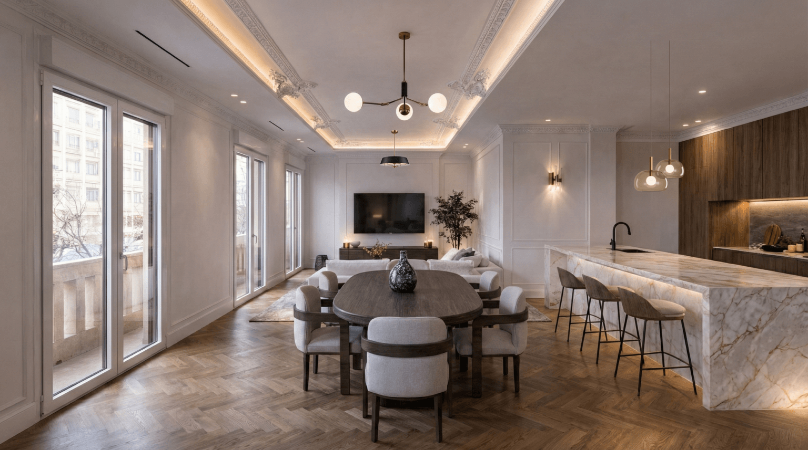

Hay espacios que se explican con planos.  
Y hay espacios que se entienden desde las sensaciones.

Algunos lugares se recorren.  
Otros se habitan.

Hay viviendas que cumplen.  
Y otras que acompañan.

No siempre sabemos por qué una casa nos calma.  
No siempre entendemos por qué otra nos incomoda.  
Pero el cuerpo lo sabe antes que la razón.

La luz que entra a una hora concreta.  
La forma en que una estancia se abre sin esfuerzo hacia otra.  
El silencio que se produce cuando la distribución respira.

Nada de eso es casualidad.

Hablamos de la Inteligencia Espacial.

## ¿Qué es la Inteligencia Espacial?

La Inteligencia Espacial es la capacidad de comprender un espacio más allá de su superficie. Es la habilidad de distribuir, organizar y estructurar una vivienda de manera que dialogue con la vida real de quienes la habitan.  
  
No hablamos únicamente de mover tabiques.  
Hablamos de: Cómo entra la luz y desde dónde.  
  
Cómo se producen las transiciones entre lo público y lo íntimo.  
Cómo respira un salón.  
Cómo se despierta un dormitorio.  
Cómo se conecta la cocina con la vida social.  
Cómo una apertura de hueco puede transformar la percepción de amplitud.  
Cómo un pasillo puede dejar de ser un espacio residual para convertirse en parte activa de la vivienda.  
  
**[Frank Lloyd Wright](https://www.arquitecturaydiseno.es/creadores/frank-lloyd-wright)** defendía que la arquitectura debía crecer desde dentro hacia fuera, desde la experiencia humana hacia la forma construida. Esa idea sigue siendo radicalmente actual.  
  
La Inteligencia Espacial no es estética. Es estructura invisible con impacto cotidiano.

*Frank Lloyd Wright*

## ¿Para qué sirve hablar de ello?

Porque el valor real de la arquitectura no siempre es visible.  
La mayoría de las personas reconocen un buen material o una iluminación decorativa atractiva.  
Pero pocos identifican una distribución mal resuelta hasta que la viven.  
  
Cuando un plano no responde a la lógica del habitante:  
  
- Se acumulan recorridos incómodos.
- Se desaprovecha la luz natural.
- Se fragmenta la convivencia.
- Se generan tensiones invisibles en el día a día. La Inteligencia Espacial aporta algo fundamental: calidad de vida silenciosa.

## El problema actual: distribución impuesta y rentabilidad prioritaria

En muchas promociones contemporáneas, la distribución no nace del habitar. Nace del cálculo.  
  
  
Se prioriza:  

- La repetición tipológica.
- La optimización de metros vendibles.
- La rentabilidad por planta. El resultado es una estandarización del espacio que genera despersonalización y alienación urbana. Las viviendas dejan de tener identidad. Se convierten en módulos intercambiables. Esto no solo afecta a la estética. Afecta al estado anímico. El espacio condiciona el comportamiento. Condiciona la forma de relacionarnos. Condiciona incluso nuestra energía diaria. Cuando la distribución ignora la Inteligencia Espacial, la casa pierde capacidad de acompañar la vida.

## El impacto diario en la experiencia humana

Un dormitorio mal orientado altera el descanso.  
Una cocina aislada del núcleo social limita la interacción.  
Un salón fragmentado reduce la sensación de amplitud.  
Un exceso de compartimentación impide la flexibilidad futura.  
  
Y, además, se pierde algo más profundo: la tradición estética ligada al lugar. Cada edificio, cada fachada histórica, cada contexto urbano tiene una memoria que debe dialogar con la distribución interior.  
  
No todo espacio admite cualquier plano.  
  
La Inteligencia Espacial implica escuchar al edificio, al entorno y al habitante simultáneamente.

## La solución: arquitectura que entiende el espacio

Existen ejemplos históricos donde la distribución se convierte en el verdadero protagonista.

El brutalismo, por ejemplo, más allá de su contundencia formal, exploró la sinceridad estructural y la lógica espacial sin artificios. En otro plano, la arquitectura biofílica contemporánea integra naturaleza y distribución para mejorar bienestar físico y emocional.

En ambos casos, el espacio no es un contenedor. Es una experiencia.

La clave no es el estilo.  
La clave es la coherencia entre forma, función y vida.

## Un caso real: Casa Elara

En Bramanti Arquitectos aplicamos esta visión en proyectos concretos.  
  
Un ejemplo claro es Casa Elara.  
  
Se trata de una intervención en un edificio con fuerte presencia histórica. La fachada tiene carácter, proporción y memoria urbana. Nuestro objetivo no era imponer una distribución estándar, sino dialogar con esa esencia.  
  
¿Qué hicimos?  
  

- Realzamos la relación entre fachada y espacio interior.
- Reorganizamos la distribución para potenciar la entrada de luz natural.
- Eliminamos compartimentaciones innecesarias.
- Creamos ejes visuales que amplían la percepción espacial.
- Integramos tecnología domótica sin alterar la estética clásica.
- Respetamos elementos originales reinterpretándolos con lenguaje contemporáneo. El resultado no es solo una vivienda reformada. Es un espacio coherente con su contexto histórico y adaptado a la vida actual. Inteligencia Espacial aplicada.

## Nuestro modelo de trabajo

En Bramanti Arquitectos no diseñamos planos aislados. Diseñamos experiencias espaciales. Nuestro proceso integra:  
  
1\. Análisis profundo del contexto urbano y arquitectónico.  
  
2\. Comprensión de los hábitos reales del cliente.  
  
3\. Estudio técnico de estructura, instalaciones y posibilidades de apertura.  
  
4\. Diseño de distribución priorizando luz, circulación y jerarquía espacial.  
  
5\. Interiorismo coherente con la lógica del espacio.  
  
6\. Coordinación con ejecución para garantizar fidelidad al concepto inicial.  
  
La Inteligencia Espacial no surge en el papel. Surge del diálogo entre técnica, sensibilidad y experiencia constructiva.

## El Aprendizaje: entender antes de diseñar

Hablar de Inteligencia Espacial no es un ejercicio teórico. Es una responsabilidad profesional.

El arquitecto no solo dibuja planos.  
Traduce vidas.

En Bramanti Arquitectos creemos que el verdadero valor de la arquitectura no está en lo visible, sino en cómo se siente al habitarla.

Porque un mismo espacio puede entenderse de muchas formas.

La diferencia está en si responde al mercado… o si responde a la persona.

Si quieres descubrir cómo aplicamos esta visión en nuestros proyectos, te invitamos a conocer nuestras **[Creaciones](/nuestas-creaciones/)** y explorar casos reales como Casa Elara.

La arquitectura inteligente no se impone.  
Se adapta.  
Y permanece.

[Suscríbete a Ecos de Bramanti](https://20295dfc.sibforms.com/serve/MUIFAIeDxCekAiWPpAlthn_exGLwvzdzBWbPPe6lRFmnqATolrVM-yS30s80n4jxoJekXlrfgoz7UyKum7avibRoTyPICYxW25LluTEjzhV8YZMmVgDa7rwweBqFTRdMPgEEjcFULlMHAVOYLPDZV1UcEFr7qQhGadfnpBRy2MMamsFxgZm-WNT-lP2lquXmfhInws5aIHirLx7Z)
