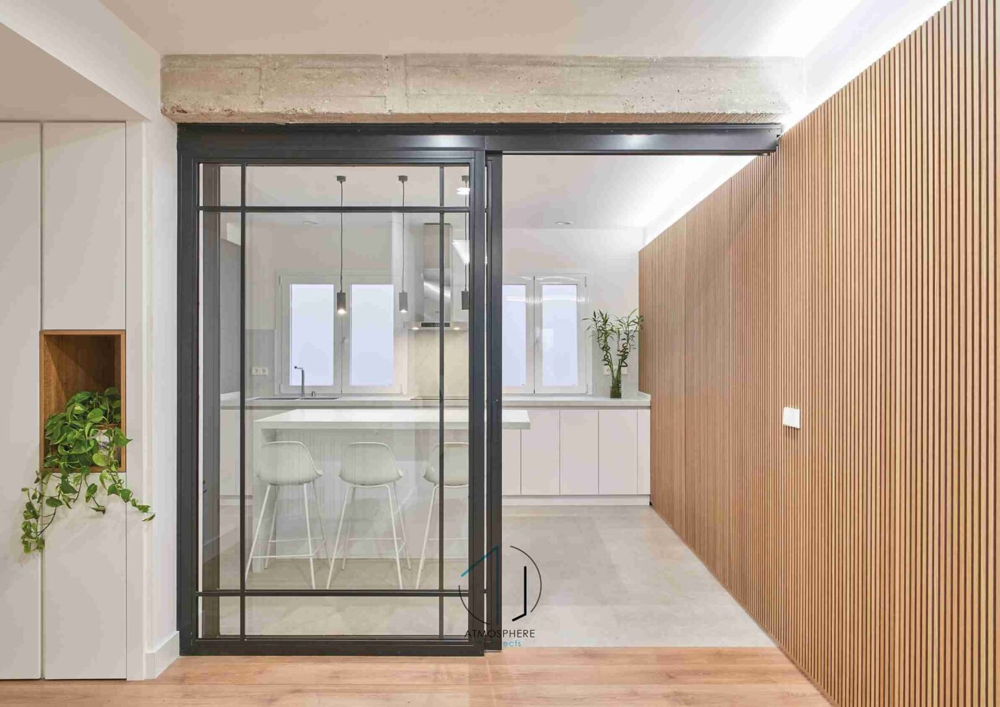
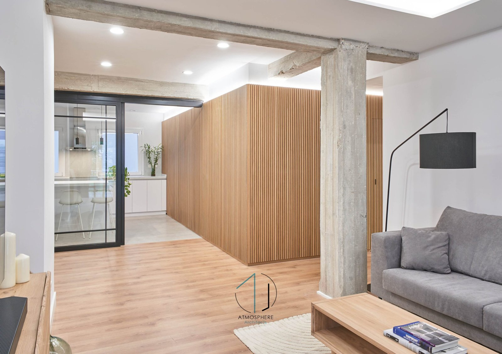

En el mundo del diseño de interiores y la arquitectura, constantemente emergen tendencias que capturan la atención y la imaginación. Una de las más intrigantes en los últimos tiempos es el estilo Japandi, una fusión armoniosa entre el minimalismo japonés y la calidez escandinava. En este artículo, exploraremos en detalle esta fascinante tendencia y cómo Bramanti Arquitectos ha aplicado este enfoque en su innovador **[Proyecto](/goya-madrid/) [Hermosilla](/goya-madrid/)**. Prepárate para sumergirte en un viaje de descubrimiento a través de la belleza y la serenidad del Japandi.

## ¿Qué es el Estilo Japandi?

El Japandi es una fusión única que combina la simplicidad y funcionalidad del diseño japonés con la comodidad y la calidez de la estética escandinava. En el corazón de este estilo reside una profunda apreciación por la belleza natural, la artesanía cuidadosa y la armonía en todas las cosas. Elementos clave incluyen líneas limpias, materiales naturales, colores suaves y una sensación de serenidad en el espacio.

## Los Fundamentos del Estilo Japandi

- **Líneas limpias y Simplicidad:** El Japandi abraza la idea de «menos es más», con un enfoque en líneas limpias y formas simples que crean una sensación de orden y tranquilidad en el espacio.
- **Materiales Naturales**: La madera, el bambú, el papel de arroz y la piedra son materiales característicos que añaden calidez y textura a los interiores Japandi, conectando el espacio con la naturaleza.
- **Colores Serenos**: La paleta de colores en el Japandi se inspira en la naturaleza, con tonos suaves y neutros que fomentan la relajación y la armonía.
- **Funcionalidad y Confort**: Aunque el diseño es minimalista, el Japandi prioriza la comodidad y la funcionalidad, creando espacios que son a la vez estéticamente atractivos y prácticos para vivir.

## Nuestro Proyecto Hermosilla: Un Ejemplo Vivo del Estilo Japandi

Bramanti Arquitectos ha llevado la esencia del Japandi al [**Proyecto Hermosilla**](/goya-madrid/), creando un espacio verdaderamente único y envolvente. A través de una cuidadosa selección de materiales, un diseño inteligente y una atención meticulosa a los detalles, Hermosilla encapsula la esencia del Japandi en cada rincón.

[Descubre Nuestro Proyecto](/goya-madrid/)

## Características Clave del Proyecto Hermosilla

- **Diseño Integrado**: El [**Proyecto Hermosilla**](/goya-madrid/) se caracteriza por un diseño fluido y coherente que integra armoniosamente los principios del Japandi en cada aspecto del espacio.
- **Uso de Materiales Naturales**: Desde la madera de roble hasta el mármol blanco, los materiales naturales se utilizan de manera prominente para crear una sensación de calidez y conexión con la naturaleza.
- **Luminosidad y Amplitud**: La abundante luz natural y los espacios abiertos contribuyen a una atmósfera serena y acogedora en Hermosilla, invitando a la relajación y la contemplación.
- **Funcionalidad sin Sacrificar Estilo**: Cada elemento en [**Hermosilla**](/goya-madrid/) ha sido cuidadosamente seleccionado para combinar la funcionalidad con un diseño estéticamente atractivo, demostrando que la belleza y la practicidad pueden coexistir armoniosamente.

## ¿Quieres transformar tu hogar?

¡Déjanos ayudarte a dar vida a tus ideas y convertir tu espacio en un reflejo de tu estilo personal!

## Consejos para Incorporar el Estilo Japandi en tu Hogar

- **Simplifica**: Elimina el desorden y opta por muebles y accesorios con líneas limpias y formas simples.
- **Apuesta por la Naturaleza**: Incorpora materiales naturales como la [**tarima de madera**](/tarima-de-madera-natural-o-tarima-laminada/), la piedra y el mimbre para añadir calidez y textura a tus espacios.
- **Paleta de Colores Suaves**: Opta por tonos neutros y suaves que evocan la serenidad y la tranquilidad.
- **Espacios Funcionales**: Prioriza la funcionalidad en el diseño de tus espacios, asegurándote de que sean prácticos y confortables para vivir.

## Conclusión

El estilo Japandi es mucho más que una tendencia pasajera; es una filosofía de diseño que celebra la simplicidad, la armonía y la belleza en todas las cosas. A través del [**Proyecto Hermosilla**](/goya-madrid/), Bramanti Arquitectos ha demostrado magistralmente cómo este enfoque puede transformar un espacio en un santuario de serenidad y estilo. ¿Estás listo para darle a tu hogar la calma y la elegancia del Japandi? ¡Inspírate y hazlo realidad!

## ¿Listo para dar vida a tus sueños de diseño interior?

¡Contáctanos ahora y deja que Bramanti Arquitectos transforme tu espacio en un oasis de belleza y funcionalidad! Nuestro equipo experto está aquí para escuchar tus ideas y convertirlas en realidad.

**¡No esperes más, contáctanos hoy para empezar tu proyecto de arquitectura con Japandi!**
