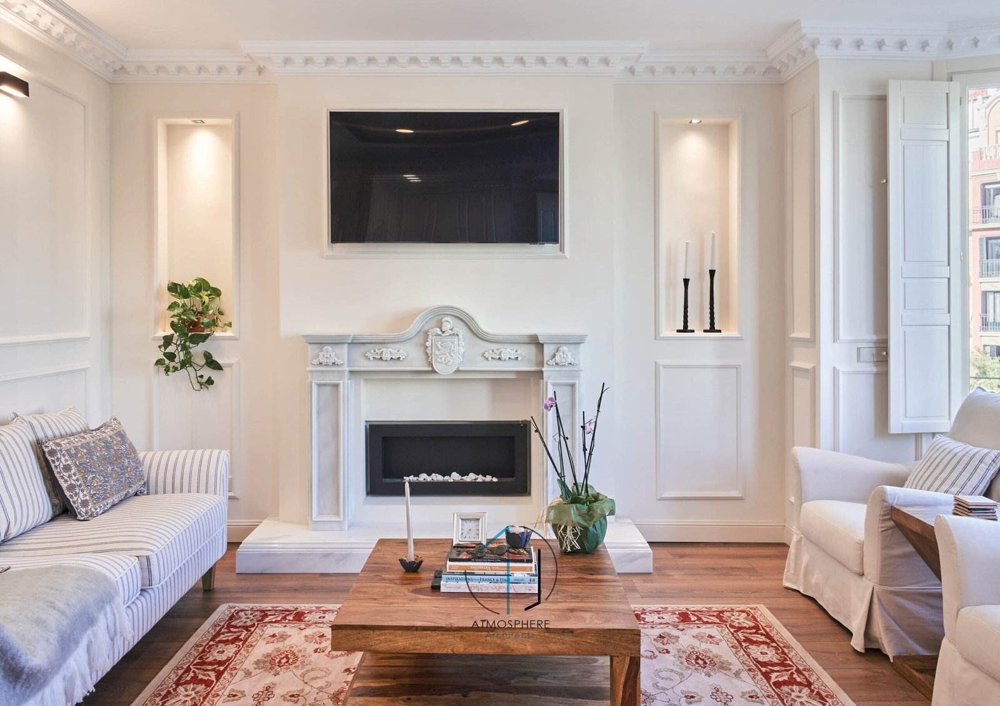

En **Bramanti Arquitectos,** nos apasiona explorar cómo los detalles meticulosos pueden transformar por completo un espacio. En nuestro último proyecto destacamos la belleza atemporal de las molduras, elementos arquitectónicos que han perdurado a través de los siglos como símbolo de refinamiento y estilo.

Recientemente, tuvimos el privilegio de colaborar con [**Escayolas Saz**](https://www.escayolasaz.com/) en la creación e instalación de molduras para uno de nuestros proyectos más emblemáticos. Este proceso artesanal, que hemos compartido en nuestro [**Instagram**](https://www.instagram.com/reel/C9NeZpfNZHb/?utm_source=ig_web_copy_link&igsh=MzRlODBiNWFlZA==), no solo resalta la dedicación y habilidad de nuestros colaboradores, sino también la importancia de cada detalle en la **creación de espacios arquitectónicos únicos**.

## ¿Qué son las molduras y por qué son tan importantes?

Las **molduras** son elementos decorativos que se añaden a los techos, paredes, ventanas y puertas para mejorar su apariencia estética. Originariamente utilizadas en la arquitectura clásica, las molduras no solo proporcionan un acabado elegante y sofisticado, sino que también pueden tener funciones prácticas, como proporcionar transiciones suaves entre diferentes superficies.

[¡Quiero transformar mi hogar!](/tu-reforma-integral-en-madrid/#valoracion)

## El proceso de elaboración de las molduras

La creación de molduras es **un arte en sí mismo**. Requiere habilidad técnica y precisión para moldear yeso u otros materiales de construcción en formas variadas, desde simples perfiles hasta diseños más elaborados y ornamentados. En colaboración con Escayolas Saz, pudimos observar de primera mano cómo cada pieza se elabora cuidadosamente para cumplir con las especificaciones exactas de nuestro diseño.

## Aplicaciones contemporáneas de las molduras

Aunque tradicionalmente asociadas con la arquitectura clásica, las molduras han encontrado su lugar en la arquitectura moderna. En **[Bramanti Arquitectos](/)**, aprovechamos su versatilidad para añadir dimensión y carácter a nuestros proyectos contemporáneos. Desde líneas limpias y minimalistas hasta patrones geométricos innovadores, las molduras pueden adaptarse a una variedad de estilos y estéticas, añadiendo un toque distintivo a cualquier espacio.

## El impacto de las molduras en el diseño interior

Además de su impacto estético, las molduras tienen el poder de **transformar la percepción del espacio**. Al resaltar ciertos elementos arquitectónicos o crear puntos focales, pueden influir en cómo se experimenta la altura, la luminosidad y la proporción dentro de una habitación. En muchos de nuestros proyectos, hemos utilizado molduras para **enfatizar la elegancia** de techos altos o para añadir un elemento de drama a una pared de características.

## Conclusiones

En **Bramanti Arquitectos**, creemos que los detalles hacen la diferencia. Las molduras no son simplemente elementos decorativos; son testimonios de nuestra dedicación a la artesanía y al diseño meticuloso. Gracias a nuestra colaboración con Escayolas Saz, hemos podido llevar la belleza clásica de las molduras a la arquitectura contemporánea, creando nuevos proyectos con espacios que inspiran. Visita nuestro [**Instagram**](https://www.instagram.com/bramantiarquitectos/) para ver más sobre cómo incorporamos las molduras en nuestros trabajos y descubre cómo estos detalles pueden transformar tu propio espacio en algo verdaderamente excepcional. En **Bramanti Arquitectos**, estamos aquí para hacer realidad tus visiones arquitectónicas más audaces.

## Contacta con nosotros

Te ofreceremos asesoramiento personalizado para crear el hogar de tus sueños en Madrid.
