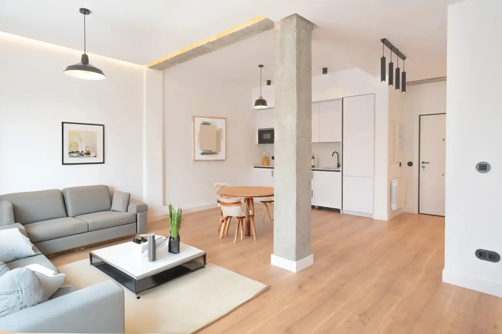
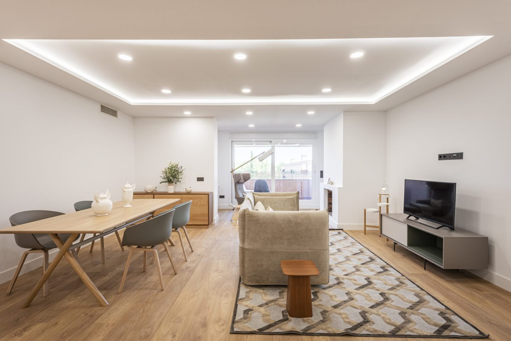

Madrid, la vibrante capital de España, es una ciudad llena de historia, cultura y oportunidades. Con un constante crecimiento urbanístico y una transformación de muchos de sus barrios, la capital se ha convertido en un lugar ideal para vivir. Si estás buscando mudarte a Madrid en 2024, es fundamental conocer las mejores zonas para vivir, ya sea por su calidad de vida, accesibilidad, oferta de servicios o el ambiente que ofrecen. En esta guía, analizamos en detalle **las mejores zonas para vivir en Madrid** este año, destacando sus ventajas y características clave

## 1. Salamanca: Elegancia y Exclusividad

El **Barrio de Salamanca** sigue siendo una de las áreas más exclusivas de Madrid, caracterizada por su elegancia y calles comerciales lujosas, como la famosa **Calle Serrano**. Este barrio es perfecto para quienes buscan propiedades de lujo y una oferta inmejorable de boutiques internacionales, restaurantes gourmet y servicios de alta gama.

Los inmuebles en Salamanca tienen un precio elevado, pero la inversión se traduce en **calidad de vida** y seguridad. Su proximidad al **Parque del Retiro** y a prestigiosas instituciones educativas lo convierte en una opción ideal para familias y profesionales de alto perfil.

## Proyecto Alcalá (En Venta)

Disfruta de la comodidad y el estilo de una propiedad ubicada en una de las arterias más vibrantes y centrales de la ciudad. ¡Contáctanos hoy para conocer más y agendar una visita!

## 2. Chamberí: Historia y Modernidad

Chamberí es una de las zonas más codiciadas de Madrid por su ubicación céntrica y su mezcla de tradición y modernidad. Este barrio ha sabido mantener su esencia histórica, a la vez que adopta tendencias urbanísticas modernas que lo hacen atractivo para jóvenes profesionales y familias.

Con su amplia oferta cultural, excelentes conexiones de transporte y diversidad en la oferta de viviendas, Chamberí es una excelente opción para quienes buscan equilibrio entre historia y comodidad. Su cercanía a zonas universitarias también lo convierte en una opción preferida por estudiantes y académicos.

## 3. Aravaca y Pozuelo: Tranquilidad y Naturaleza

Si lo que buscas es vivir en una zona tranquila y rodeada de naturaleza, **Aravaca** o Pozuelo podría ser la elección perfecta. Estos distritos ofrece un equilibrio entre la vida urbana y espacios verdes, como la **Casa de Campo** y el **Monte del Pardo**, ideales para quienes disfrutan de actividades al aire libre.

Aravaca y Pozuelo son conocidos por sus ambientes residenciales de alto nivel, con viviendas espaciosas, infraestructura educativa de calidad y acceso a centros médicos. Sin duda, son opciones ideales para familias que desean un entorno seguro y con buenas conexiones a la ciudad.

## Proyecto Finalizado

Un **elegante** y **sofisticado** equilibrio entre lo clásico y lo moderno, creando una **estética luminosa** gracias a una selección personalizada de mobiliario en tonos claros.

[Descubrir](/proyectos/)

## 4. Madrid Río: Renovación y Sostenibilidad

El proyecto de renovación en torno a **Madrid Río** ha transformado esta área en una de las mejores zonas para vivir en Madrid . Con kilómetros de espacios recreativos, carriles bici y zonas deportivas a lo largo del **río Manzanares**, es ideal para quienes valoran un estilo de vida activo y en contacto con la naturaleza.

Este desarrollo ha fomentado la construcción de nuevos proyectos residenciales enfocados en la **sostenibilidad** y la eficiencia energética, lo que lo convierte en una excelente opción para jóvenes profesionales y familias comprometidas con el bienestar ambiental.

## 5. Retiro: Calidad de Vida junto al Parque

El **Barrio del Retiro**, ubicado junto al icónico **Parque del Buen Retiro**, sigue siendo una de las mejores zonas para vivir en Madrid. Este barrio ofrece una combinación única de vida urbana y acceso a la naturaleza, con amplios espacios para relajarse y hacer deporte.

Retiro destaca por su tranquilidad y su completa oferta de servicios, que incluye colegios, hospitales y centros comerciales. Además, la excelente red de transporte público permite moverse con facilidad por toda la ciudad.

## 6. Malasaña: Vida Bohemia y Alternativa

Conocido por su ambiente joven y bohemio, **Malasaña** es uno de los barrios más vibrantes de Madrid. Es un imán para jóvenes creativos y profesionales que buscan un estilo de vida más relajado, lleno de cultura y vida social. Sus calles están llenas de tiendas vintage, galerías de arte y una gran oferta gastronómica.

Aunque mantiene su espíritu rebelde, Malasaña ha experimentado una renovación urbanística que lo convierte en un lugar atractivo para quienes disfrutan de una vida social activa y un entorno culturalmente rico.

## Descubre nuestros proyectos

Descubre nuestros **proyectos** realizados y cómo **transformamos ideas en espacios únicos**. Nuestra **experiencia** nos avala.

[¡Explóralos aquí!](/proyectos/)

## 7. Chueca: Diversidad y Modernidad

El **barrio de Chueca** es famoso por su ambiente inclusivo y su diversidad. Es un punto de referencia para la comunidad LGTBI+ en Madrid, ofreciendo una vibrante vida cultural y una amplia oferta gastronómica.

Chueca ha ganado popularidad en los últimos años, gracias a su proximidad al centro de la ciudad y a su vida social activa. Es ideal para quienes valoran la **diversidad** y una vida urbana dinámica.

## 8. Tetuán: Oportunidades a Precios Accesibles

Para aquellos que buscan oportunidades de inversión y precios más asequibles, **Tetuán** es una opción excelente. Este barrio ha experimentado una importante transformación, con nuevos edificios y mejoras en infraestructura que lo están convirtiendo en una de las zonas con más potencial de revalorización.

Tetuán ofrece una comunidad diversa, buenas conexiones de transporte y una oferta de servicios en constante crecimiento. Aunque no tiene el glamour de Salamanca o Chamberí, es ideal para quienes buscan una vivienda con gran potencial de inversión.

## 9. La Latina: Encanto Tradicional y Vida Social

**La Latina** es uno de los barrios más encantadores de Madrid, conocido por sus calles estrechas, plazas y su famosa oferta de tapas. Es ideal para quienes disfrutan de un ambiente relajado pero con una activa vida social, especialmente durante los fines de semana.

A pesar de su carácter tradicional, La Latina ha visto la llegada de nuevos residentes jóvenes y profesionales que buscan un equilibrio entre la autenticidad madrileña y la proximidad al centro de la ciudad.

## 10. Majadahonda – Urbanización Los Satélites: Tranquilidad y Conectividad

La [**Urbanización Los Satélites**](/ventapromocionlossatelites/), ubicada en [**Majadahonda**](/siete-razones-para-vivir-en-majadahonda-guia-completa/), se ha consolidado como una de las mejores opciones para vivir cerca de Madrid, combinando paz, naturaleza y una excelente conectividad. A solo unos minutos de la capital, Los Satélites es ideal para aquellos que buscan un entorno residencial más tranquilo, sin alejarse demasiado del bullicio urbano.

Con amplias zonas verdes, parques y áreas recreativas, Los Satélites ofrece un estilo de vida más relajado, ideal para familias que valoran la seguridad y el bienestar. Además, su acceso rápido a la A-6 y buenas conexiones de transporte público permiten llegar fácilmente al centro de Madrid. Los proyectos residenciales en esta urbanización destacan por su diseño moderno y sostenible, con todas las comodidades necesarias para una vida de calidad.

El ambiente comunitario y la sensación de seguridad hacen de Los Satélites un lugar perfecto para quienes buscan un equilibrio entre la vida urbana y la tranquilidad de las afueras.

## Proyecto en venta

Uno de nuestros **proyectos más exclusivo**s ubicado en la **urbanización Los Satélites, Majadahonda, Madrid**. No dudes en solicitar más información.

## Conclusión

Madrid ofrece una variedad de zonas residenciales que se adaptan a diferentes estilos de vida. Desde la exclusividad de **Salamanca** hasta la bohemia de **Malasaña**, cada barrio tiene su propio encanto. Elegir la mejor zona para vivir en Madrid en 2024 dependerá de tus prioridades: si prefieres la tranquilidad, la energía urbana o el acceso a zonas verdes, hay una opción para ti.

Si estás buscando asesoramiento para encontrar tu hogar ideal en Madrid o planeas un proyecto arquitectónico en la ciudad, no dudes en contactar con nuestro **estudio de arquitectura**. Estamos aquí para ayudarte a hacer realidad tu hogar en las mejores zonas de Madrid.

## Preguntas Frecuentes

### ¿Cuáles son las zonas más exclusivas para vivir en el centro de Madrid?

Las mejores zonas incluyen Salamanca, Chamberí y Retiro, por su exclusividad, calidad de vida y servicios de lujo.

### ¿Qué barrios son ideales para jóvenes profesionales?

Malasaña y Chueca son populares entre jóvenes profesionales por su ambiente dinámico y vida social activa.

### ¿Es Tetuán una buena opción para invertir en vivienda?

Tetuán ha experimentado una gran transformación y crecimiento, lo que lo convierte en una excelente opción para invertir en vivienda con potencial de revalorización.

### ¿Qué barrio es el más alternativo en Madrid?

Malasaña es el barrio más alternativo, con un ambiente bohemio, tiendas vintage y una vibrante vida nocturna.

### ¿Cuál es la mejor zona para familias con niños?

Aravaca, Pozuelo o Majadahonda son ubicaciones ideales para familias que buscan un entorno residencial tranquilo, con acceso a buenas escuelas y zonas verdes.

Madrid en 2024 sigue siendo una ciudad llena de oportunidades, y elegir la zona ideal para vivir dependerá de tus preferencias personales, estilo de vida y presupuesto. Desde la exclusividad de **Salamanca** hasta la vibrante vida cultural de **Malasaña**, Madrid tiene un barrio perfecto para cada tipo de residente.

Si estás buscando un hogar en Madrid o planeas diseñar una vivienda que se ajuste a tus necesidades y estilo, nuestro **estudio de arquitectura** está aquí para ayudarte. Con años de experiencia en proyectos residenciales y un profundo conocimiento de las mejores zonas para vivir en Madrid, te ofrecemos un servicio personalizado y profesional para hacer realidad tu proyecto.

### Estás a tan solo un clic de tu nuevo hogar

Contáctanos hoy mismo para una **consulta gratuita** y descubre cómo podemos ayudarte a encontrar o diseñar la casa de tus sueños en **Madrid**. Haz clic en el siguiente enlace para **concertar una reunión** con uno de nuestros **arquitectos expertos** y dar el primer paso hacia **tu nuevo hogar**.

