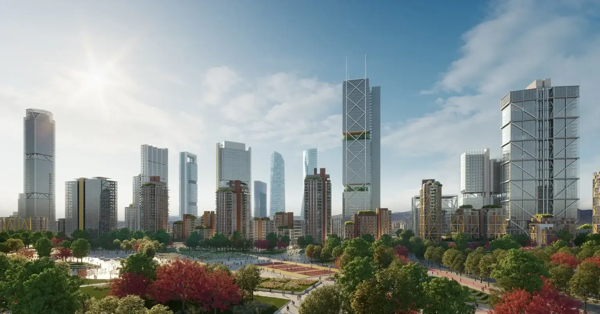
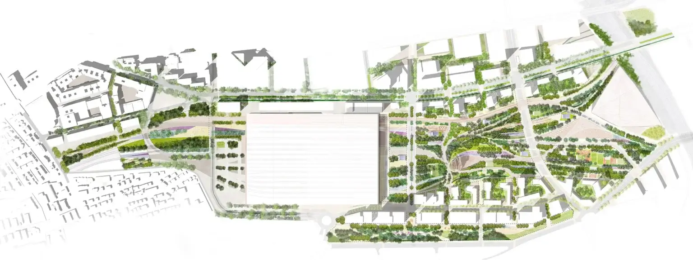

**Madrid Nuevo Norte**, conocido como uno de los desarrollos urbanísticos más ambiciosos de Europa, está destinado a cambiar el paisaje de la capital española. Este proyecto **Madrid Nuevo Norte** se centra en revitalizar el norte de Madrid con una apuesta por la sostenibilidad, la innovación y la creación de espacios accesibles para todos. Con más de 400 hectáreas de terreno, incluye **viviendas modernas**, un **distrito financiero** y **amplias zonas verdes**.

En este artículo exploraremos los aspectos clave de este proyecto, desde su **impacto urbanístico** hasta los beneficios que aportará a los madrileños. Además, responderemos preguntas frecuentes sobre **el mapa Madrid Nuevo Norte**, cómo solicitar [**viviendas de VPO,**](https://www.comunidad.madrid/servicios/vivienda/vivienda-protegida) (Viviendas de Protección Oficial) y detalles sobre las cooperativas involucradas.

## ¿Qué es Madrid Nuevo Norte?

### El Proyecto Madrid Nuevo Norte: Una Breve Introducción

**Madrid Nuevo Norte** es una iniciativa de regeneración urbana que promete revolucionar el norte de la ciudad. Diseñado para convertirse en un referente en urbanismo sostenible, combina espacios residenciales, comerciales y recreativos, adaptándose a las necesidades del futuro. Este megaproyecto destaca por su enfoque en la conectividad y en la mejora de la calidad de vida de los madrileños.

### Mapa de Madrid Nuevo Norte: Ubicación Estratégica

El área que ocupa **Madrid Nuevo Norte** abarca desde la estación de Chamartín hasta el límite norte de la ciudad, conectando diversos barrios y dotándolos de infraestructura moderna. Las nuevas viviendas estarán estratégicamente distribuidas para aprovechar al máximo el espacio, mientras que se prioriza la movilidad con un rediseño del transporte público y acceso a carriles bici.

### Novedades del Proyecto

Entre las principales novedades **Madrid Nuevo Norte**, destaca la construcción de más de 10.000 viviendas, de las cuales una parte será destinada a viviendas protegidas. También se contempla un enfoque único en sostenibilidad, con edificios de bajo impacto ambiental y la creación de parques que suman más de 250 hectáreas de áreas verdes.

*CREA MADRID NUEVO NORTE*

## Impacto del Proyecto Madrid Nuevo Norte

### Beneficios Urbanísticos y Sociales

El impacto de **Madrid Nuevo Norte** no se limita a lo visual. Este desarrollo modernizará infraestructuras obsoletas, creará empleo en todas las etapas del proyecto y ofrecerá acceso a viviendas para una amplia variedad de ingresos. El modelo apuesta por la mezcla social, con precios de viviendas diseñados para ser accesibles a diferentes perfiles económicos.

### Sostenibilidad como Pilar Fundamental

El proyecto prioriza la sostenibilidad, integrando soluciones para la movilidad urbana, como el uso de vehículos eléctricos, y asegurando un bajo impacto ambiental en las nuevas edificaciones. Las amplias zonas verdes, además, jugarán un papel esencial en la lucha contra la contaminación.

### La Inversión y Cooperativas en Madrid Nuevo Norte

Madrid Nuevo Norte es un imán para inversores y cooperativas inmobiliarias. El ambicioso plan, respaldado por una inversión superior a los 7.300 millones de euros, promete beneficios económicos tanto para empresas como para las familias que busquen opciones accesibles de vivienda.

## Urbanismo e Infraestructuras en Madrid Nuevo Norte

### Innovación Urbanística: Un Diseño para el Futuro

El urbanismo de Madrid Nuevo Norte representa una evolución en el desarrollo de ciudades modernas. La integración de edificios sostenibles, zonas verdes y tecnologías inteligentes hace que este proyecto sea un modelo a seguir para futuros desarrollos en Europa. El diseño urbano ha sido concebido para priorizar a las personas, creando espacios accesibles y funcionales que promuevan una comunidad activa y conectada.

### Infraestructuras: Movilidad y Conectividad

Una de las principales prioridades del proyecto es la movilidad. Madrid Nuevo Norte contará con una red de transporte público mejorada, que incluye la ampliación de la estación de Chamartín como un gran núcleo intermodal. Además, el proyecto introduce carriles bici, zonas peatonales y una infraestructura vial modernizada para minimizar la congestión.

Este enfoque en la conectividad posiciona a Madrid Nuevo Norte como un referente para la movilidad sostenible en grandes ciudades.

### Mapa Madrid Nuevo Norte: División de Zonas

El proyecto se organiza en diferentes zonas:

- **Área residencial**: Con más de 10.000 viviendas, incluidas opciones de **vivienda protegida**.
- **Distrito financiero**: Con edificios diseñados para ser un referente en arquitectura sostenible.
- **Parques y áreas recreativas**: Más de 250 hectáreas dedicadas a espacios verdes.

Este equilibrio entre áreas asegura que el proyecto será tanto un espacio para vivir como para trabajar y disfrutar.

## Descubre nuestro Estudio de Arquitectura en Madrid

En **Bramanti Arquitectos**, diseñamos y construimos espacios únicos y funcionales, adaptados a tus necesidades. Con nuestro equipo de arquitectos y constructores, nos encargamos de todo, desde la planificación hasta la entrega de llaves.

[Conoce la metodología de Bramanti Arquitectos](/estudio-de-arquitectura-en-madrid/)

## Viviendas en Madrid Nuevo Norte: Acceso y Precios

### Viviendas Protegidas: Accesibilidad para Todos

Uno de los objetivos del proyecto es garantizar que haya opciones de vivienda para todos. Las viviendas protegidas en Madrid Nuevo Norte ofrecerán oportunidades para familias y jóvenes que buscan un hogar en una zona moderna y bien conectada. Además, el proyecto incluye programas para solicitar VPO (Viviendas de Protección Oficial), diseñados para facilitar el acceso a una vivienda a precios asequibles.

### Precios y Oportunidades de Inversión

Los precios de las viviendas en Madrid Nuevo Norte variarán según el tipo de propiedad y la ubicación dentro del proyecto. Las cooperativas y promotores inmobiliarios ya están trabajando para ofrecer opciones competitivas que se adapten a diferentes presupuestos, lo que convierte a esta zona en una **excelente oportunidad de inversión** tanto para compradores como para empresas.

### ¿Cómo Solicitar Viviendas?

Para aquellos interesados en adquirir una vivienda, es importante seguir las actualizaciones oficiales sobre el proceso. Las opciones incluyen cooperativas y promociones directas, con detalles disponibles a través de canales como el [**Ayuntamiento de Madrid**](https://www.madrid.es/portal/site/munimadrid) y las entidades asociadas al proyecto.

*PORTAL DE TRANSPARENCIA DEL AYUNTAMIENTO DE MADRID*

## Beneficios a Largo Plazo para Madrid

### Impacto Económico

El proyecto generará miles de empleos durante su construcción y en las actividades económicas que surgirán posteriormente. El desarrollo de un **nuevo distrito financiero** también atraerá empresas internacionales, consolidando a **Madrid** como un **centro de negocios global.**

### Calidad de Vida para los Residentes

Madrid Nuevo Norte no solo se centra en el desarrollo urbano; también prioriza el bienestar de sus habitantes. Las **áreas verdes**, las viviendas accesibles y las instalaciones modernas harán que esta zona sea un ejemplo de cómo **equilibrar la vida urbana** con la **sostenibilidad** y la comodidad.

### Referente Internacional

Con su **diseño innovador** y **enfoque sostenible**, el proyecto está destinado a convertirse en un modelo a seguir para otros proyectos urbanísticos en todo el mundo. Este desarrollo **posicionará a Madrid** como una ciudad que **lidera** en **soluciones urbanas integrales** y **sostenibles**.

## Conclusión

### Madrid Nuevo Norte: El futuro de Madrid ya está en marcha

Madrid Nuevo Norte es **más que un proyecto urbanístico**; es una **transformación para el norte de la capital** que impactará positivamente en la economía, la sostenibilidad y la calidad de vida de sus habitantes. Desde su ambicioso diseño hasta las oportunidades de vivienda e inversión que ofrece, este proyecto promete **redefinir el futuro** de Madrid. Si estás buscando más información o deseas participar en este desarrollo, mantente atento a las actualizaciones sobre el proyecto.

### Un proyecto que marca un antes y un después en el urbanismo español

El impacto va más allá de la arquitectura; transformará la forma en que los ciudadanos interactúan con la ciudad. Desde **Bramanti Arquitectos**, celebramos iniciativas como esta, que combinan diseño, innovación y responsabilidad ambiental, y esperamos que sea un ejemplo para el desarrollo urbano del futuro.

## Preguntas Frecuentes (FAQs)

### ¿Cuándo estará listo Madrid Nuevo Norte?

Se espera que las primeras fases estén terminadas para 2030, con el proyecto completo hacia 2040.

### ¿Cómo beneficiará este proyecto a los ciudadanos de Madrid?

Madrid Nuevo Norte mejorará la calidad de vida con más vivienda asequible, espacios verdes y mejores infraestructuras de transporte.

### ¿Qué impacto tendrá en el medioambiente?

El proyecto apuesta por la sostenibilidad con edificios eficientes, movilidad limpia y la creación de 400 hectáreas de zonas verdes.

### ¿Qué estudios de arquitectura están detrás del proyecto?

Varias firmas nacionales e internacionales participan en el diseño, incluyendo destacados estudios que priorizan la sostenibilidad.

### ¿Cuál es la inversión total de Madrid Nuevo Norte?

La inversión estimada supera los 7.300 millones de euros, posicionándose como una de las mayores de Europa.

## Contacta con nosotros

En **Bramanti Arquitectos**, diseñamos y construimos espacios únicos y funcionales, adaptados a tus necesidades. Con nuestro equipo de arquitectos, interioristas y constructores, nos encargamos de todo, desde la planificación hasta la entrega de llaves.
