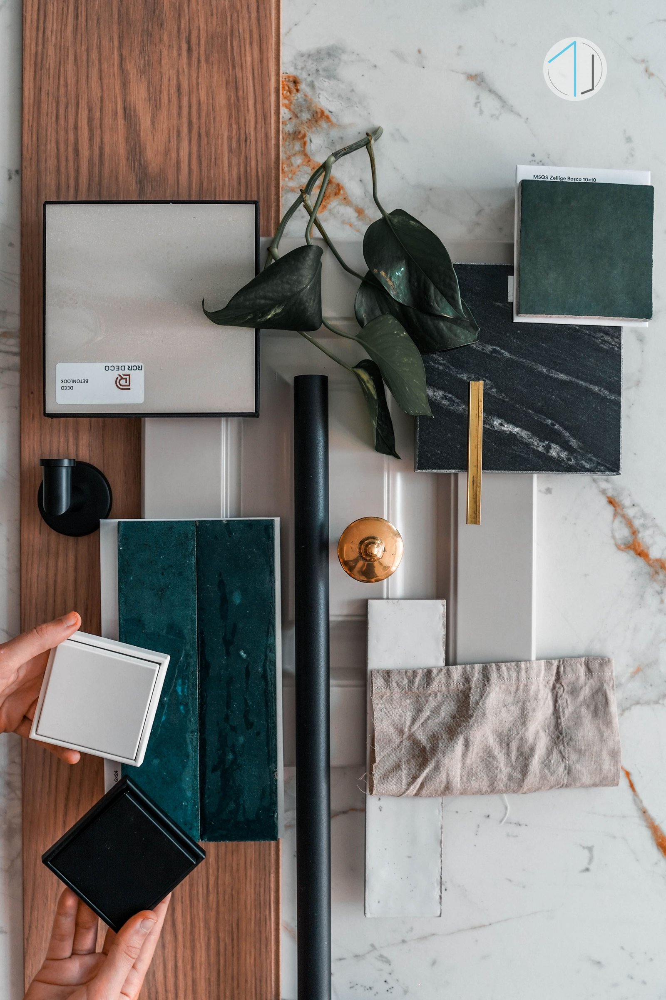
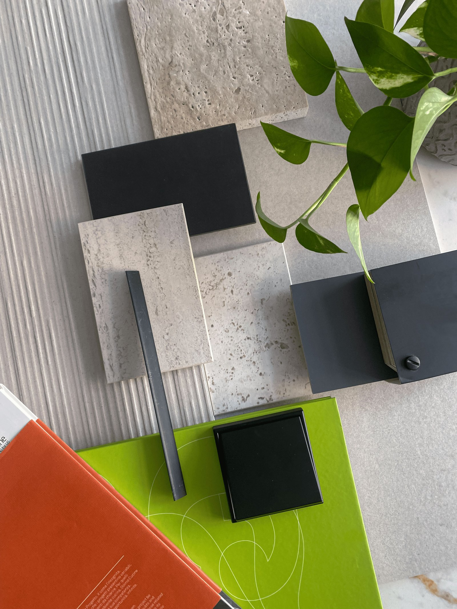

## Descubrid cómo el mood board se convierte en el faro creativo de nuestro estudio de arquitectura en Madrid.

En nuestro **estudio de arquitectura en Madrid**, Bramanti Arquitectos, nos enorgullece presentar una herramienta que desempeña un papel fundamental en cada proyecto: el **mood board**. En este artículo, exploraremos en detalle la importancia del mood board en el diseño y la arquitectura, y cómo este elemento se convierte en el faro creativo que guía vuestro camino junto a **Bramanti Arquitectos**.

## Nuestro ¿Qué es un Mood Board?

Un **mood board**, o tablero de inspiración, es una compilación visual de elementos que transmiten la **esencia y visión de un proyecto**. En cada proyecto que emprendemos en Bramanti Arquitectos, este tablero cuidadosamente elaborado se convierte en el **punto de partida** que da vida a vuestras ideas.

## El Mood Board como Reflejo de la Visión

El **desarrollo del mood board** es el primer paso para reflejar la esencia de cada proyecto de diseño o arquitectura que emprendemos junto a vosotros. A través de la selección meticulosa de **texturas**, **colores** y **materiales**, capturamos la atmósfera que deseamos **transmitir** en el espacio a crear.

### Contacta con nosotros y empecemos a dar forma a tus ideas.

## Inspiración y Colaboración con Bramanti Arquitectos

El **mood board** no es solo una herramienta interna, sino una **fuente de inspiración** que compartimos con vosotros, nuestros clientes y colaboradores, aquí en Bramanti Arquitectos. Cada elemento visual en el tablero se convierte en una conversación sobre la **dirección del proyecto** y un medio para explorar nuevas ideas en conjunto.

## Tomando Decisiones Informadas

Al utilizar el **mood board** junto a Bramanti Arquitectos, podemos tomar **decisiones más informadas** sobre los elementos de diseño, los materiales y la paleta de colores. Esto agiliza el proceso de diseño y **garantiza que cada decisión esté alineada** con la visión inicial de vuestro proyecto.

### ¡Descubre alguno de nuestros proyectos más destacados!

[Visitar](/nuestras-creaciones/)

## Vuestra Opinión Importa

El **mood board** también abre las puertas a vuestra participación activa junto a **Bramanti Arquitectos**. Os permite visualizar y comprender mejor la dirección del proyecto y, al mismo tiempo, ofrece la oportunidad de **expresar vuestras preferencias y opiniones** en cada etapa del proceso creativo.

## Conclusión:

En resumen, el **mood board** es la brújula creativa que guía vuestro camino en el diseño y la arquitectura junto a **Bramanti Arquitectos**. Es el faro que ilumina el proceso de transformar vuestras visiones en realidades palpables. Si estáis buscando un diseño que refleje vuestra visión única, no busquéis más allá del mood board y la experiencia que ofrecemos en Bramanti Arquitectos. Es el corazón de la creatividad en nuestro **estudio de arquitectura en Madrid**.

¿Listo para dar vida a tu proyecto arquitectónico en Madrid? ¡**Contáctanos hoy mismo** y juntos hagamos realidad tu idea!

[Nuestra web](/)
