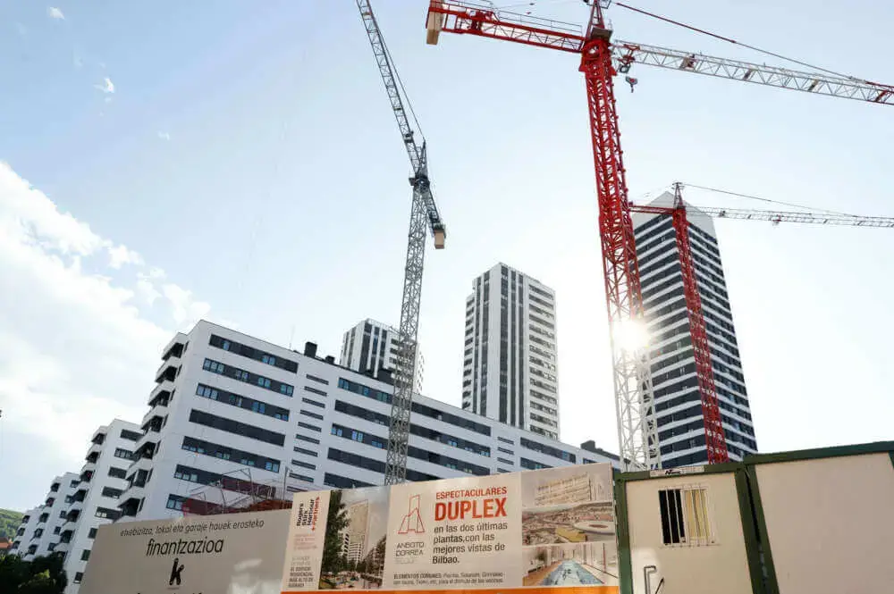

*EFE (LUIS TEJIDO)*

## Viviendas de obra nueva

Una [vivienda de obra nueva](https://www.primeinvest.es/es/nuestro-blog/que-es-obra-nueva) es aquella que se encuentra en **proceso de construcción o que ha sido construida recientemente** y que nunca ha sido habitada. Este tipo de viviendas se caracterizan por:

**Su estado:** Se encuentran en perfecto estado, sin desperfectos ni signos de desgaste.

**Sus características modernas:** Incorporan los últimos avances en diseño, materiales de construcción, eficiencia energética y domótica.

**Sus mayores garantías:** Cuentan con una serie de garantías legales y contractuales que protegen al comprador frente a posibles defectos de construcción o vicios ocultos.

**Su mayor eficiencia energética:** Suelen estar diseñadas para minimizar el consumo de energía y agua, lo que se traduce en un ahorro en las facturas para el propietario.

**Posibilidad de personalización:** En algunos casos, las promotoras ofrecen la posibilidad de personalizar la vivienda durante la fase de construcción, lo que permite al comprador adaptarla a sus gustos y necesidades.

**Mayor seguridad jurídica:** La compra de una vivienda de obra nueva se rige por la *Ley de Vivienda de Obra Nueva (Ley 57/1968)*, que establece una serie de garantías y protecciones para el comprador.

### **Las viviendas de obra nueva se pueden clasificar en dos categorías principales:**

Vivienda de obra nueva sobre plano: Se compra antes de que se inicie la construcción, lo que permite al comprador adquirirla a un precio más económico y elegir algunas de las características de la vivienda.

Vivienda de obra nueva terminada: Se encuentra ya construida y lista para ser habitada. El comprador puede ver la vivienda antes de comprarla y comprobar su estado y características.

## Invertir en obra nueva: Una decisión inteligente para un futuro prometedor

Adquirir una propiedad de obra nueva no solo significa mudarse a un hogar moderno y confortable, sino también realizar una inversión inteligente con numerosos beneficios que perdurarán en el tiempo. A continuación, te presento algunas de las razones más convincentes para dar este importante paso:

### **Viviendas modernas, eficientes y sostenibles**

Las propiedades de obra nueva se construyen con **materiales y técnicas de última generación**, lo que se traduce en una mayor **eficiencia energética** y un **menor impacto ambiental**. Esto se refleja en **ahorros en tu factura de energía** y en la contribución a un **futuro más sostenible**. Además, incorporan **las últimas tecnologías** en domótica y seguridad, brindándote **confort, practicidad y tranquilidad**.

### **Personalización a tu gusto**

En muchos casos, la obra nueva te ofrece la posibilidad de **personalizar** algunos aspectos de tu vivienda, como los acabados, la distribución o los materiales. De esta manera, puedes crear un **hogar único y a tu medida**, que se adapte perfectamente a tus necesidades y gustos.

### **Mayor seguridad jurídica**

Al invertir en una propiedad de obra nueva, cuentas con **todas las garantías legales** y la vivienda está **libre de cargas o gravámenes**. Esto te proporciona una **mayor seguridad jurídica** y la tranquilidad de que tu inversión está protegida.

### **Menor riesgo de averías**

Las viviendas de obra nueva son **nuevas**, por lo que el **riesgo de sufrir averías** en los primeros años es **considerablemente menor**. Esto se traduce en un **ahorro significativo en costes de mantenimiento y reparaciones**, permitiéndote disfrutar de tu hogar sin preocupaciones.

### **Posibilidad de revalorización**

Las propiedades de obra nueva suelen **apreciarse en valor** con el paso del tiempo, lo que las convierte en una **inversión rentable a largo plazo**. Esto te permite obtener un **retorno de tu inversión** considerablemente mayor que el que podrías obtener con otros instrumentos financieros. A esto se le suma que, si tu objetivo es **alquilar la propiedad**, las viviendas de obra nueva suelen ser **más atractivas para los inquilinos** debido a su modernidad, eficiencia y buen estado. Esto te permite obtener una **mayor rentabilidad de tu inversión** a través del alquiler.

En definitiva, invertir en una propiedad de obra nueva es una decisión acertada que te permitirá disfrutar de un hogar moderno, eficiente, seguro, con un alto potencial de revalorización y que además contribuye a tu bienestar y calidad de vida.

## Urbanización Los Satélites

### Invertir en una urbanización de chalets de obra nueva en Majadahonda: Un sueño hecho realidad

Si estás pensando en comprar una vivienda, desde [Bramanti Arquitectos](/) te animamos a que tengas en cuenta nuestra proyecto de [urbanización Los Satélites](/los-satelites-madrid/). Una urbanización de chalets de obra nueva situada en Majadahonda, donde estamos seguros de que encontrarás una propiedad que se ajuste a tus necesidades y expectativas.

[Majadahonda](https://www.comunidad.madrid/centros/majadahonda), ubicada a solo 18 kilómetros de Madrid, se ha convertido en uno de los municipios más exclusivos y codiciados de la Comunidad Autónoma. Su encanto reside en una combinación única de factores que la convierten en el lugar ideal para quienes buscan un estilo de vida tranquilo, seguro, familiar y con un toque de lujo. ¡No te pierdas esta oportunidad única de adquirir tu inmueble de obra nueva en Majadahonda!

Nuestro terreno en venta [Los Satélites](https://www.idealista.com/pro/Bramanti-arquitectos/inmueble/104513457/) te ofrece una amplia variedad de opciones para que encuentres tu inmueble de obra nueva en Majadahonda perfecto para ti:

- Pisos en venta Los Satélites: Si buscas un inmueble moderno y luminoso en una zona tranquila, Los Satélites es la opción ideal para ti.
- Terreno de lujo Los Satélites: ¿Quieres invertir en un terreno de lujo en una de las zonas más cotizadas de Madrid? En Majadahonda encontrarás las propiedades de lujo más espectaculares del mercado.
- Propiedad con piscina en Majadahonda: Disfruta del verano en tu propia piscina. En Los Satélites encontrarás una amplia variedad de propiedades con piscina para que elijas la que mejor se adapte a tus necesidades para tu exclusividad y confort.
- Vivienda con jardín en Majadahonda: ¿Te gusta disfrutar del aire libre? En Los Satélites encontrarás viviendas con amplios jardines para que puedas relajarte y disfrutar del sol en terrenos con las mejores vistas.
- Casa con vistas Los Satélites: Disfruta de las mejores vistas de Madrid en un entorno privilegiado desde tu propia casa en Los Satélites.
- Venta de propiedades Majadahonda: En Majadahonda encontrarás una amplia variedad de propiedades en venta para que encuentres la que mejor se adapte a tus necesidades de la mano de Bramanti Arquitectos.
- Chalets nuevos Majadahonda: Si buscas un chalet nuevo a estrenar, en Majadahonda encontrarás las mejores promociones de chalets de lujo.

Invertir en una urbanización de chalets de obra nueva en Majadahonda es una decisión acertada que te permitirá disfrutar de un estilo de vida exclusivo, seguro, familiar, confortable y con un alto potencial de revalorización.

¡No lo dudes más y [contacta con nosotros](/contacto/) para encontrar la propiedad de tus sueños en Los Satélites, Majadahonda!

*Bramanti Arquitectos (Urbanización Los Satélites)*
