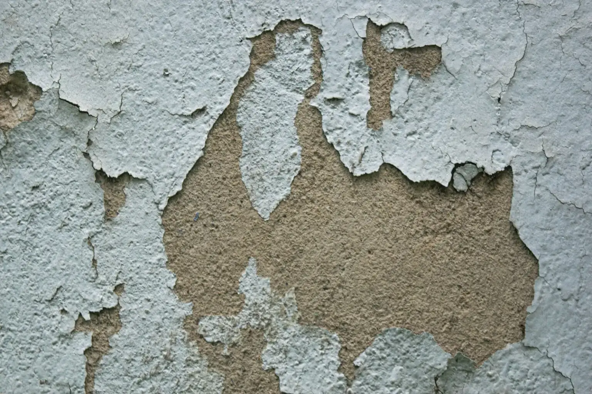

En el mundo de la construcción y la compra de inmuebles, uno de los mayores temores de los compradores son los **vicios ocultos**. Pero, **¿qué son los vicios ocultos?** Estos son defectos estructurales no visibles a simple vista, como grietas, humedades y fallos en las instalaciones, que pueden pasar desapercibidos durante una inspección superficial en el momento de compra. En **Bramanti Arquitectos**, entendemos la importancia de detectar y solucionar estos problemas antes de que se conviertan en verdaderas pesadillas para los propietarios.

## ¿Qué son los Vicios Ocultos?

Los vicios ocultos son defectos que no se perciben a simple vista y que suelen aparecer después de la compra de un inmueble. Entre los más comunes se encuentran:

- Grietas en las paredes o techos
- [**Problemas de humedad**](/optimizando-la-impermeabilizacion-protegiendo-tu-hogar-de-la-humedad/)
- Fallos en las instalaciones eléctricas o de fontanería

Estos problemas pueden convertir la compra de tu casa de ensueño en una auténtica pesadilla. Sin embargo, con la ayuda de un estudio de arquitectura especializado, es posible detectarlos y resolverlos a tiempo.

## ¿Cómo se pueden evitar los Vicios Ocultos?

En **Bramanti Arquitectos**, utilizamos técnicas avanzadas para detectar y resolver estos problemas antes de que se conviertan en una amenaza. Nuestro enfoque integral y detallado nos permite identificar estos defectos estructurales no visibles a simple vista, garantizando así la calidad y seguridad de tu hogar.

## Técnicas de detección avanzada

Usamos herramientas y metodologías modernas que van más allá de una simple inspección superficial. Desde el uso de cámaras termográficas hasta pruebas de presión en las tuberías, nuestro objetivo es asegurar que tu inversión esté protegida.

## Conoce nuestro servicios

Te ofreceremos asesoramiento personalizado para que encuentres el hogar de tus sueños en Madrid.

[Conoce nuestro estudio](/estudio-arquitectura-madrid/)

## Tu hogar con garantías

A diferencia de otros profesionales, trabajar con un estudio de arquitectura como **Bramanti Arquitectos** garantiza detectar y solucionar los vicios ocultos antes de que se conviertan en problemas. De esta manera, evitamos sorpresas desagradables y aseguramos la calidad de tu hogar.

### Beneficios de trabajar con un estudio de arquitectura:

1. **Expertise y conocimiento técnico:** Nuestra formación y experiencia nos permite identificar problemas que otros profesionales podrían pasar por alto.
2. **Soluciones personalizadas:** Diseñamos soluciones a medida para cada proyecto, adaptándonos a las necesidades específicas de cada cliente.
3. **Garantía de calidad:** Nos comprometemos a entregar proyectos que cumplan con los más altos estándares de calidad y seguridad.

En **Bramanti Arquitectos**, tu tranquilidad y satisfacción son nuestra prioridad. Evita sorpresas desagradables y asegura la calidad de tu hogar con **[nuestro equipo](/contacto/)** de profesionales.

### Conclusión

Los vicios ocultos pueden representar un gran riesgo para los nuevos propietarios de inmuebles, pero con la ayuda de un estudio de arquitectura especializado, estos problemas se pueden detectar y resolver a tiempo. En **Bramanti Arquitectos**, estamos comprometidos con la excelencia y la seguridad de tu hogar. Confía en nosotros para convertir tus sueños en realidad, sin sorpresas ni preocupaciones.

## Contacta con nosotros

En **Bramanti Arquitectos**, diseñamos y construimos espacios únicos y funcionales, adaptados a tus necesidades. Con nuestro equipo de arquitectos y constructores, nos encargamos de todo, desde la planificación hasta la entrega de llaves.
