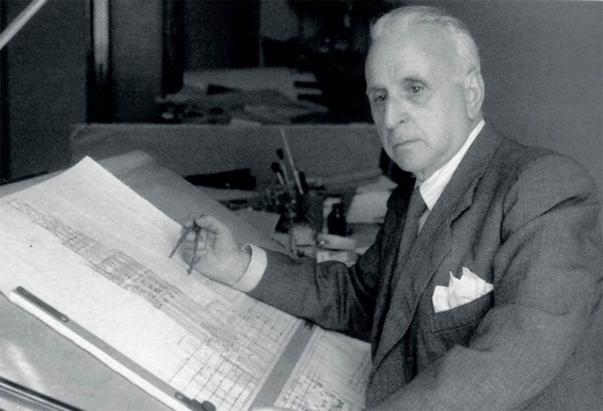

Durante el **mes de octubre**, Madrid se convierte en la capital de la arquitectura con la celebración de la **Semana Internacional de la Arquitectura 2024**, del **4 al 17 de octubre**. Este evento, organizado por el **COAM (Colegio Oficial de Arquitectos de Madrid)**, ofrece una gran cantidad de actividades que abarcan desde exposiciones hasta visitas guiadas por algunos de los edificios más icónicos de la ciudad. Si estás buscando planes culturales en Madrid, este es un evento que no puedes pasar por alto. Te contamos las principales novedades acerca semana de la Arquitectura Madrid 2024: Todo lo que puedes hacer y no te puedes perder

## Las mejores actividades de la Semana de la Arquitectura en Madrid 2024

### 1. Exposiciones de renombre: Renzo Piano y la arquitectura peruana

Una de las exposiciones más esperadas es la dedicada al arquitecto **[Renzo Piano](https://es.wikipedia.org/wiki/Renzo_Piano)** y su estudio **[Renzo Piano Building Workshop](https://www.rpbw.com/)**, conocido por obras como el Centro Pompidou de París. Además, Lima, ciudad invitada de este año, presenta una exposición única sobre su patrimonio arquitectónico, explorando la influencia de su pasado inca y colonial (**[Semana Arq 2024](https://www.semanaarquitecturamadrid.com/)**).

### 2. Conoce el legado de Antonio Palacios en Madrid

Este año se celebra el centenario del arquitecto **[Antonio Palacios](https://es.wikipedia.org/wiki/Antonio_Palacios)**, una figura clave en la arquitectura madrileña. Podrás disfrutar de una exposición al aire libre en el Parque del Retiro dedicada a su trabajo, con edificios tan emblemáticos como el Palacio de Cibeles y el Edificio Telefónica.

*Antonio Palacios. Arquitecto.*

### 3. Visitas guiadas por los edificios más emblemáticos de Madrid

Si te apasiona la arquitectura o simplemente quieres descubrir algunos de los secretos mejor guardados de la ciudad, hay más de 300 **visitas guiadas** organizadas a lo largo de la semana. Edificios históricos, modernos y palacios estarán abiertos al público para ser visitados​ (**[Gacetín Madrid](https://gacetinmadrid.com/2024/09/19/semana-arquitectura-madrid-xxi-300-actividades-peru/)**).

### 4. Debates y conferencias sobre el futuro de la arquitectura

No solo se trata de ver edificios, sino también de aprender. Durante la semana, expertos debatirán temas como la **preservación del patrimonio cultural** o el impacto de la **inteligencia artificial en la arquitectura moderna**. Destaca la participación de alcaldes de ciudades como Madrid, Lima, Estambul y Praga en un foro sobre el futuro de nuestras ciudades​.

### 5. Pop Arq Store: Diseño y artesanía por arquitectos

Una parada obligatoria para los amantes del diseño es el Pop Arq Store, un mercado donde los arquitectos venden sus propias creaciones artesanales. Desde mobiliario hasta accesorios y joyería, este mercado es el lugar perfecto para encontrar piezas únicas. Este año, además, colabora con la Asociación Española Contra el Cáncer, promoviendo una causa solidaria.​

### 6. Actividades para toda la familia: Itinerarios y talleres infantiles

¿Buscas actividades para hacer con niños en Madrid? La Semana de la Arquitectura también ofrece itinerarios guiados y talleres infantiles diseñados para despertar el interés de los más pequeños por la arquitectura y el urbanismo. Los parques de Madrid Río y el Retiro son algunos de los escenarios donde los niños podrán aprender jugando (**[Semana Arq 2024](https://www.semanaarquitecturamadrid.com/)**).

### 7. Talleres temáticos sobre arquitectura peruana y sostenibilidad

Para quienes deseen sumergirse en una experiencia más educativa, se han organizado varios talleres centrados en la **arquitectura peruana** y su relación con la **sostenibilidad**. Estos talleres buscan acercar al público a la arquitectura de una manera más práctica y lúdica (**[ES Madrid](https://www.esmadrid.com/agenda/semana-arquitectura)**).​

## ¿Por qué no te lo puedes perder?

El título del post no lo puede describir mejor: Semana de la Arquitectura Madrid 2024: Todo lo que puedes hacer y no te puedes perder, la **Semana de la Arquitectura Madrid 2024** es una oportunidad única para disfrutar de la ciudad desde una perspectiva completamente nueva. Ya sea que te interese el diseño, la historia o simplemente quieras disfrutar de actividades culturales diferentes, este evento tiene algo para todos. Además, si eres un amante del arte, recuerda que en octubre también se celebra [**Madrid Otra Mirada**](https://www.esmadrid.com/agenda/madrid-otra-mirada-mom), otro evento que complementa la oferta cultural de la capital.

Para más información sobre las actividades, reservas e inscripciones, puedes consultar el programa completo en la página oficial de la Semana de la Arquitectura (**[Gacetín Madrid](https://gacetinmadrid.com/2024/09/19/semana-arquitectura-madrid-xxi-300-actividades-peru/)**).

Además, para no perderte nada acerca de las últimas novedades y aspectos importantes relacionados con la arquitectura, no dudes en visitar los artículos de nuestro **[blog](/magazine/)**.

## Contacta con nosotros

¿Estás preparado para llevar tu idea al siguiente nivel? **Contáctanos hoy** y construyamos juntos un espacio que inspire.
