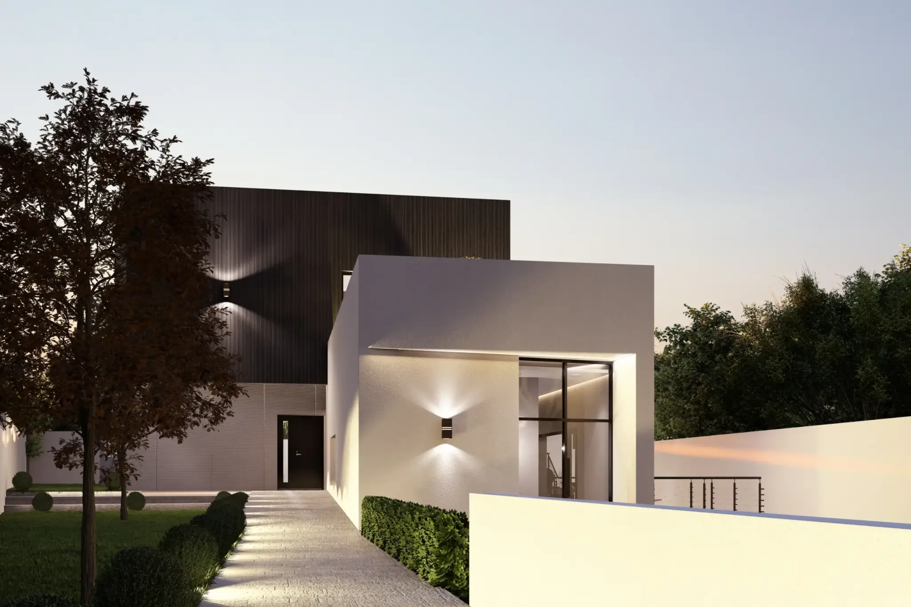
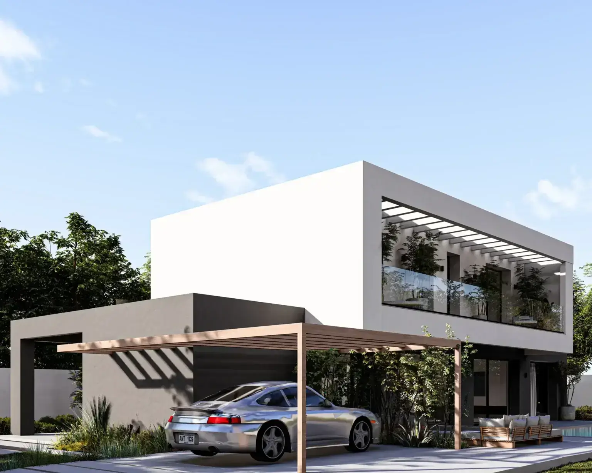

## Majadahonda: Un oasis de lujo, exclusividad y calidad de vida al alcance de tu mano.

¿Sueñas con una vida de lujo y confort en un entorno privilegiado? **[Los Satélites](https://www.idealista.com/pro/Bramanti-arquitectos/inmueble/104513457/)** lo hace realidad. Esta exclusiva propiedad en venta en **[Majadahonda](https://www.comunidad.madrid/centros/majadahonda)** te ofrece la oportunidad de disfrutar de un estilo de vida único, rodeado de naturaleza y con las mejores comodidades a tu alcance.

Pero, ¿por qué deberías venirte a vivir a estos chalets nuevos en Majadahonda y qué ofrece esta que no tengan otras zonas de Madrid? ¡Nosotros te lo contamos!

**Majadahonda** es la ciudad que estás buscando. Situada a solo 18 kilómetros de Madrid, Majadahonda se ha convertido en uno de los municipios más **exclusivos, codiciados y con mejor calidad de vida** de la Comunidad Autónoma y dónde puedes encontrar infinidad de terrenos y parcelas en venta en Majadahonda.

### Conoce nuestras promociones activas en Los Satélites de Majadahonda

[Contacta con nuestro equipo comercial ahora](/venta-proyecto-omega/)

Desde **Bramanti Arquitectos**, estudio de arquitectura y constructora, te ofrecemos una amplia selección de promociones inmobiliarias para que encuentres tu hogar perfecto.

- **Diseñamos y construimos viviendas** pensadas para la vida real, desde pisos modernos y funcionales en el centro de la ciudad hasta viviendas de obra nueva de ensueño con amplios jardines en zonas exclusivas y tranquilas.
- **Nos comprometemos con la calidad, la innovación y la satisfacción del cliente.**
- **Te ofrecemos una amplia gama de servicios** para acompañarte en todo el proceso de compra, desde la búsqueda de la vivienda ideal hasta la entrega de las llaves a través de nuestro [Servicio Personal Shopper.](/servicio-personal-shopper/)

*Bramanti Arquitectos (Urbanización Los Satélites)*

## ¿Qué hace que Majadahonda sea tan especial?

### **01\. Exclusividad y lujo**

Majadahonda es conocida por sus **urbanizaciones privadas de lujo**, como la urbanización Los Satélites, donde podrás disfrutar de chalets espaciosos, jardines privados, piscinas comunitarias y zonas verdes. Un entorno perfecto para aquellos que buscan **exclusividad, privacidad y confort en auténticos chalets de lujo, inmuebles con piscina, terrenos con vistas, etc. Como nuestras casas de obra nueva Los Satélites.**

### **02\. Excelentes comunicaciones**

Majadahonda está perfectamente comunicada con el resto de la ciudad de Madrid y con otras localidades de la Comunidad Autónoma. Cuenta con una amplia red de transportes que te permitirá desplazarte con facilidad a cualquier lugar. Disponiendo de:

Autobús: La red de autobuses de Majadahonda es **amplia y eficiente**, con líneas que conectan el municipio con Madrid y otras localidades cercanas. La **[EMT (Empresa Municipal de Transportes)](https://www.emtmadrid.es/Home)** opera varias líneas que te permiten llegar al centro de Madrid en menos de 40 minutos.

Tren de cercanías: Majadahonda cuenta con dos estaciones de tren de cercanías: [**Majadahonda**](https://www.renfe.com/es/es/cercanias/cercanias-madrid/rodajes/estacion-majadahonda) y El Boalo. Estas estaciones pertenecen a la línea C-5, que conecta el municipio con el centro de Madrid, Príncipe Pío y Móstoles, entre otras localidades.

Metro ligero: El metro ligero [**Línea ML3**](https://www.metromadrid.es/es/linea/ml3) conecta Majadahonda con Alcorcón, Móstoles y Boadilla del Monte. Esta línea es una opción rápida y cómoda para llegar a estos municipios vecinos.

Carretera: Majadahonda está perfectamente comunicada por carretera con Madrid y otras localidades de la Comunidad Autónoma.La M-50, la A-6 y la M-5 son algunas de las principales vías que atraviesan el municipio.

Bicicleta: Majadahonda cuenta con una amplia red de carriles bici que te permiten moverte por el municipio de forma sostenible y saludable. Además, el servicio de bicicletas públicas [**BiciMAD**](https://www.bicimad.com/) también está disponible en Majadahonda.

### **03\. Amplia oferta de servicios**

Majadahonda cuenta con todo tipo de servicios para cubrir las necesidades de sus habitantes.

- **Educación:** Majadahonda cuenta con algunos de los mejores colegios e institutos de la Comunidad Autónoma de Madrid. Tanto públicos como privados, ofrecen una educación de calidad en un entorno seguro y estimulante.
- **Sanidad:** El municipio dispone de una amplia red de centros de salud y hospitales, tanto públicos como privados, que garantizan una atención sanitaria de calidad a todos sus habitantes. **[El Hospital Universitario Puerta de Hierro](https://www.comunidad.madrid/hospital/puertadehierro/)**, uno de los centros hospitalarios más prestigiosos de España, se encuentra ubicado en Majadahonda.
- **Ocio y cultura:** Majadahonda ofrece una **[amplia oferta de ocio y cultura](https://cultura.majadahonda.org/)** para todos los gustos. Teatros, cines, museos, parques, zonas deportivas y una gran variedad de eventos culturales durante todo el año te esperan para que disfrutes de tu tiempo libre en familia o con amigos.
- **Comercios:** En Majadahonda encontrarás una gran variedad de comercios, desde pequeñas tiendas tradicionales hasta grandes centros comerciales. El **[Centro Comercial Gran Plaza 2](https://www.centrocomercialgranplaza2.com/)**, uno de los más grandes de la Comunidad Autónoma, se encuentra ubicado en el municipio.
- **Restaurantes:** Majadahonda cuenta con una amplia oferta gastronómica, con **[restaurantes](https://www.tripadvisor.es/Restaurants-g1063665-Majadahonda.html)** para todos los gustos y presupuestos. Desde restaurantes de alta cocina hasta bares de tapas y cafeterías, podrás disfrutar de una gran variedad de sabores en un ambiente agradable.
- **Servicios municipales:** El **[Ayuntamiento de Majadahonda](https://cultura.majadahonda.org/)** ofrece una amplia gama de servicios municipales a sus habitantes, como bibliotecas, ludotecas, centros deportivos, piscinas municipales y jardines públicos.
- **Otros servicios:** En Majadahonda encontrarás todo tipo de servicios que puedas necesitar en tu día a día, como bancos, farmacias, peluquerías, talleres mecánicos y supermercados.

### **04\. Seguridad como prioridad**

La seguridad es un aspecto fundamental en Majadahonda. La ciudad goza de una **baja tasa de criminalidad,** la eficiente vigilancia policial, las urbanizaciones privadas con seguridad propia, la conciencia ciudadana, el alumbrado público y las campañas de prevención son algunos de los factores que contribuyen a que Majadahonda sea un oasis de seguridad en la Comunidad de Madrid.  Si estás buscando un lugar para vivir donde puedas sentirte seguro y tranquilo, las parcelas nuevas de Majadahonda son la opción ideal para ti.

### **05\. Entorno natural privilegiado**

A pesar de su cercanía a Madrid, Majadahonda presume de un **entorno natural único**. Parques, zonas verdes y espacios abiertos te permitirán disfrutar del aire libre y relajarte en plena naturaleza ideal para niños y animales domésticos: **Encontrarás numerosas áreas de juego infantiles**, equipadas con columpios, toboganes, balancines y otros elementos para que los niños se diviertan de forma segura. También, para los amantes de los animales encontrarán en Majadahonda **zonas específicas para pasear a sus mascotas**. El Parque Canino de La Malvarrosa, el Parque Canino de El Tejar y el Parque Canino de Emmanuel Kant son algunos ejemplos.

### **06\. Estilo de vida familiar y tranquilo**

Majadahonda ofrece un **estilo de vida tranquilo y familiar**, ideal para aquellos que buscan un lugar donde vivir en paz y armonía. Un ambiente acogedor donde podrás hacer nuevas amistades y crear recuerdos inolvidables con tus seres queridos en nuestros chalets de obra nueva.

### **07\. Un lujo discreto y una exclusividad accesible**

Si bien Majadahonda es una zona de alto standing, **los precios de las viviendas son más accesibles que en otras zonas exclusivas de Madrid**. Esto la convierte en una opción ideal para aquellos que buscan **un lujo discreto y una exclusividad alcanzable**.

**Vivir en Majadahonda es un privilegio.** Es disfrutar de un **estilo de vida exclusivo, tranquilo y seguro** en un entorno natural privilegiado, con todas las comodidades y servicios a tu alcance. Viviendas de lujo en Majadahonda al alcance de tu mano gracias a Bramanti Arquitectos.

### **¿Quieres saber más?**

Si estás buscando una vivienda de lujo en Majadahonda, no dudes en **[contactarnos](/contacto/)**. Estaremos encantados de atenderte y mostrarte todos los detalles de nuestras casas de obra nuevas en [**Los Satélites**.](/los-satelites-madrid/) ¡No pierdas la oportunidad de vivir como mereces y no dejes pasa esta oportunidad de inmueble de obra nueva en venta en Majadahonda!

## ¡Contáctanos y descubre tu nuevo hogar en Majadahonda!

### Nuestra experiencia en el mercado inmobiliario nos ha permitido reunir una cartera diversa de propiedades para satisfacer las necesidades de cada cliente. Ya sea que estés buscando un hogar acogedor para tu familia o un espacio elegante para disfrutar de tu retiro, tenemos la vivienda perfecta para ti.
