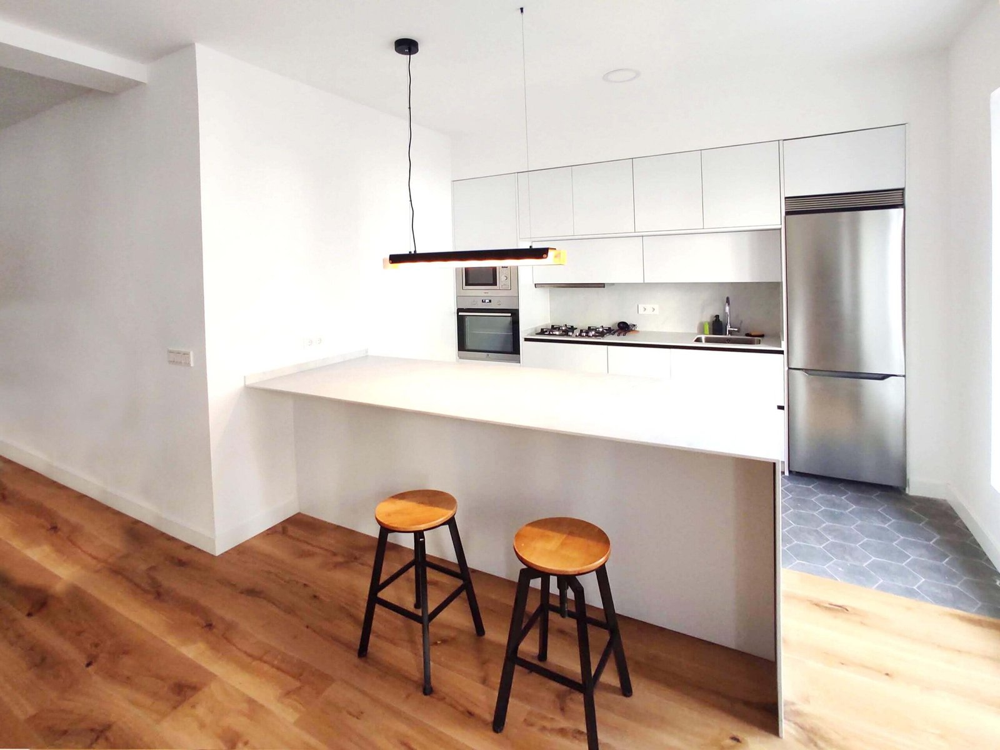
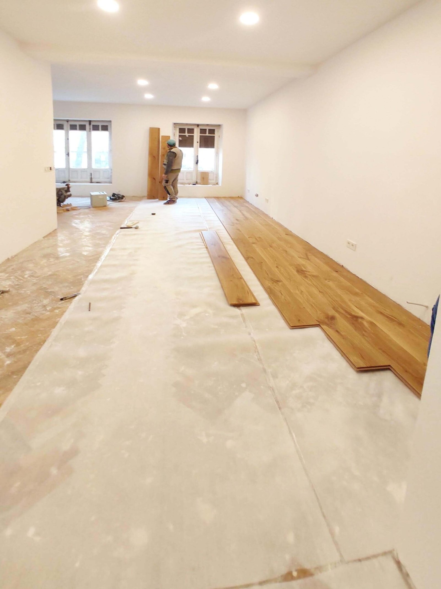
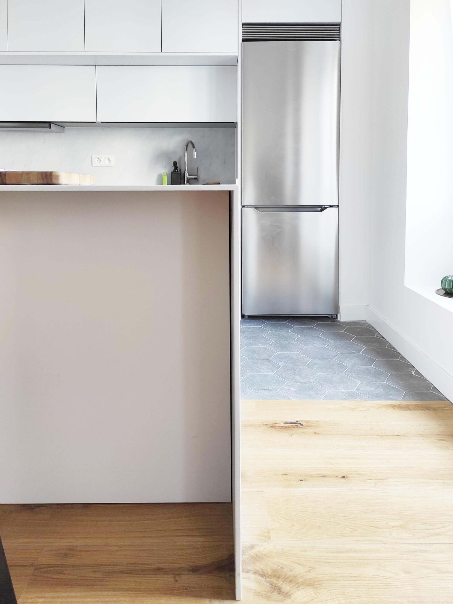

## Comparativa: Tarima de Madera Natural vs. Tarima Laminada - La Elección Crucial entre AC4 y AC5 para un Suelo Laminado Perfecto

En el fascinante mundo de la arquitectura, cada decisión relativa a los materiales marca una diferencia significativa. La elección entre una **tarima de madera natural** y una **tarima laminada** puede transformar por completo la estética y funcionalidad de un espacio. En **Bramanti Arquitectos**, comprendemos a la perfección la importancia de seleccionar los materiales más adecuados para cada proyecto. Es por ello que nos adentramos en las características y beneficios de estas dos opciones tan populares.

## Tarima de Madera Natural: Elegancia y Autenticidad

La **tarima de madera natural** destaca por su elegancia atemporal y autenticidad inigualable. Cada tabla cuenta con una narrativa única, presentando vetas y tonalidades que añaden **calidez** y **carácter** a cualquier entorno. Más allá de su atractivo estético, la madera natural se distingue por su durabilidad, capaz de resistir el paso del tiempo y adquirir una encantadora pátina con el uso siempre y cuando se aplique una conservación correcta.

En **Bramanti Arquitectos**, valoramos la conexión entre la naturaleza y el diseño. La tarima de madera natural se alinea perfectamente con nuestra filosofía de crear espacios que se integren armoniosamente en su entorno, aportando al mismo tiempo **un toque de lujo sutil**.

### Contacta con nosotros y empecemos a dar forma a tus ideas.

## Tarima Laminada: Versatilidad y Durabilidad

La **tarima laminada**, en cambio, presenta una alternativa **moderna y versátil**. Compuesta por capas de material prensado, esta opción es **mucho más resistente** a arañazos y al desgaste, convirtiéndola en una elección práctica para espacios de alto tráfico. Su variedad de diseños y acabados permite una personalización excepcional, adaptándose con facilidad a diferentes estilos arquitectónicos.

En proyectos donde la **durabilidad y la facilidad** de mantenimiento son prioritarias, **la tarima laminada es la elección adecuada**. En Bramanti Arquitectos, reconocemos la importancia de equilibrar la estética con la funcionalidad, y la tarima laminada ofrece una solución que combina ambas cualidades de manera efectiva.

## La Elección Correcta para Cada Proyecto

La decisión entre tarima de madera natural y tarima laminada dependerá de las **necesidades específicas de ca**da proyecto. En Bramanti Arquitectos, nos enorgullece colaborar estrechamente con nuestros clientes para comprender sus **objetivos** y visiones, seleccionando así **los materiales que mejor se alineen** con dichas metas.

Ya sea la calidez y autenticidad de la madera natural o la versatilidad y durabilidad de la tarima laminada, en **Bramanti Arquitectos** nos esforzamos por crear espacios que **no solo sean estéticamente impactantes**, sino también **perdurables** a lo largo del tiempo.

### ¡Descubre alguno de nuestros proyectos más destacados!

[Visitar](/proyectos/)

## Suelo Laminado AC5: La Innovación en Resistencia

En este contexto, es fundamental considerar las clasificaciones **AC4** y **AC5** al explorar la alternativa del suelo laminado. La tarima de madera natural destaca por su elegancia atemporal y autenticidad inigualable, pero el suelo laminado, especialmente el de categoría **AC5**, se presenta como una opción moderna con una resistencia excepcional al desgaste. Cada tabla no solo ofrece versatilidad y durabilidad, sino que también permite una personalización excepcional para adaptarse a diversos estilos arquitectónicos.

En proyectos donde la durabilidad y la facilidad de mantenimiento son prioritarias, la elección del **suelo laminado AC5** puede ser la respuesta adecuada. En Bramanti Arquitectos, reconocemos la importancia de equilibrar la estética con la funcionalidad, y el suelo laminado AC5 ofrece una solución que combina ambas cualidades de manera efectiva.

## Conclusión:

En conclusión, la elección entre **tarima de madera natural** y **tarima laminada**, especialmente al considerar las clasificaciones **AC4 y AC5**, es crucial para definir la estética y durabilidad de un espacio arquitectónico. Mientras la madera natural aporta **elegancia** atemporal y autenticidad, el suelo laminado AC5 destaca por su innovadora **resistencia** al desgaste y versatilidad. En **Bramanti Arquitectos**, reconocemos la importancia de esta decisión y nos comprometemos a colaborar estrechamente contigo para seleccionar los materiales que mejor se adapten a tus objetivos. Ya sea la calidez de la madera natural o la vanguardia del suelo laminado AC5, trabajamos para crear espacios que no solo sean visualmente impactantes, sino también funcionales y perdurables en el tiempo.

¿Listo para dar vida a tu proyecto arquitectónico en Madrid? ¡**Contáctanos hoy mismo** y juntos hagamos realidad tu idea!

[Nuestra web](/)
