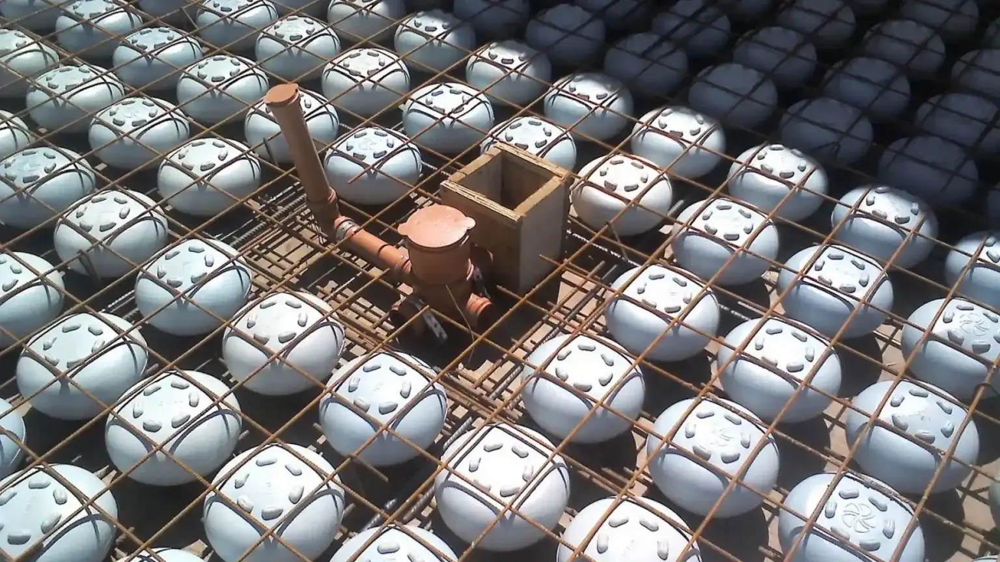
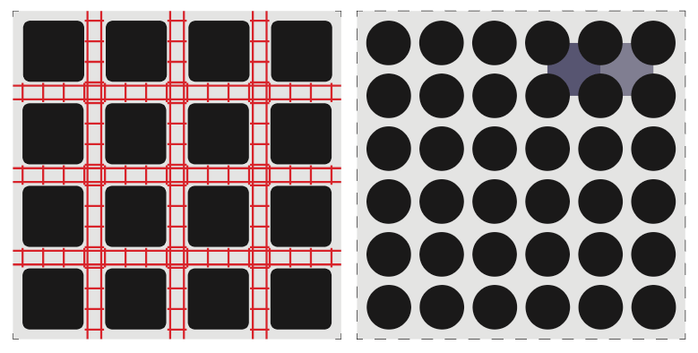
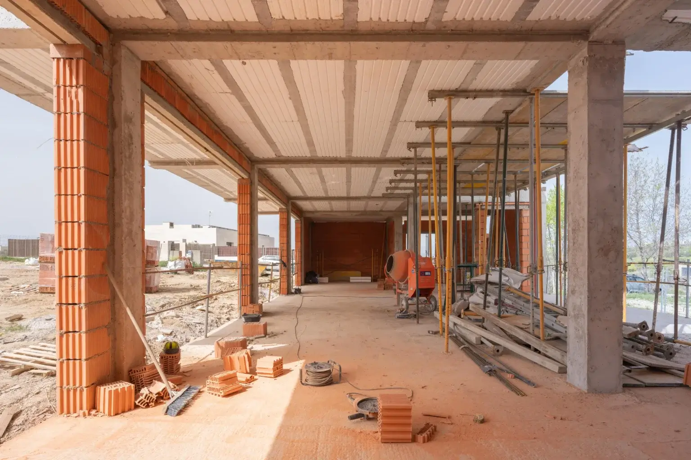

## ¿Qué es Cobiax?

**Cobiax** es una tecnología innovadora que **revoluciona** **la** **construcción** al reducir significativamente el peso de las losas de hormigón. ¿Cómo lo logra? Sustituyendo parte del hormigón por cápsulas plásticas recicladas, **sin comprometer la resistencia estructural**.

*Losas con discos inflados de Prenova Prenova Omicrono*

## ¿Cómo funciona?

El sistema **Cobiax** consiste en integrar estas cápsulas ligeras dentro de las losas de hormigón. Al reducir la cantidad de material tradicional, se obtiene una **estructura más ligera y eficiente**. Además, el uso de plástico reciclado promueve la **economía circular y reduce el impacto ambiental.**

## Beneficios Clave

1. **Menor peso estructural**: Permite diseños más esbeltos y reduce las cargas sobre columnas y cimentaciones.
2. **Optimización de recursos:** Disminuye el consumo de hormigón y acero, reduciendo costos y el impacto ambiental.
3. **Mayor flexibilidad:** Facilita la construcción de grandes luces y espacios abiertos, ampliando las posibilidades arquitectónicas.
4. **Sostenibilidad**: El uso de materiales reciclados y la reducción de la huella de carbono contribuyen a una construcción más ecológica.

*Representación gráfica de la tecnología Cobiax.*

## Aplicaciones

**Cobiax** ha demostrado su eficacia en una amplia gama de proyectos, desde edificios comerciales y residenciales hasta infraestructuras públicas. Su **versatilidad** lo convierte en una solución ideal para cualquier construcción que busque **optimizar recursos** y **reducir su impacto ambiental**. Además, su integración en proyectos de gran altura y estructuras con grandes luces permite diseños más innovadores y sostenibles. **La tecnología Cobiax: Innovación para una construcción más sostenible** se adapta a las necesidades de diferentes sectores, proporcionando eficiencia estructural y contribuyendo al cumplimiento de los objetivos de sostenibilidad en la industria de la construcción.

## Comparativa con sistemas tradicionales

Frente a los métodos convencionales, Cobiax destaca por:

1. **Mayor ligereza**: Reduciendo hasta un 35% el peso de las losas.
2. **Mayor eficiencia**: La instalación es más rápida y sencilla.
3. **Mayor sostenibilidad**: Promueve el uso de materiales reciclados y reduce la huella de carbono.

## Construye Tu Hogar Ideal con Bramanti Arquitectos

¿Tienes en mente un nuevo proyecto? En **Bramanti Arquitectos**, diseñamos y construimos espacios únicos y funcionales, adaptados a tus necesidades. Con nuestro equipo de arquitectos y constructores, nos encargamos de todo, desde la planificación hasta la entrega de llaves.

## Retos y oportunidades

Si bien **Cobiax** ofrece numerosos beneficios, su implementación puede presentar algunos desafíos, como la inversión inicial y la adaptación a normativas específicas. Sin embargo, las ventajas a largo plazo y las tendencias hacia la **sostenibilidad** hacen que esta **tecnología sea cada vez más atractiva.**

## El futuro de Cobiax

La **integración de Cobiax** con herramientas digitales como **BIM** y tecnologías de construcción avanzadas promete un futuro aún más prometedor. Esta **tecnología** no solo optimiza el diseño y la planificación, sino que también mejora la precisión en la ejecución, **reduciendo errores y costos**. Además, su capacidad de adaptarse a las demandas de la construcción moderna la posiciona como una solución clave para una construcción más sostenible y eficiente. **La tecnología Cobiax: Innovación para una construcción más sostenible** seguirá desempeñando un papel fundamental en proyectos que buscan reducir el impacto ambiental y maximizar la eficiencia estructural.

## Conclusiones

**Cobiax** es una tecnología disruptiva que está transformando la industria de la construcción. Al reducir el peso estructural, **optimizar recursos** y **promover la sostenibilidad**, Cobiax se posiciona como una solución clave para **el futuro de la arquitectura e ingeniería.**

## Preguntas Frecuentes

### ¿En qué tipo de proyectos es ideal Cobiax?

Es ideal para edificios de gran altura, proyectos comerciales e infraestructuras que buscan optimizar recursos y reducir peso estructural.

### ¿Cuánto peso se puede reducir con Cobiax?

Se puede reducir hasta un 35% del peso de las losas, dependiendo del diseño estructural.

### ¿Cobiax cumple con las normativas actuales?

Sí, pero es importante verificar la compatibilidad con las regulaciones locales. crea la frase objetivo, titulo seo, slug y meta description

## Contacta con nosotros

En **Bramanti Arquitectos**, diseñamos y construimos espacios únicos y funcionales, adaptados a tus necesidades. Con nuestro equipo de arquitectos y constructores, nos encargamos de todo, desde la planificación hasta la entrega de llaves.
