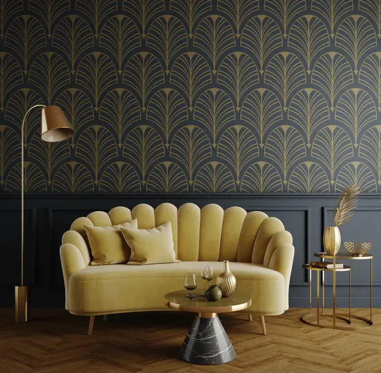
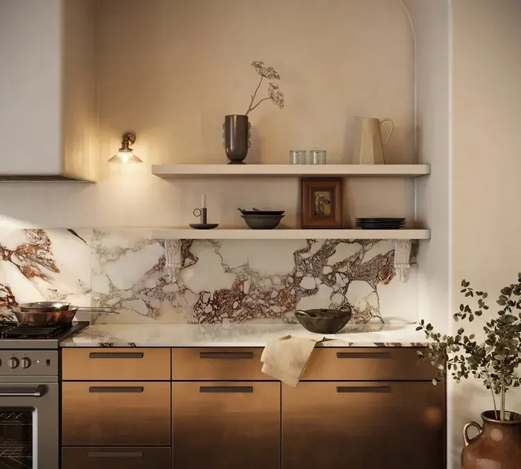
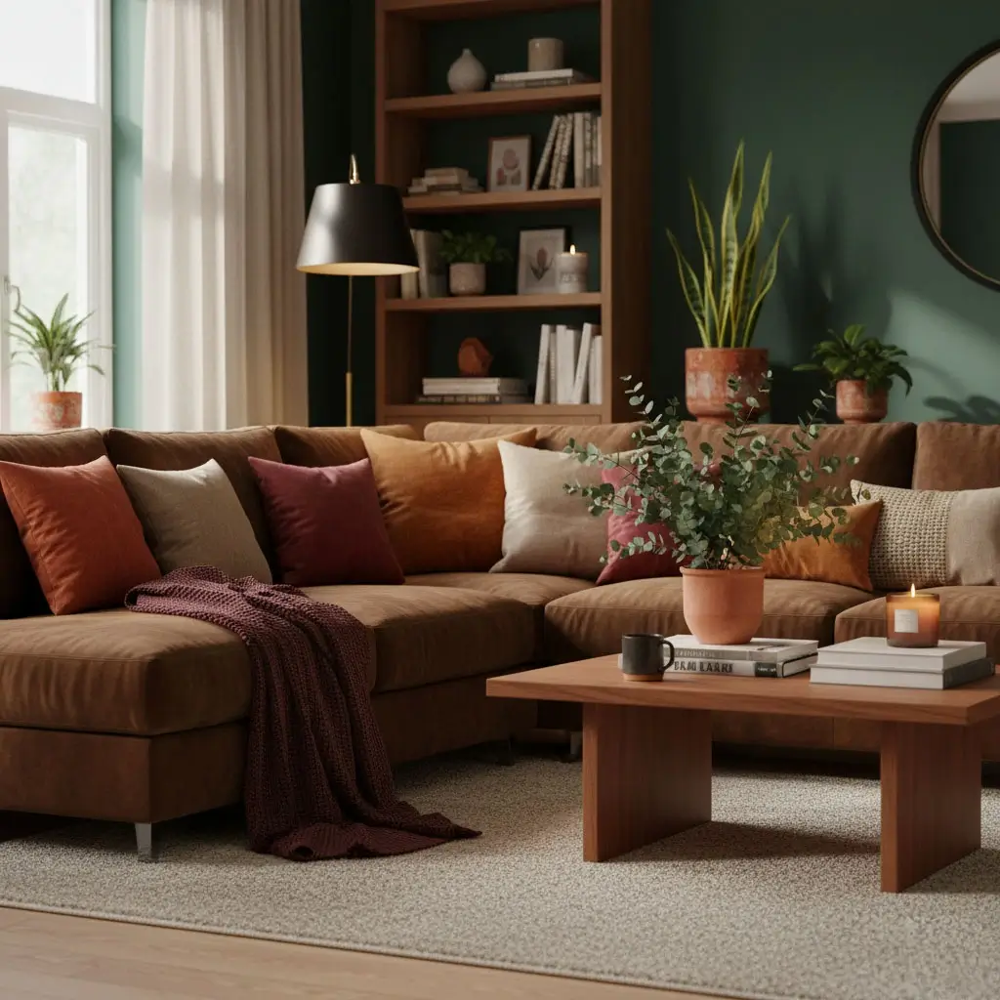

El otoño de 2025 llega cargado de **nuevas sensaciones, colores y materiales**. Tras un verano centrado en el aire libre, la vuelta a casa invita a crear interiores acogedores, sofisticados y cargados de personalidad. En [**Bramanti Arquitectos**](/estudio-arquitectura-madrid/) analizamos las tendencias internacionales y locales de cara al próximo otoño/invierno para ofrecer a nuestros clientes una **guía completa** para actualizar sus espacios sin renunciar a la elegancia y el confort.

## 1. Paletas de color: bases neutras y tonos profundos

### Colores tierra y joya

Los diseñadores coinciden en que la tendencia cromática más potente es la **vuelta a los tonos tierra y joya**. Paletas de marrón chocolate, terracota, verde bosque y burdeos crean [**ambientes acogedores y sofisticados**](https://www.elledecor.com/design-decorate/trends/a65831907/fall-design-trends-2025/). [**Elle Decor**](https://www.elledecor.com/design-decorate/trends/a65831907/fall-design-trends-2025/) apunta que estos tonos se equilibran con blancos cálidos y piedra para evitar la sensación de pesadez, mientras que [**Better Homes & Gardens**](https://www.bhg.com/) destaca que los **colores moody** como el chocolate, el burdeos y el verde oscuro sustituyen a los grises y **[aportan profundidad](https://www.bhg.com/2025-interior-design-trends-8751895#:~:text=In%202025%2C%20home%20design%20celebrates,to%20take%20off%20in%202025)**. En España, la [**revista *Vogue***](https://www.vogue.es/) confirma que los tonos tierra –arcilla, terracota, óxido– y los neutros cálidos –arena, beige y gris topo– serán la base cromática del otoño, combinándose con acentos intensos como naranja mandarina, azul petróleo y rojo burdeos.

Para dar dinamismo sin saturar, los diseñadores recomiendan utilizar colores intensos de forma estratégica –por ejemplo, en una pared destacada, una alfombra o un sofá– y mantener neutros en las superficies principales. La distribución del color varía según la estancia: las cocinas se tiñen de verde y azul, los salones de neutrales cálidos con toques vibrantes, los dormitorios de tonos suaves como el salvia o el azul grisáceo para favorecer el descanso, y los baños se atreven con verdes profundos, azules intensos o incluso negros. Si quieres profundizar en cómo aplicar estas gamas cromáticas estancia por estancia, consulta **nuestra guía sobre paletas de color por espacios.**

### Mustard, ciruela y metalizados fríos

Además del protagonismo del marrón y el burdeos, los expertos señalan que el **amarillo mostaza** será el [**nuevo color de acento**](https://www.thespruce.com/fall-design-trends-2025-11780189#:~:text=Nothing%20signals%20a%20change%20in,designer%20of%20Denine%20Jackson%20Interiors). En los acentos metálicos, se aprecia un giro de los bronces dorados hacia metales fríos como el níquel y el cromo. [***The Spruce***](https://www.thespruce.com/fall-design-trends-2025-11780189#:~:text=Silvery%20Metallic%20Accents) advierte que los acabados cromados y níquel aportan un toque moderno y nítido que contrasta con las texturas cálidas[thespruce.com](https://www.thespruce.com/fall-design-trends-2025-11780189#:~:text=Silvery%20Metallic%20Accents), tendencia que también recoge *Vogue* al afirmar que los metales plateados recuperan protagonismo en baños contemporáneos, después de varias temporadas dominadas por los dorados.

*Ninoon / Getty Images*

## 2. Materiales y texturas: la naturaleza como protagonista

### Maderas nobles y piedras expresivas

Se mantiene la preferencia por **materiales naturales**. Las interioristas españolas Eva González y Lucía Rodrigo subrayan que las maderas sostenibles o recuperadas, el lino, el yute, el ratán y la lana siguen siendo imprescindibles. La piedra se vuelve más expresiva: mármoles veteados como el [**Calacatta Viola**](https://www.xtone-surface.com/productos/porcelanico/calacatta-viola), verde con vetas marcadas o travertino se utilizan en islas de cocina, encimeras y accesorios escultóricos. La vuelta a la tradición implica apostar por maderas nobles oscuras (nogal, cerezo, castaño) con acabados en tonos chocolate y tabaco, e incluso maderas envejecidas con nudos y vetas marcadas que aportan una pátina de historia y carácter rústico.

### Tejidos suaves y mezcla de texturas

En textiles, el **terciopelo** desplaza al bouclé como tejido estrella, aunque este no desaparece por completo. También ganan presencia las mantas y cojines de **sherpa o borreguito**. Lucía Rodrigo destaca la superposición de textiles: combinar en una misma estancia lino lavado, cáñamo y lana con distintos estampados (rayas retro, cuadros, motivos botánicos) genera sinergias y aporta opulencia y confort sin saturar. Los diseños **maximalistas** con estampados botánicos, geométricos o bucólicos toman fuerza en el papel pintado, así como la técnica *color drenching*, que consiste en pintar paredes y techo con el mismo tono intenso para crear una atmósfera envolvente.

*Fuente: alvarez / Getty Images*

## 3. Mobiliario y formas: curvas, confort y piezas vintage

Las formas curvas y orgánicas que vimos en temporadas anteriores se consolidan. Sofás modulares de gran volumen, sillones envolventes y mesas con líneas suaves buscan el confort y crean [**un ambiente cálido**](https://www.nordicnest.es/inspiracion-consejos/tendencias-y-estilos/tendencias-de-interiores-otono-2024/#:~:text=2). **Curvas y soft shapes** también aparecen en cocinas y baños a través de islas curvas y lavabos redondeados. A su vez, regresan piezas retro de inspiración Art Déco y los muebles vintage reciclados o heredados para añadir autenticidad.

El **maximalismo controlado** será uno de los conceptos clave. La arquitecta Lucía Rodrigo lo define como un estilo de raíces anglosajonas que busca ambientes ricos en matices, texturas y colores, contando una historia en cada rincón mediante papeles pintados, textiles vibrantes y obras de arte. Esta tendencia convive con el **minimalismo depurado** de líneas simples y paletas neutras, que incorpora acentos pop –lámparas escultóricas, obras de arte coloridas o piezas retro– para aportar energía y personalidad. También se consolidan estilos como el **japandi cálido** (minimalismo con calidez y texturas naturales), el **rústico moderno** con maderas oscuras combinadas con líneas contemporáneas, el **maximalismo elegante** que cuenta historias a través de objetos y textiles sin caer en el exceso y el **wabi‑sabi** artesanal que valora la imperfección. El **cottagecore modernizado** aporta una estética más personal y rica inspirada en los cottages ingleses; utiliza madera, textiles ricos y papeles pintados combinados con colores saturados.

## Somos especialistas en Interiorismo

En **Bramanti Arquitectos**, diseñamos y construimos espacios únicos y funcionales, adaptados a tus necesidades. Con nuestro equipo de arquitectos y constructores, nos encargamos de todo, desde la planificación hasta la entrega de llaves.

## 4. Iluminación y objetos decorativos

La iluminación cobra protagonismo a través de **lámparas escultóricas**, apliques recargados y candelabros de carácter artístico. La tendencia de las **baterías recargables** continúa, con lámparas portátiles que permiten crear escenarios luminosos más flexibles. En decoración, los accesorios adquieren carácter de piezas de arte: jarrones artesanales en vidrio o cerámica, candelabros de acero inoxidable y objetos vintage o de segunda mano que aportan personalidad y un punto *trendy*. Eva González señala que los estampados botanicos, tartanes y rayas retro resurgen en cojines, cortinas dobles y alfombras superpuestas, creando espacios cálidos y envolventes.

## 5. Paredes y techos: protagonistas inesperados

Las paredes dejan de ser un fondo neutro para convertirse en protagonistas mediante **papeles pintados maximalistas** con motivos botánicos, geométricos o bucólicos y murales panorámicos. También vuelven los techos decorados con papel o pintura de alto brillo, una tendencia que ayuda a reflejar la luz y a atraer la mirada hacia arriba. La técnica *color drenching* y los **murales artísticos** permiten crear espacios inmersivos y dramáticos, tendencia confirmada por diseñadores internacionales.

## 6. Consejos para aplicar las tendencias en proyectos de alta gama

1. **Equilibrar color y neutralidad**: Utiliza tonos neutros cálidos como base y añade colores intensos en elementos puntuales (sillones, alfombras, obras de arte). En espacios sociales, atrévete con verdes o azules; en dormitorios, opta por tonos relajantes como el salvia para favorecer el descanso.
2. **Materiales nobles y sostenibles**: Prioriza maderas recuperadas y piedras naturales con vetas expresivas. Complementa con metalizados fríos (cromo, níquel) en griferías o luminarias para un toque contemporáneo.
3. **Juega con las texturas**: Combina textiles suaves (terciopelo, lana, lino lavado) con superficies rugosas (madera envejecida, piedra) para generar riqueza táctil. Superponer mantas y cojines de distintos tamaños agrega profundidad sin saturar.
4. **Incorpora piezas vintage**: Añade al menos una reliquia con historia (aparador de nogal, silla curvada, lámpara Art Déco). Estos elementos aportan autenticidad y se integran perfectamente en ambientes contemporáneo.
5. **Diseña una iluminación estratificada**: Mezcla luz ambiental, de tarea y decorativa mediante lámparas de pie, apliques y tiras LED regulables para crear ambientes acogedores.
6. **Cuida el detalle en paredes y techos**: Atrévete con papel pintado maximalista o murales personalizados para destacar una zona. En techos, utiliza molduras, colores oscuros o acabados de alto brillo para un efecto sorprendente.

## La opinión de Bramanti Arquitectos

El otoño de 2025 supone un retorno a lo **sensorial y personal**: colores profundos, materiales honestos y una mezcla armónica de estilos. El lujo silencioso convive con el maximalismo controlado, la sostenibilidad con la artesanía. Aplicar estas tendencias permite crear espacios **únicos y emotivos** que reflejan la personalidad de quienes los habitan.

## Somos especialistas en Interiorismo

En **Bramanti Arquitectos**, diseñamos y construimos espacios únicos y funcionales, adaptados a tus necesidades. Con nuestro equipo de arquitectos y constructores, nos encargamos de todo, desde la planificación hasta la entrega de llaves.
