La iluminación en el hogar no es solo una cuestión funcional; también es un elemento clave para definir el carácter y la atmósfera de cada espacio. Desde lámparas minimalistas hasta diseños que combinan el lujo y la tecnología, elegir la lámpara adecuada puede transformar cualquier habitación. Hoy te compartimos nuestro top 5 de lámparas de mesa modernas para iluminar tu hogar que destacan no solo por su diseño moderno, sino también por su capacidad de aportar calidez, estilo y sofisticación.

Descubre cómo estas piezas pueden complementar tu decoración y dale a tu hogar un toque único con ideas que van desde estilos retro hasta propuestas escandinavas. En **[Bramanti Arquitectos](/contacto/)** siempre buscamos diseños que se adapten a las necesidades de cada cliente, y aquí encontrarás opciones que no solo iluminan, sino que cuentan historias a través de sus formas y materiales.

## 1. Lámpara de mesa vintage Levels (LedsC4)

La lámpara **[Levels](https://www.gascon.es/products/ledsc4-sobremesa-levels-1-body-o420mm-led-14-7-sw-2700-3000-4000k-3-steps-dimming-negr-10-a004-05-15)**, de [**LedsC4**](https://ledsc4.com/es) ([**Gascón**](https://www.gascon.es/)) es una oda al estilo vintage con un toque contemporáneo que la hace irresistible. Su pantalla de vidrio en tonos ámbar suaviza la luz, creando una atmósfera relajante y sofisticada. Su diseño se convierte en una pieza central que añade carácter a cualquier espacio, especialmente aquellos con decoraciones cálidas y acogedoras.

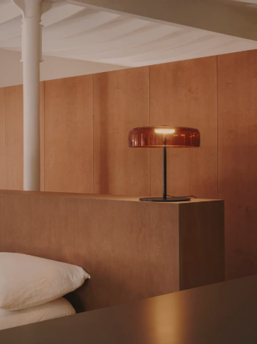

*Lámpara LEVELS de LEDSC4 (GASCÓN)*

### Consejo de combinación

Ubica esta lámpara en una mesa auxiliar de madera o en un escritorio con acabados rústicos. Combínala con elementos decorativos en tonos tierra como macetas de cerámica o libros de tapa dura. Será el toque perfecto para complementar un salón o estudio con un aire bohemio.

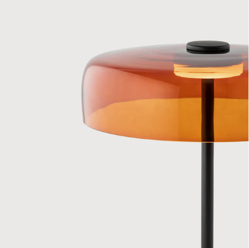

*Lámpara LEVELS de LEDSC4 (GASCÓN)*

## 2. Lámpara de mesa Design en Metal Plateado (TACIA)

La lámpara [**TACIA**](https://www.thecoolrepublic.com/es-es/iluminacion/lamparas/lampara-de-mesa-design-en-metal-plateado-taccia-flos?utm_source=pinterest) de [**The Cool Republic**](https://www.thecoolrepublic.com/es-es) destaca por su diseño vanguardista y su estructura de metal plateado, que refleja elegancia y modernidad. Con su difusor de luz inclinado, es ideal para iluminar espacios minimalistas y sofisticados. Este modelo se convierte en un accesorio que no solo aporta funcionalidad, sino que eleva el diseño de cualquier habitación.

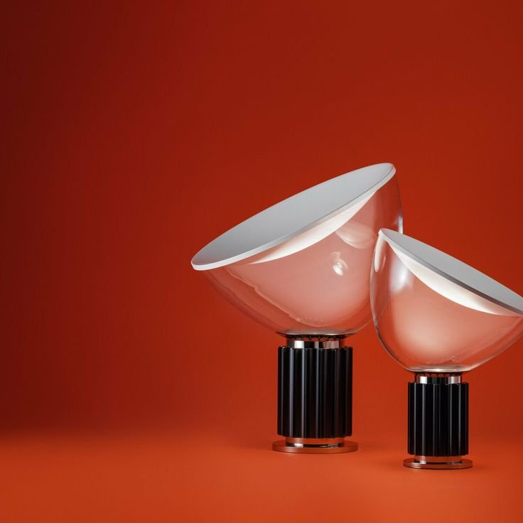

*Lámpara TACIA de THE COOL REPUBLIC*

### Consejo de combinación

Colócala en un salón con mobiliario de líneas rectas y colores neutros. Los acabados metálicos y las superficies de vidrio, como mesas o estanterías, potencian su diseño. Añadir un cuadro abstracto o piezas de arte contemporáneo ayudará a crear un ambiente moderno y equilibrado.

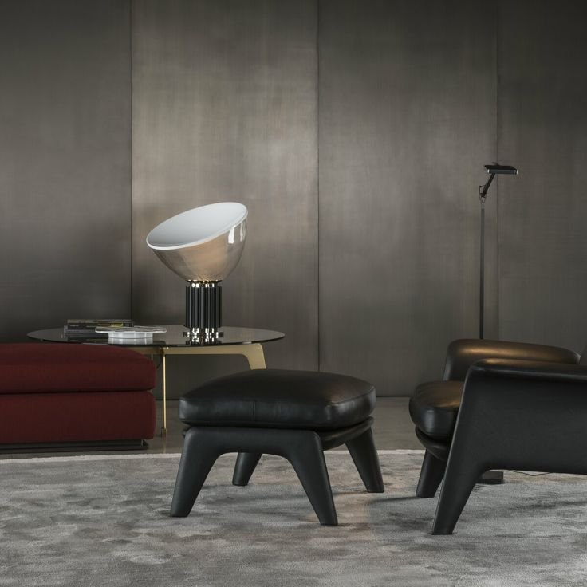

*Lámpara TACIA de THE COOL REPUBLIC*

## 3. Lámpara regulable de mármol Snoopy (FLOS)

La lámpara [**Snoopy**](https://www.westwing.es/lampara-de-mesa-regulable-de-marmol-snoopy-155300.html), de [**Flos**](https://flos.com/es/es/?utm_source=google&utm_medium=cpc&utm_campaign=STO_[SEA_BRA_ACQ_ES]_a-01_EXA_Exact&utm_term=STO_[SEA_BRA_ACQ_ES]_a-01_EXA_Exact&gad_source=1&gclid=Cj0KCQiAs5i8BhDmARIsAGE4xHxhkumzTDBOv3Jd54gGjG5ATUgWD9gT1jWO0c8ZH1PO_EAGbI84tL4aAkD-EALw_wcB) (**[Westwing](https://www.westwing.es/)**), combina la belleza del mármol con la elegancia del vidrio soplado, evocando el diseño clásico italiano. Su forma orgánica y sofisticada la convierte en un punto focal en cualquier espacio, destacando por su originalidad y funcionalidad. Es una opción ideal para quienes buscan una pieza única que irradie exclusividad.

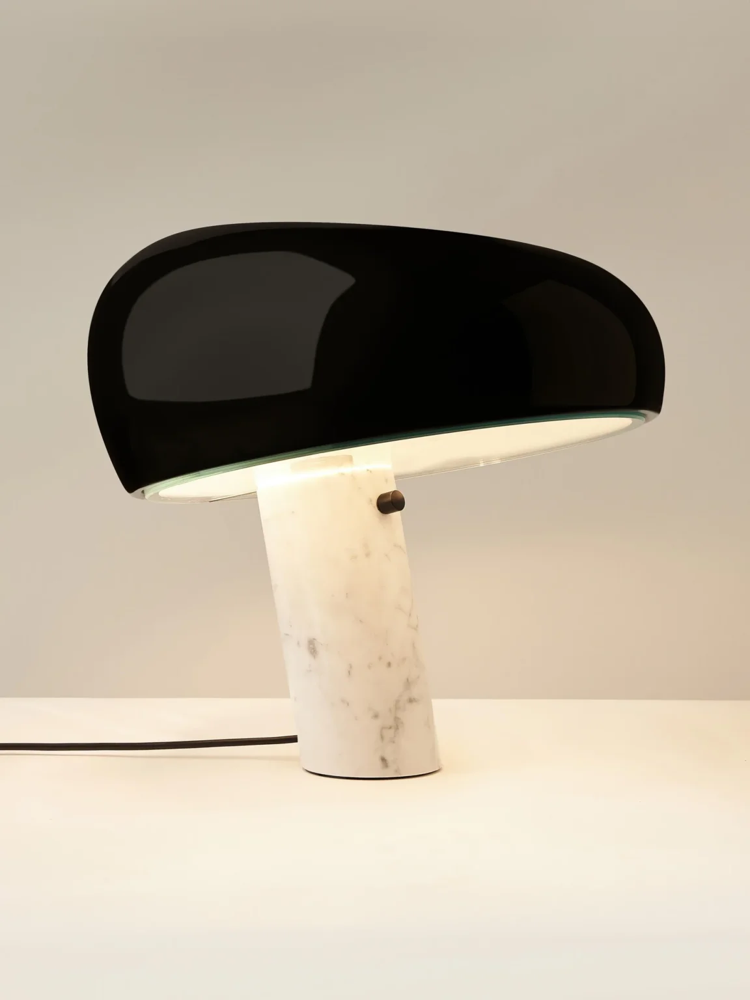

*Lámpara SNOOPY de FLOS (WESTWING)*

### Consejo de combinación

Úsala en una sala con paredes en tonos oscuros como azul marino o verde olivo, y complétala con sofás de terciopelo y cojines en tonos neutros. Este contraste resaltará la elegancia del mármol y creará una atmósfera sofisticada y acogedora.

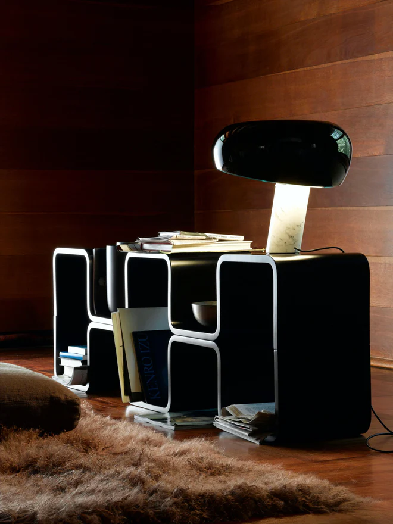

*Lámpara SNOOPY de FLOS (WESTWING)*

#### ¿Te gustaría transformar tus espacios con una iluminación pensada al detalle?

En **Bramanti Arquitectos** podemos ayudarte a diseñar interiores que combinen **funcionalidad** y **diseño**. Visita nuestra página y descubre cómo podemos llevar tus ideas a otro nivel.

## 4.Lámpara Fontanella (FontanaArte)

Inspirada en el minimalismo escandinavo,  en la popular tienda [**Westwing**](https://www.westwing.es/)  puedes encontrar la lámpara [**Fontanella**](https://www.westwing.es/lampara-de-mesa-artesanal-fontanella-154265.html) de **[FontanaArte](https://www.fontanaarte.com/)**, una verdadera joya del diseño contemporáneo. Su base de metal negro contrasta elegantemente con la delicadeza de su pantalla de vidrio, creando un equilibrio visual perfecto. Es ideal para quienes buscan añadir un toque de sencillez y modernidad a sus espacios.

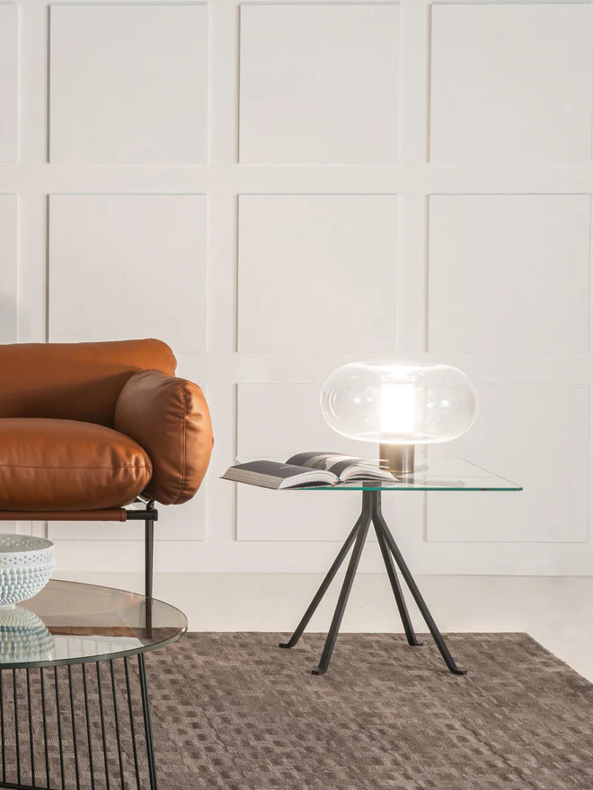

*Lámpara FONTANELLA de FONTANA ARTE (WESTWING)*

### Consejo de combinación

Colócala sobre una mesa de vidrio o mármol en una sala con muebles en tonos cálidos como marrón o terracota. Acompáñala de elementos decorativos ligeros, como plantas de hojas verdes o revistas de diseño, para potenciar su estética minimalista y crear un rincón visualmente equilibrado.

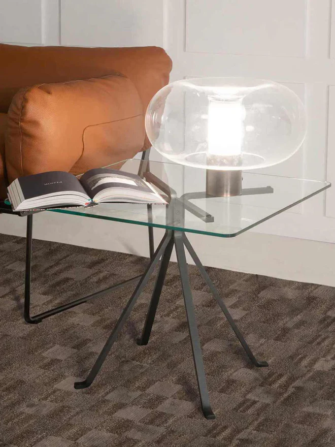

*Lámpara FONTANELLA de FONTANA ARTE (WESTWING)*

## 5.Lámpara de Latón T (Frama)

La [**lámpara de latón T**](https://www.thecoolrepublic.com/es-es/iluminacion/lamparas-de-escritorio/lampara-de-mesa-en-laton-t-frama), de [**Frama**](https://framacph.com/?gad_source=1&gclid=Cj0KCQiAs5i8BhDmARIsAGE4xHy5vkzjG46wfzlDSZRJtRJ_IkebRMzZyhrqN7j5vFgjrRCyV3RTFRMaAsbzEALw_wcB) ([**The Cool Republic**](https://www.thecoolrepublic.com/es-es)), es un tributo a la estética industrial. Con su diseño minimalista y líneas geométricas, esta pieza se destaca por ser funcional y atemporal. Fabricada en acabados metálicos, es ideal para añadir un toque de sofisticación a espacios modernos y elegantes.

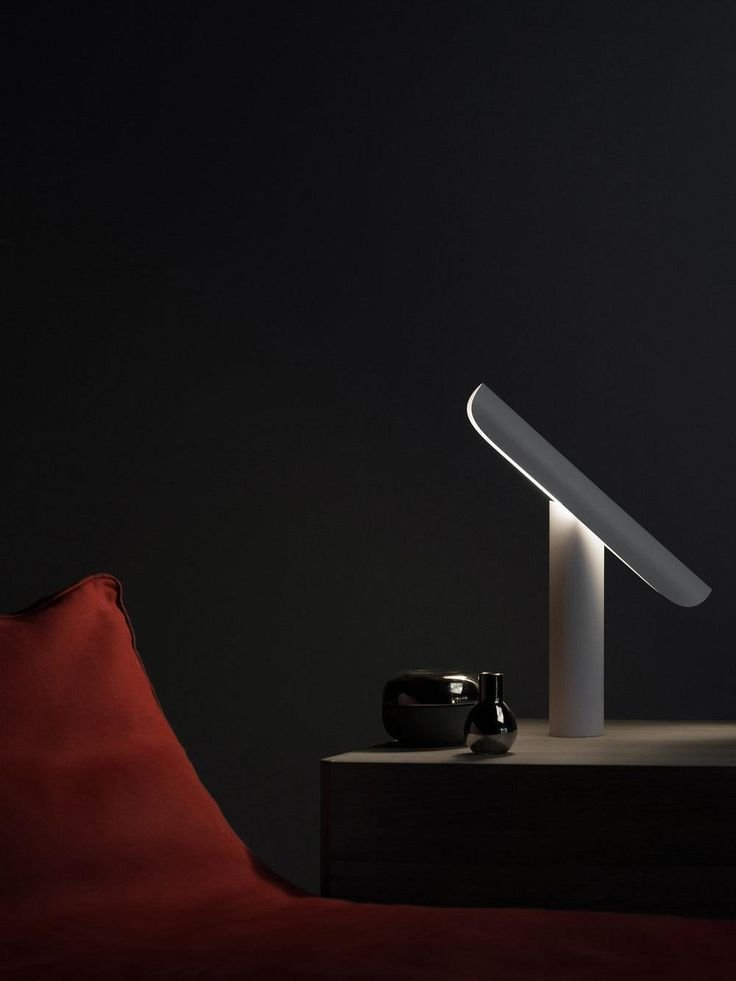

*Lámpara LATÓN T de FRAMA (THE COOL REPUBLIC)*

### Consejo de combinación

Úsala en un espacio de trabajo o lectura, colocándola sobre un escritorio de madera oscura o una estantería metálica. Completa el diseño con objetos decorativos en tonos cobre o dorado, y añade una lámpara de pie en un estilo similar para lograr una iluminación más completa y uniforme.

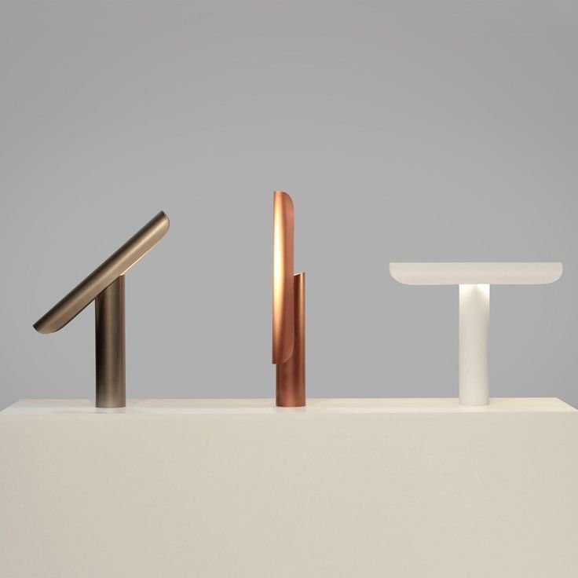

*Lámpara LATÓN T de FRAMA (THE COOL REPUBLIC)*

## Tendencias en Iluminación para 2025

La iluminación no solo se trata de funcionalidad; es una forma de expresar estilo y adaptarse a las innovaciones que definen cada época. En 2025, las tendencias en iluminación destacan por la combinación de tecnología, sostenibilidad y diseño atemporal. Aquí te compartimos algunas de las principales tendencias que marcarán el rumbo en la decoración de interiores:

1. **Sostenibilidad y eficiencia energética**

La iluminación LED sigue siendo protagonista, pero con un enfoque aún más innovador. Este 2025, las lámparas no solo consumirán menos energía, sino que también estarán fabricadas con materiales reciclados y sostenibles. Además, las lámparas que permiten ajustar la intensidad de la luz (dimmers) se convierten en esenciales para ahorrar energía y crear ambientes personalizados.

1. **Diseños escultóricos y orgánicos**

Las lámparas con formas orgánicas, fluidas y escultóricas estarán en tendencia. Estas piezas se convierten en arte funcional, capturando la atención como un elemento central en cualquier espacio. Modelos como la [**Snoopy de Flos**](https://www.westwing.es/lampara-de-mesa-regulable-de-marmol-snoopy-155300.html), con su combinación de mármol y vidrio, son un gran ejemplo de cómo el diseño puede transformar una lámpara en una obra maestra.

1. **Iluminación modular**

En 2025, la flexibilidad será clave. Los sistemas modulares de iluminación permiten a los usuarios ajustar y personalizar las lámparas según sus necesidades. Este tipo de diseño es ideal para hogares modernos que priorizan la adaptabilidad y la funcionalidad.

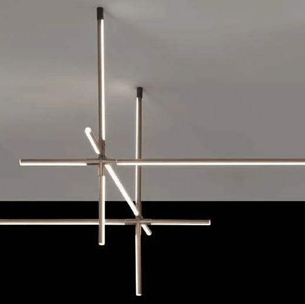

*Sistema de iluminación modular de CATTANEO (ITALIA)*

4.**Tecnología inteligente**

Las lámparas inteligentes, conectadas a dispositivos como smartphones o asistentes de voz, serán indispensables. Controlar el color, la intensidad y los horarios de iluminación será más fácil que nunca, ayudando a crear espacios que se adapten al estado de ánimo y la rutina diaria.

1. **Estética retro-futurista**

El estilo vintage sigue siendo un favorito, pero en 2025 se mezcla con elementos futuristas como metales reflectantes, acabados en latón y tonalidades metálicas. Modelos como **la [lámpara Levels de LedsC4](https://www.gascon.es/products/ledsc4-sobremesa-levels-1-body-o420mm-led-14-7-sw-2700-3000-4000k-3-steps-dimming-negr-10-a004-05-15)**, con su diseño retro contemporáneo, capturan perfectamente esta tendencia.

1. **Luz cálida y tonos neutros**

En contraste con la luz blanca fría de años anteriores, la luz cálida y los tonos ámbar son los preferidos, ya que generan una atmósfera más acogedora. Este tipo de iluminación es ideal para hogares que buscan un ambiente relajante y elegante.

## Ten en cuenta...

La elección de una lámpara no solo tiene un impacto en la funcionalidad de un espacio, sino también en la manera en que percibimos y vivimos nuestro hogar. Ya sea que prefieras un estilo vintage, minimalista o de lujo, las lámparas de mesa que te hemos presentado son mucho más que fuentes de luz; son piezas de diseño que cuentan historias y transforman el ambiente.

En [**Bramanti Arquitectos**](/contacto/), creemos que la iluminación es un pilar esencial en el diseño de interiores. Si estás buscando asesoramiento personalizado para integrar estas u otras lámparas en tu proyecto, no dudes en contactarnos. Nuestro equipo está aquí para ayudarte a crear espacios que reflejen tu estilo y personalidad.

### Contacta con nosotros

En **Bramanti Arquitectos**, diseñamos y construimos espacios únicos y funcionales, adaptados a tus necesidades. Con nuestro equipo de arquitectos y constructores, nos encargamos de todo, desde la planificación hasta la entrega de llaves.

[Visita nuestra web](/)
