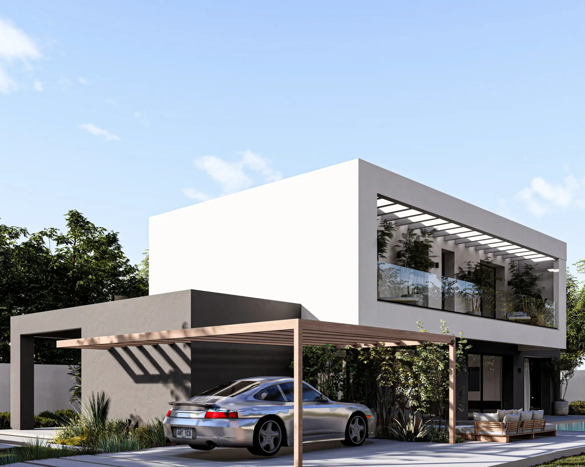
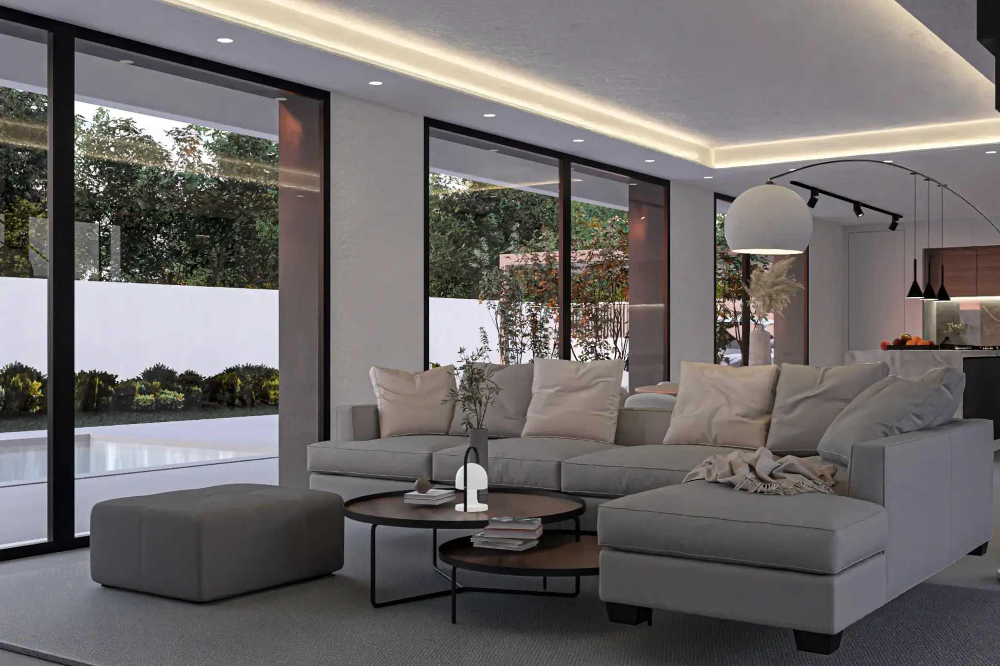

Vivir en el centro de **[Madrid](https://www.timeout.es/madrid/es/noticias/madrid-elegida-quinta-mejor-ciudad-del-mundo-en-2024-012324)** tiene su encanto: la vibrante vida cultural, la amplia oferta de ocio y gastronomía, y la conveniencia de tener todo al alcance de la mano. Sin embargo, la realidad para muchos residentes es una vida marcada por el ruido constante, el tráfico interminable y la falta de espacios verdes. Este estilo de vida, aunque emocionante, puede resultar agobiante y estresante a largo plazo.

El ritmo acelerado del centro de Madrid puede dejar a los residentes deseando un respiro. La congestión diaria, la búsqueda interminable de estacionamiento y la necesidad de escapar del bullicio urbano son solo algunos de los desafíos que enfrentan aquellos que viven en el corazón de la ciudad. La falta de tranquilidad y la limitada privacidad hacen que muchos busquen alternativas que ofrezcan un equilibrio mejor entre vida personal y profesional.

## Urbanización Los Satélites, Majadahonda: Un Refugio en Crecimiento

En contraste con la agitada vida urbana, la **urbanización Los Satélites en Majadahonda** se presenta como una alternativa perfecta para quienes buscan paz y comodidad sin alejarse demasiado de la capital. Esta zona está ganando rápidamente popularidad y se está posicionando como un futuro centro neurálgico residencial y comercial.

## Calidad de Vida y Tranquilidad

**Los Satélites** ofrece un entorno tranquilo, rodeado de naturaleza, donde las familias pueden disfrutar de un estilo de vida más relajado y saludable. Los amplios espacios verdes, los parques y las zonas recreativas proporcionan un oasis de calma, ideal para desconectar del estrés urbano.

## Conectividad y Accesibilidad

A pesar de su serenidad, Los Satélites no sacrifica la conectividad. Con acceso rápido a la **A-6 y excelentes conexiones de transporte público**, los residentes pueden llegar al centro de Madrid en poco tiempo. Esta accesibilidad hace que Los Satélites sea una opción atractiva para aquellos que trabajan en la ciudad pero prefieren vivir en un entorno más tranquilo.

## Crecimiento y Desarrollo

La urbanización de Los Satélites está experimentando un notable desarrollo. Con **nuevos proyectos residenciales** y **comerciales** en marcha, la zona se está transformando en un polo de atracción para familias y profesionales. La inversión en infraestructura y servicios está posicionando a Los Satélites como una de las áreas más prometedoras de Majadahonda.

Los Satélites cuenta con una amplia oferta de propiedades en venta, desde viviendas de lujo hasta inmuebles de obra nueva. Si estás buscando una **[casa en venta en Los Satélites](/ventapromocionlossatelites/)** o una [**vivienda de lujo en Majadahonda**](/ventapromocionlossatelites/), este es el momento perfecto para explorar las oportunidades que ofrece esta urbanización en crecimiento.

## Innovación y Modernidad

Los proyectos en Los Satélites se caracterizan por su diseño innovador y moderno, combinando **sostenibilidad** y **funcionalidad**. La urbanización está preparada para convertirse en un referente de calidad de vida, con viviendas que ofrecen todas las comodidades modernas y un entorno seguro y acogedor.

### Contacta con nosotros

Te ofreceremos asesoramiento personalizado para que encuentres el hogar de tus sueños en Madrid.

## Comunidad y Seguridad

La **sensación de comunidad** es fuerte en Los Satélites, con vecinos que valoran la tranquilidad y el bienestar colectivo. La seguridad es una prioridad, con sistemas de vigilancia avanzados y un ambiente seguro para que las **familias** **disfruten** de una **vida sin** preocupaciones.

## Un Futuro Brillante

Los Satélites está emergiendo como un **centro neurálgico** que ofrece lo mejor de ambos mundos: la **proximidad a Madrid** y la **serenidad de un entorno residencial privilegiado**. Con su continuo desarrollo y su enfoque en la calidad de vida, esta urbanización está destinada a convertirse en una de las áreas más deseadas para vivir en la Comunidad de Madrid.

Para aquellos que buscan **escapar del agobio del centro de Madrid**, Los Satélites en Majadahonda representa una oportunidad inmejorable para disfrutar de una vida más equilibrada y satisfactoria. Este es el momento perfecto para considerar un futuro en esta próspera urbanización, donde la **comodidad** y la **tranquilidad** son la norma, y el crecimiento y la innovación están a la vuelta de la esquina.

## Descubre tu Nuevo Hogar

Si estás interesado en una **[propiedad en venta en Majadahonda](/ventapromocionlossatelites/)** o específicamente en un chalet en venta en Los Satélites, las opciones son variadas y adaptables a todas las necesidades. Desde casas de lujo con piscina hasta inmuebles con jardín y vistas impresionantes, Los Satélites ofrece una amplia gama de propiedades diseñadas para satisfacer los gustos más exigentes.

No pierdas la oportunidad de invertir en una **[vivienda de obra nueva](/promociones-activas/)** en Majadahonda, donde cada detalle ha sido cuidadosamente planificado para ofrecer la máxima comodidad y calidad de vida. Los Satélites no solo es una urbanización en crecimiento, sino una comunidad en la que podrás construir tu futuro con tranquilidad y estilo.

## ¡Contáctanos y descubre tu nuevo hogar en Madrid!

### Nuestra experiencia en el mercado inmobiliario nos ha permitido reunir una cartera diversa de propiedades para satisfacer las necesidades de cada cliente. Ya sea que estés buscando un hogar acogedor para tu familia o un espacio elegante para disfrutar de tu retiro, tenemos la vivienda perfecta para ti.
