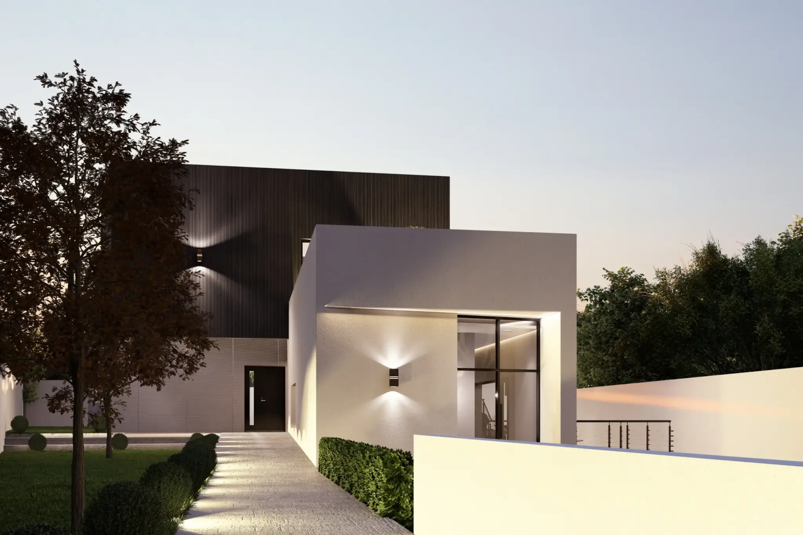

Comprar una vivienda sobre plano es una opción cada vez más popular entre quienes buscan adquirir una propiedad. Este tipo de compra, que implica adquirir un inmueble que aún no ha sido construido, ofrece numerosas ventajas que pueden marcar la diferencia en términos económicos, de personalización y de eficiencia energética. En este artículo, te explicamos por qué comprar sobre plano es una decisión inteligente, especialmente si estás buscando una vivienda moderna y adaptada a tus necesidades.

## 1. Ahorro Económico: Paga Menos por Más

Una de las principales ventajas de comprar una vivienda sobre plano es el ahorro económico que supone. Normalmente, el precio de estas propiedades es entre un **10% y un 20% más bajo** en comparación con una vivienda ya construida. Este descuento se debe a que, al adquirir sobre plano, estás invirtiendo en un proyecto en fase inicial, lo que te permite beneficiarte de precios más competitivos.

Otra ventaja económica es la **flexibilidad en los pagos**. Generalmente, al comprar sobre plano solo necesitas abonar una entrada, y el resto de los pagos se van realizando de manera gradual, conforme avanzan las certificaciones de obra. Esto te permite planificar tus finanzas de una manera más eficiente, en lugar de asumir un pago único o una hipoteca completa desde el principio.

## 2. Personalización: Tu Casa a Tu Medida

Comprar sobre plano también te brinda la oportunidad de **personalizar tu futura vivienda**. Dado que el inmueble aún no ha sido construido, puedes tomar decisiones clave sobre los materiales, acabados y distribución de espacios, asegurando que la casa se ajuste perfectamente a tus gustos y necesidades.

Este nivel de personalización es mucho más limitado cuando compras una vivienda ya terminada, donde los cambios implicarían obras adicionales que pueden ser costosas y complicadas. En cambio, al adquirir sobre plano, puedes ser parte activa del proceso de diseño y adaptar tu casa desde el principio.

## Proyecto en venta

Uno de nuestros **proyectos más exclusivos** ubicado en la **urbanización Los Satélites, Majadahonda, Madrid**. Promoción sobre plano. No dudes en solicitar más información acerca de nuestra **última promoción disponible**.

[Me interesa](/landing-proyecto-omega/)

## 3. Aprovecha la Eficiencia Energética de las Nuevas Construcciones

Las viviendas de nueva construcción suelen ser más eficientes energéticamente, gracias a la utilización de **tecnologías y materiales modernos** que favorecen el ahorro de energía. Esto no solo contribuye a la sostenibilidad del medio ambiente, sino que también reduce significativamente los costes de consumo energético a largo plazo.

En este sentido, las construcciones sobre plano te permiten asegurarte de que tu futura vivienda cumpla con los estándares más elevados en **eficiencia energética**, como los que se aplican en las casas **Passivhaus**. Este tipo de construcción, que prioriza el aislamiento y la reducción de la demanda energética, garantiza un confort térmico y acústico superior. Además, si compras una vivienda ya lista, es mucho más difícil implementar modificaciones que mejoren su rendimiento energético.

## 4. Mayor Valor de Reventa

Al comprar sobre plano, te aseguras un **precio de adquisición inferior** al que probablemente tendría la vivienda una vez finalizada la obra. Esto significa que si decides venderla en el futuro, podrías obtener una plusvalía significativa, ya que el valor de mercado de una vivienda terminada suele ser más alto.

Además, las viviendas de nueva construcción tienden a mantener su valor durante más tiempo debido a su modernidad, eficiencia energética y personalización. De esta manera, la inversión inicial se traduce en una **mayor rentabilidad** a largo plazo.

## 5. Más Flexibilidad en la Planificación Financiera

Otra ventaja de la compra sobre plano es que **no necesitas desembolsar una gran cantidad de dinero de inmediato**. A diferencia de la compra de una vivienda ya construida, donde necesitas pagar la totalidad o asumir una hipoteca completa, en la compra sobre plano los pagos son graduales. Esto te permite distribuir mejor tus recursos económicos mientras observas cómo progresa la construcción.

## Proyecto Omega: Tu Oportunidad para Comprar sobre Plano en Majadahonda

Si estás considerando las ventajas de comprar una vivienda sobre plano, te presentamos el [**Proyecto Omega**](/landing-proyecto-omega/), un nuevo desarrollo ubicado en la [**Urbanización Los Satélites en Majadahonda**](/urbanizacion-los-satelites-la-mejor-ubicacion-para-vivir-en-madrid/), que actualmente está en fase de preventa. Este proyecto ofrece todas las ventajas que hemos mencionado: **personalización**, **ahorro económico** y **eficiencia energética**de primera clase.

Este exclusivo desarrollo, que aún no ha comenzado su construcción, te permitirá diseñar tu hogar a medida, con la posibilidad de elegir materiales y acabados de primera calidad, integrando tecnologías de construcción sostenibles y eficientes como el **Passivhaus**. No solo estarás invirtiendo en una propiedad que tendrá un valor mayor una vez finalizada, sino que además te beneficiarás de un ahorro de hasta un 20% en el precio final.

## Aprovecha las ventajas de comprar sobre plano

**Ahorra hasta un 20%**, personaliza tu **hogar** desde el principio y disfruta de un entorno residencial único en Majadahonda. No dejes pasar esta **oportunidad** de asegurar tu **vivienda ideal** a un **precio exclusivo**.
