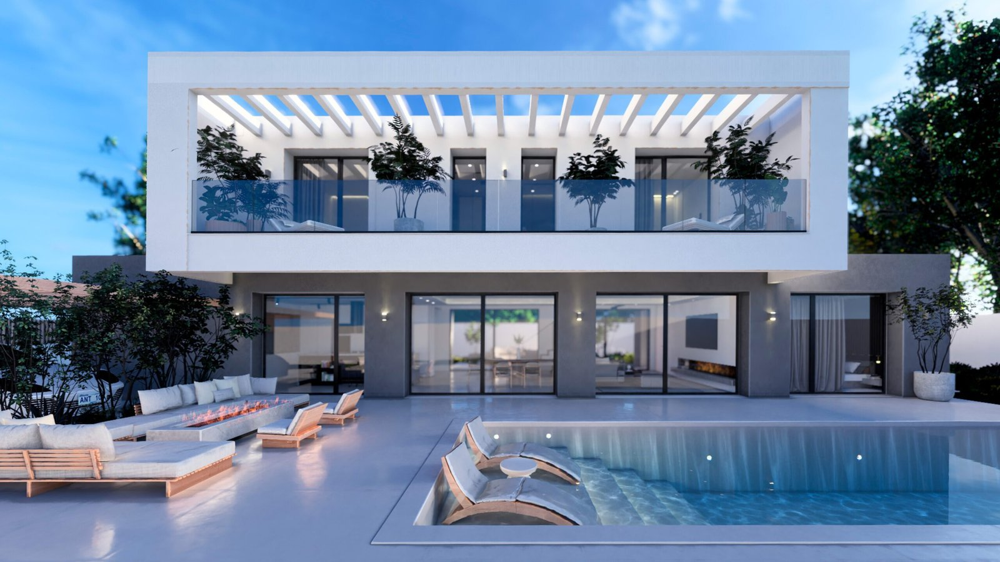
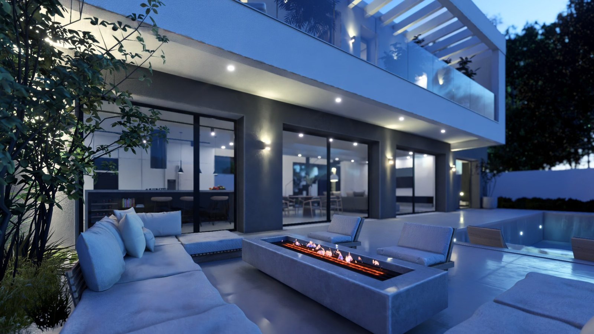
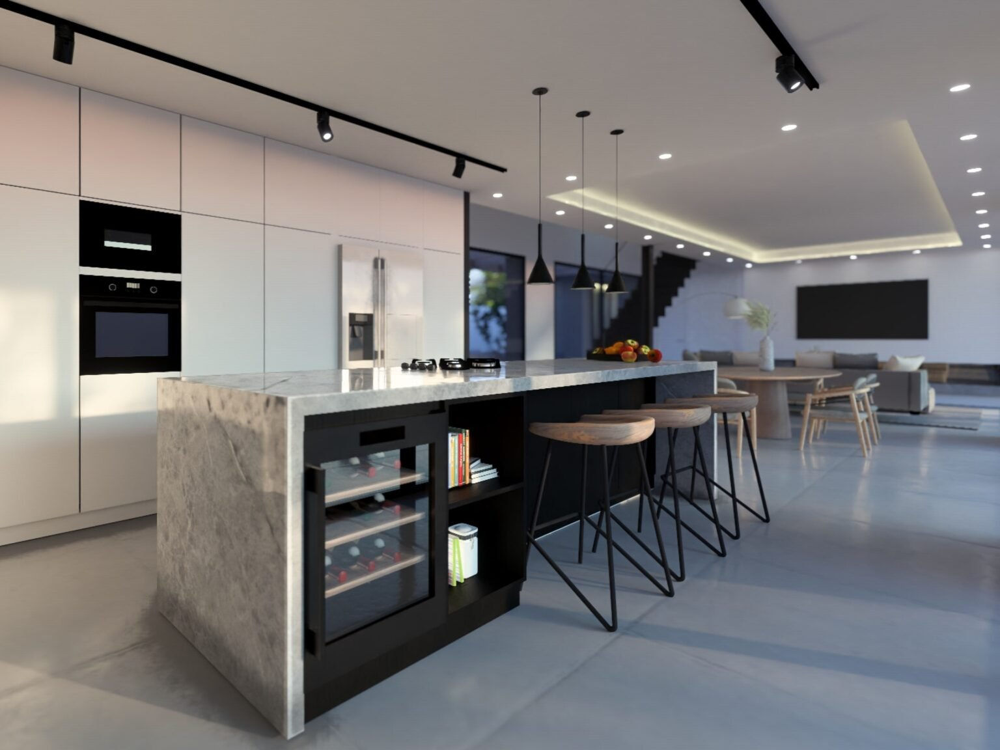

## Diseño Passivhaus y Eficiencia Energética: Los Satélites

En nuestro estudio de arquitectura en Madrid, nos enorgullecemos de presentar la vivienda de los Satélites en Majadahonda, un verdadero ejemplo de compromiso con la sostenibilidad y el confort. En este artículo, exploraremos en detalle la certificación Passivhaus y cómo este estándar de construcción revolucionario se aplica en **[esta vivienda en Los Satélites](/los-satelites/)**, Madrid, donde el diseño Passivhaus y la eficiencia energética son los elementos principales.

## Acerca de la Certificación Passivhaus: Transformando la Construcción Sostenible

La **[certificación Passivhaus](https://www.passivehouse.es/)** es un estándar internacionalmente reconocido que destaca por su énfasis en la eficiencia energética y el confort interior. Su enfoque riguroso en la envolvente del edificio y la alta calidad de los materiales asegura un hogar que demanda una cantidad mínima de energía para mantener una temperatura confortable durante todo el año.

## Beneficios de una Vivienda Passivhaus:

- **Ahorro Energético Sustancial:** Las viviendas Passivhaus [*consumen hasta un 90% menos de energía*](https://www.spainhabitat.es/casas_pasivas_passivhaus/#:~:text=Passivhaus%20es%20un%20t%C3%A9rmino%20alem%C3%A1n,b%C3%A1sicos%3A%20el%20llamado%20est%C3%A1ndar%20passivhaus.) para calefacción y refrigeración, lo que se traduce en significativos ahorros en las facturas de energía.
- **Confort Térmico y Acústico:** El diseño cuidadoso y las técnicas de construcción avanzadas aseguran una temperatura uniforme y sin corrientes de aire, así como una excelente insonorización.
- **Salud y Bienestar:** La calidad del aire interior es notablemente superior gracias a la ventilación mecánica con recuperación de calor, lo que promueve un ambiente más saludable y libre de alérgenos.
- **Sostenibilidad y Reducción de la Huella de Carbono:** Una vivienda Passivhaus tiene una menor huella ecológica al requerir menos recursos energéticos a lo largo de su vida útil.

### Si quieres seguir descubriendo más beneficios de la certificación Passivhaus, no dudes en contactar con nosotros

## La Vivienda de los Satélites: Un Ejemplo de Excelencia Passivhaus

Ubicada en el corazón de Majadahonda, la Vivienda de Los Satélites combina la elegancia arquitectónica con los más **altos estándares de eficiencia energética**. Con un diseño meticulosamente planificado y **materiales de calidad superior**, esta propiedad se alza como un testimonio de lo que es posible cuando la **sostenibilidad y el lujo convergen**.

### Descubre nuestra vivienda exclusiva en venta ubicada en la nueva y lujosa urbanización Los Satélites, Madrid.

[Visitar](/landing-los-satelites/)

## Características Destacadas:

- **Aislamiento de Última Generación:** Paredes y techos con aislamiento térmico superior que garantizan una temperatura constante en cualquier estación del año.
- **Ventilación Controlada con Recuperación de Calor:** Sistema de ventilación avanzado que asegura una circulación de aire fresco y limpio, manteniendo la temperatura interior.
- **Ventanas de Alto Rendimiento:** Doble acristalamiento con carpintería de calidad que optimiza la eficiencia energética y maximiza la entrada de luz natural.

## Conclusión:

La Vivienda de los Satélites en Majadahonda es mucho más que una casa; es un **testimonio de nuestro compromiso con la sostenibilidad y la excelencia en diseño**. Si estás buscando un hogar que abrace el **futuro de la construcción sostenible**, no busques más allá de **esta exclusiva propiedad**.

Contacta con **nosotros** para agendar una visita y descubre el potencial de vivir en una verdadera obra maestra *Passivhaus* en la **exclusiva urbanización Los Satélites, Majadahonda, Madrid**.

[Más información](/landing-los-satelites/)
