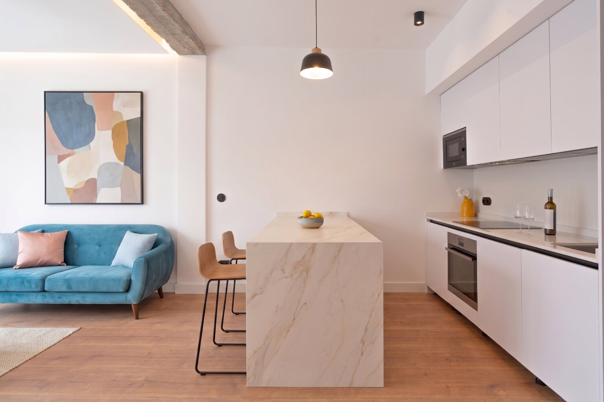

**Casa Silva** nace de una intervención que comprende el inmueble como algo más que un contenedor: una pieza de ciudad susceptible de ser reimaginada desde sus cimientos hacia arriba. La reforma integral transforma completamente el espacio, incorporando materiales de primera calidad y una lógica distributiva pensada para maximizar la amplitud visual y la entrada de luz natural.

El resultado es una vivienda diáfana, contemporánea y funcional, organizada en dos dormitorios que equilibra el uso cotidiano con una estética precisa y sin estridencias.

La **terraza privada de 28 m²**, orientada al suroeste, convierte cada tarde madrileña en una extensión natural del salón hacia el skyline de la ciudad.

Casa Silva ofrece **90 m² construidos de vivienda** y **28 m² de terraza privada** con orientación suroeste. La distribución articula **dos dormitorios** y **dos baños completos**, junto a un salón-comedor con cocina integrada, lavandería independiente y la posibilidad de adquirir plaza de garaje en el mismo edificio.

El edificio, con portal señorial, portero físico y dos ascensores, aporta el carácter propio de las fincas madrileñas consolidadas, tamizado por la reforma contemporánea del espacio interior. La obra está completamente finalizada. La vivienda se **entrega en llave en mano**, en el momento óptimo para decidir el interiorismo.

## Disfruta de la ubicación perfecta

**Casa Silva** se inserta en una zona residencial consolidada del **Barrio Salamanca**, a escasos metros del epicentro comercial y cultural del Madrid oriental. La calle Alcalá 229 concentra en su entorno inmediato todo lo que define la vida en este distrito: la oferta gastronómica y comercial de la calle Goya a cinco minutos, **centros deportivos premium** como el O2 Wellness, el **Movistar Arena** Center a diez minutos a pie y el **Parque del Retiro** accesible en menos de media hora caminando.

En cuanto a conectividad, la estación de **Metro Manuel Becerra**: líneas 2 y 6 se encuentran a un minuto del edificio, con **Ventas** en las líneas 2 y 5 también próxima. El acceso a la **M-30** y la A-2 es inmediato, y el **aeropuerto de Madrid-Barajas** queda a quince minutos en coche.

## El valor estratégico

**Casa Silva** reúne dos condiciones que el **mercado residencial premium** raramente ofrece al mismo tiempo: una reforma integral de alto nivel ya ejecutada que elimina cualquier riesgo de obra y plazo y una **terraza privada de 28 m²** en una zona de alta demanda y escasa oferta comparable.

La **distribución eficiente**, la **calidad constructiva** y la entrega en llave en mano la posicionan como un activo de rápida absorción, con un perfil de **revalorización** claro tanto para uso residencial propio como para inversión. Su **diseño contemporáneo** y la ubicación en una **finca de carácter señorial** la diferencian dentro de un segmento de mercado donde la oferta de calidad equivalente es limitada.
