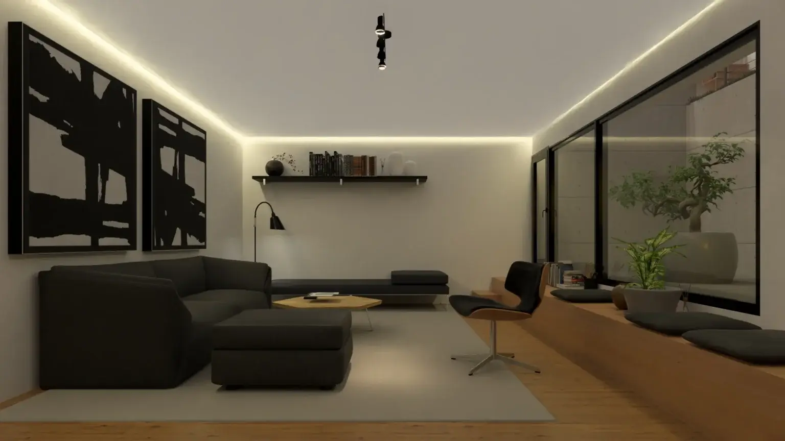
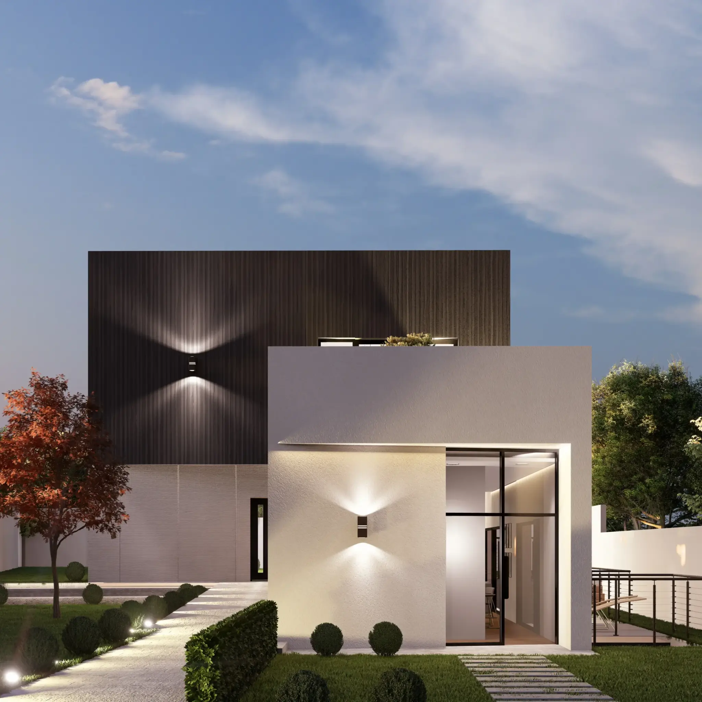
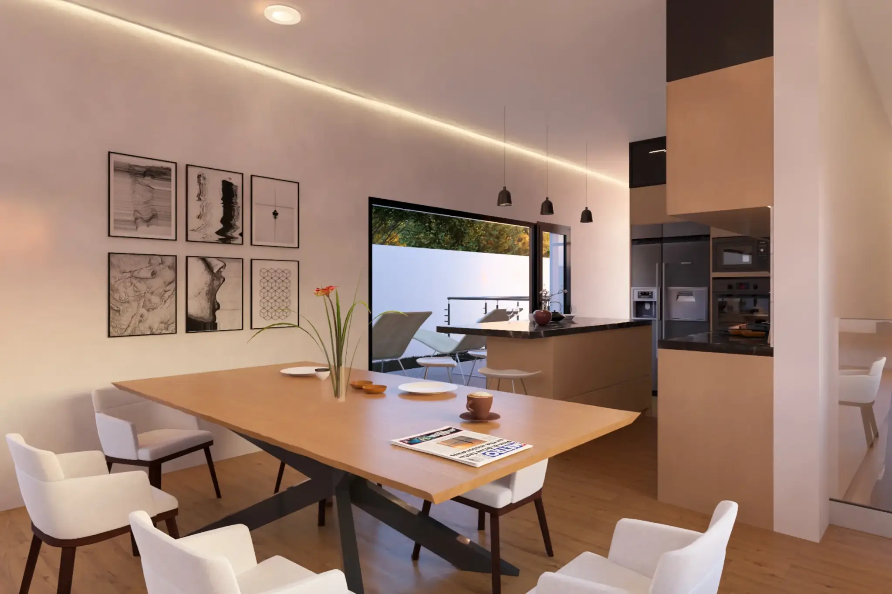

## Equilibrio perfecto entre lujo y confort.

Proyecto de **vivienda unifamiliar ubicada** en la **exclusiva** urbanización **Los Satélites, Majadahonda**, Madrid.

*Planimetría planta baja*

## Elegancia funcional en su máxima expresión.

**Bienestar**, **elegancia** y un toque de **sofisticación**. Desde la generosa **cocina** con área de **salón – comedor** integrada hasta los **2 acogedores dormitorios** y los **3 baños**, siendo uno de ellos en suite, este espacio es un reflejo de comodidad y estilo. Además, el **family room** añade un toque de calidez y versatilidad. Pero eso no es todo: la **piscina** y la **extensa zona de aparcamiento** de más de 80m2 agregan un toque de lujo y conveniencia a esta generosa de propiedad.

*Planimetría primera planta*

## Privacidad y diseño de primera categoría.

En la planta superior, el **dormitorio principal** se erige como el punto focal, ofreciendo un amplio **vestidor** y un **baño en suite**. Lo más destacado es su acceso directo a las **dos terrazas exteriores**, creando un **ambiente exclusivo** donde puedes **relajarte** y disfrutar de la **serenidad del entorno** en cualquier momento del día.

*Planimetría del sótano*

## Encanto y serenidad

Con **más de 100m2** repartidos entre el **salón principal**, una funcional **lavandería** y una **terraza** que invita al relax, el verdadero tesoro de este proyecto es, sin duda, el **espectacular patio inglés**. Aquí, la belleza de la naturaleza se entrelaza armoniosamente con la **elegancia minimalista japonesa**, creando un espacio único donde la serenidad y el estilo se fusionan en perfecta armonía.

*Planimetría de la cubierta*

## Vive Momentos Inolvidables al Aire Libre

Con **más de 120m2 disponibles**, las **dos terrazas** y los **amplios espacios exteriores** son el escenario perfecto para tus momentos de relax y entretenimiento al aire libre. Ya sea disfrutando de una tarde soleada con amigos o relajándote en privado bajo el cielo estrellado, aquí encontrarás el **espacio perfecto** para disfrutar de la belleza natural que te rodea. Con **vistas panorámicas** y un ambiente sereno, estas terrazas son el lugar ideal para crear recuerdos inolvidables y vivir la vida al máximo.

## Descubre tu oasis de exclusividad

Sumérgete en un **estilo de vida único**, donde la **elegancia** y la **comodidad** se fusionan en cada rincón de esta impresionante **vivienda unifamiliar**. Diseñada para elevar tus sentidos y satisfacer tus más altas expectativas, nuestra creación arquitectónica redefine el concepto de **hogar**.

## Acerca de la propiedad

Con una generosa **parcela de más de 727m2** y una s**uperficie útil de 520m2**, te espera un mundo de posibilidades para disfrutar al máximo del espacio exterior. Desde las **dos amplias terrazas** hasta los **espacios exteriores**, aquí encontrarás el escenario perfecto para crear recuerdos inolvidables bajo el sol o las estrellas. Además, con **tres baños** y **cinco habitaciones**, cada rincón ha sido diseñado pensando en tu **comodidad y bienestar**. Descubre la vida al aire libre en su máxima expresión en esta magnífica propiedad.

## Tu tranquilidad nos importa

La **urbanización** Los Satélites es un oasis de **tranquilidad** y **seguridad** por lo siguientes motivos:

- Vigilancia 24 horas, control de acceso y circuito cerrado de televisión para tu tranquilidad y la de tu familia.
- Entorno natural privilegiado con amplias zonas verdes, parques infantiles y pistas deportivas.
- Excelentes comunicaciones: A poca distancia de Madrid, con acceso directo a la A-6 y transporte público.

## La ubicación perfecta

Disfruta de áreas verdes exuberantes, parques infantiles, canchas deportivas y espacios recreativos para que tú y tu familia puedan disfrutar al máximo de cada momento. Además, nuestra **ubicación privilegiada** te ofrece acceso a centros comerciales, restaurantes de renombre, escuelas de calidad y transporte conveniente, todo dentro de un **entorno seguro** y **tranquilo**.

