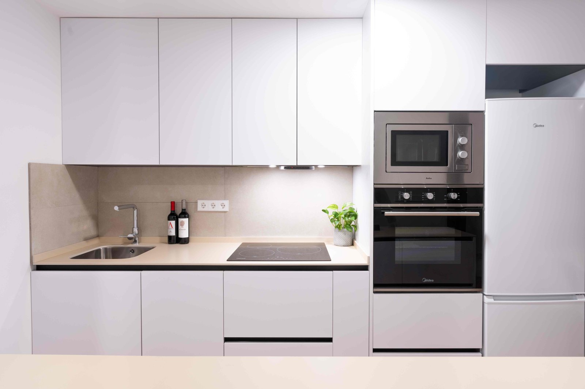

Reforma integral en el barrio de Esteban de Arteaga. Este proyecto resalta la meticulosa restauración de elementos originales, como las vigas, que han sido cuidadosamente preservadas para dar vida a un espacio completamente rediseñado. El resultado es un ambiente perfectamente acondicionado que combina la autenticidad del pasado con la funcionalidad y el estilo contemporáneo.

Renovación completa de la distribución, ampliando el programa y readaptando espacios. Se apuesta por una materialidad con personalidad para conseguir un hogar con espacios únicos y agradables. Se diseña toda la instalación, con cálculo de iluminación para cada estancia, con el propósito de conseguir una armonía entre los espacios. Además, se elige cuidadosamente todo el mobiliario.

## Anteproyecto

En esta fase se estudia la normativa urbanística, protección del edificio, elementos singulares, normas de la comunidad. También se realiza un estudio de detalle de las necesidades reales, almacenaje, estilo de vida, cocina abierta  
o semiabierta…

## Propuesta

En base a lo estudiado en la fase de Anteproyecto, se proporcionan propuestas de distribución adaptadas al propietario de la  
vivienda, junto una materialidad por cada estancia y un cálculo de instalaciones.

## Resultado

Una vez definido el proyecto, se ejecutan los trabajos con una dirección de obra exhaustiva hasta los repasos y detalles finales. Por último, con la implantación del mobiliario según el proyecto de interiorismo, el resultado es una vivienda única y personalizada para poder entrar a vivir y estrenar el nuevo hogar.
