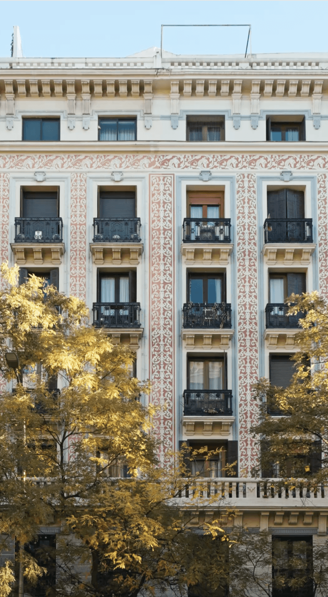
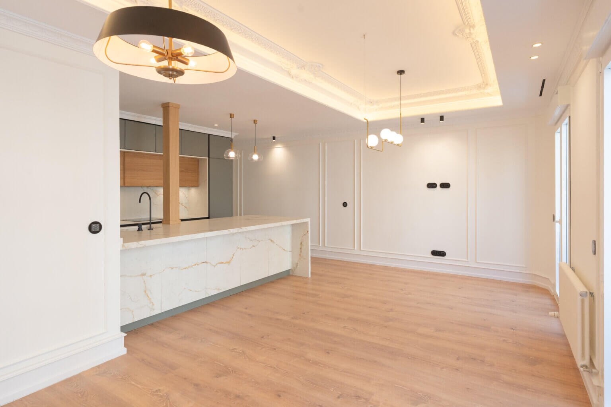
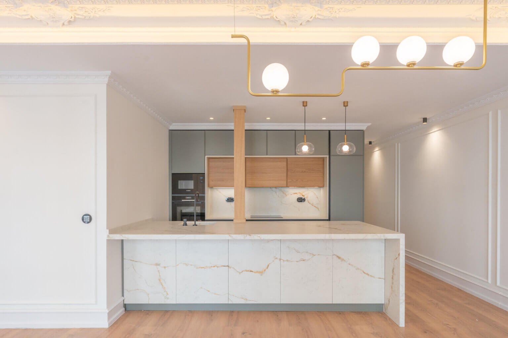
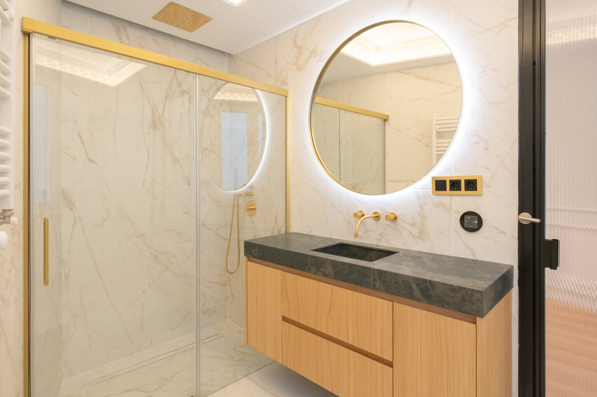
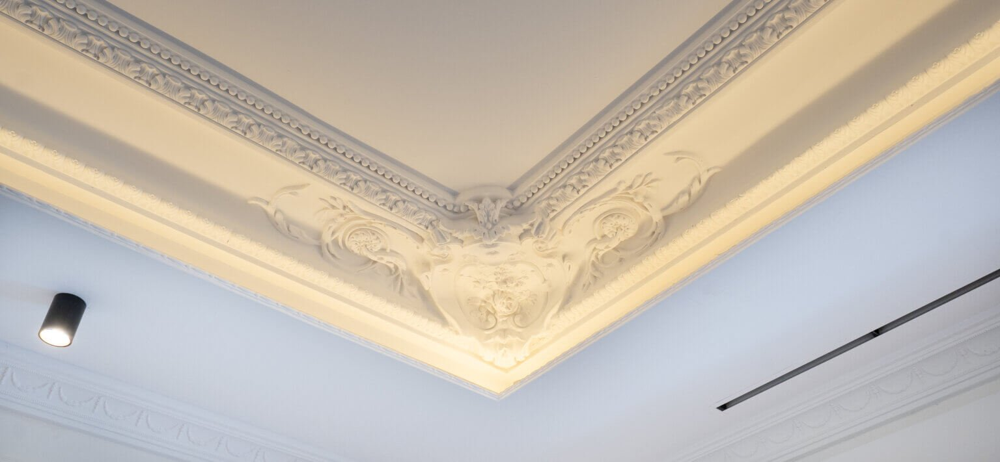

Hay direcciones que no se explican por su ubicación.  
Se entienden por lo que ocurre dentro de ellas.

En el número 124 de la Calle de Alcalá, en pleno Barrio de Salamanca, nace Casa Elara: una vivienda de lujo en Madrid concebida desde la mirada de un **estudio de arquitectura en Madrid** que entiende el espacio como algo más que forma.

No es un proyecto que parta de cero.  
Es un proyecto que parte de la memoria.

Tal como se plantea en el origen del proyecto, el objetivo no era añadir, sino reinterpretar una historia existente y traducirla en una nueva forma de habitar.

## Reforma integral en Madrid: cuando transformar significa entender

El punto de partida era reconocible.

Una vivienda clásica del Barrio de Salamanca, construida en 1930, con una estructura que ya no respondía a cómo vivimos hoy:

- Estancias fragmentadas
- Recorridos sin sentido
- Luz natural desaprovechada
- Falta de conexión entre espacios

Pero esta **reforma integral en Madrid** no responde desde el exceso.

Responde desde la precisión.

Refleja la forma de trabajar de un **estudio de arquitectura en Madrid** que no busca añadir capas, sino revelar el potencial del espacio.

Porque hay proyectos que se construyen sumando.  
Y otros como Casa Elara que se construyen quitando todo lo que sobra.

## La luz como herramienta, no como recurso

Antes de la intervención, la luz existía, pero no participaba.

Ahora recorre la vivienda.

La atraviesa sin obstáculos.  
La ordena.  
La define.

La iluminación artificial no compite con ella, sino que la acompaña:

- Iluminación general integrada
- Líneas de luz indirecta
- Puntos focales precisos

No hay exceso.  
No hay protagonismo innecesario.

Solo una intención clara: hacer que el espacio se entienda mejor.

## Coherencia antes que impacto

En Casa Elara, el interiorismo no busca destacar por partes.

Funciona como un sistema.

Tal como se detalla en el proyecto, la selección de materiales responde a un criterio de coherencia y durabilidad, no de exhibición.

- Piedra sinterizada de alta resistencia
- Revestimientos de gran formato efecto mármol
- Madera natural de roble
- Carpintería a medida integrada

La paleta se mantiene contenida: blancos, grises, madera y acentos dorados.

Aquí, el lujo no es decorativo.  
Es estructural.

## 138 m² diseñados desde la lógica del habitar

Casa Elara no impresiona por su tamaño.  
Lo hace por cómo está pensada.

La vivienda se organiza en:

- Tres dormitorios en suite
- Un espacio principal abierto donde cocina y salón conviven
- Aseo de cortesía
- Lavandería integrada y oculta

Pero lo importante no es la distribución.

Es la relación entre los espacios.

Nada está aislado.  
Todo está conectado.

Y esa conexión transforma la experiencia diaria.

## Tecnología y confort: lo que no se ve, pero se siente

En una vivienda de lujo en el Barrio de Salamanca, el confort no puede depender solo de lo visible.

Casa Elara incorpora soluciones técnicas que mejoran la calidad de vida sin imponerse:

- Carpinterías con aislamiento térmico y acústico
- Vidrios con control solar
- Sistemas de ventilación eficientes
- Domótica integrada

La tecnología no se muestra.

Se percibe en el silencio, en la temperatura, en la luz.

## Barrio de Salamanca: ubicación como valor estratégico

Elegir el Barrio de Salamanca no es solo una cuestión de prestigio.

Es una decisión estratégica.

Este entorno ofrece:

- Alta demanda nacional e internacional
- Revalorización constante
- Proximidad al Parque del Retiro
- Servicios premium y conectividad

Esto convierte a Casa Elara en algo más que una vivienda exclusiva en Madrid.

La convierte en una inversión sólida.

## Más allá del diseño: cómo trabaja un estudio de arquitectura en Madrid

Proyectos como Casa Elara no surgen de decisiones aisladas.

Responden a una forma de trabajar.

Un **estudio de arquitectura en Madrid** especializado en vivienda de alta gama entiende que el proyecto no empieza con planos, sino con preguntas:

- ¿Cómo se vive realmente este espacio?
- ¿Qué sobra?
- ¿Qué falta?
- ¿Qué se puede simplificar?

La respuesta no está en añadir más elementos, sino en ordenar mejor los existentes.

Y cuando esa lógica se mantiene en cada decisión, el resultado no es solo estético.

Es habitable.
