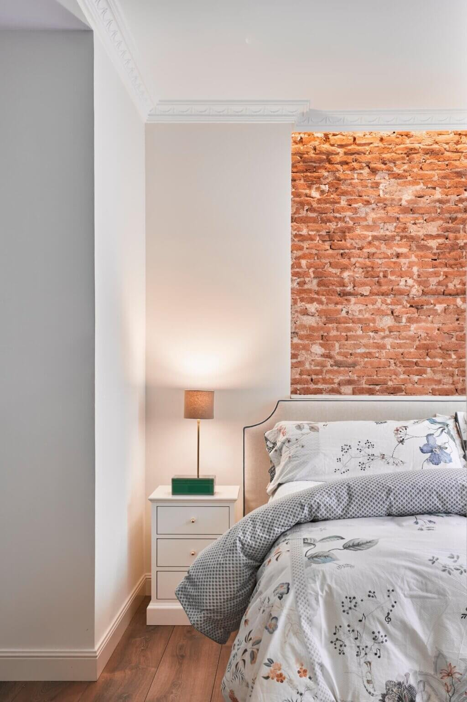
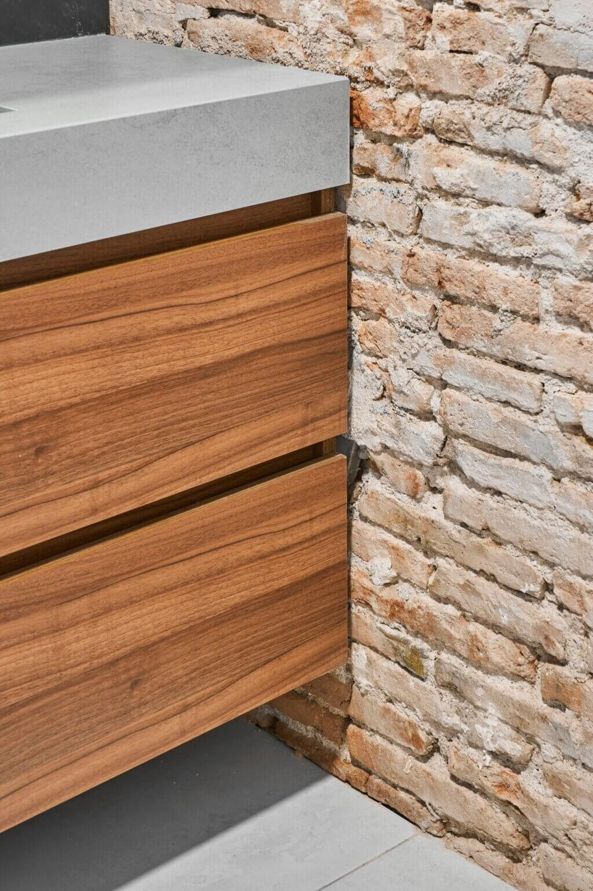
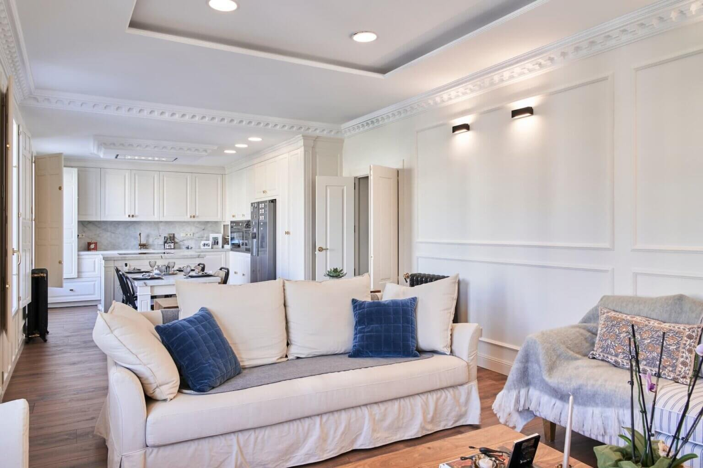

## El origen

Hay casas que no necesitan reinventarse.  
Solo necesitan volver a estar a la altura de lo que prometen.

En Felipe II, el punto de partida era claro: preservar la sensación de hogar clásico, su elegancia, su presencia y actualizarlo con una lectura contemporánea: más habitable, más cómodo, más coherente con la vida de ahora.

El objetivo no fue “modernizar”.  
Fue afinar.

## La propuesta

El proyecto de reforma integral e interiorismo busca actualizar la vivienda manteniendo su carácter clásico. La propuesta combina elementos contemporáneos con una selección de texturas y contrastes suaves.

Las decisiones de diseño se organizan en tres criterios: continuidad entre lo clásico y lo contemporáneo, una iluminación de carácter cálido y una materialidad que relacione los distintos espacios.

## El ambiente

- Elegancia sin esfuerzo
- Luz serena, cálida
- Espacios que invitan a quedarse
- Un hogar que se siente “correcto” desde que entras

## La materia

- Texturas nobles, sin excesos
- Contrastes suaves (mate / brillo, claro / profundo)
- Detalle discreto: el que se descubre, no el que se anuncia
- Una materialidad pensada para durar y envejecer bien

## El Resultado

