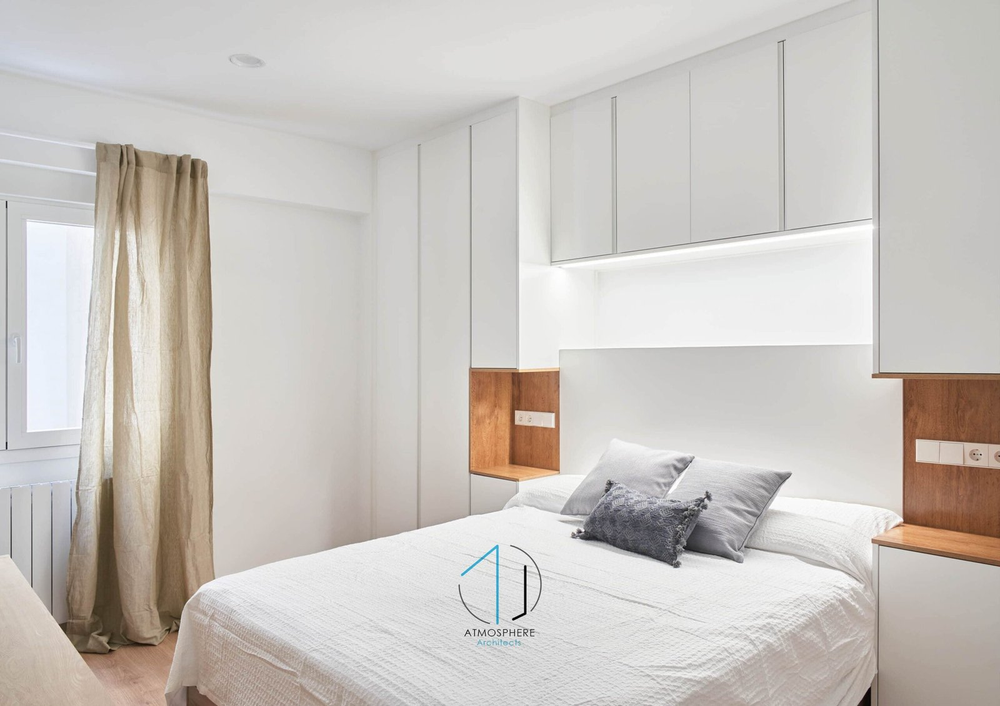
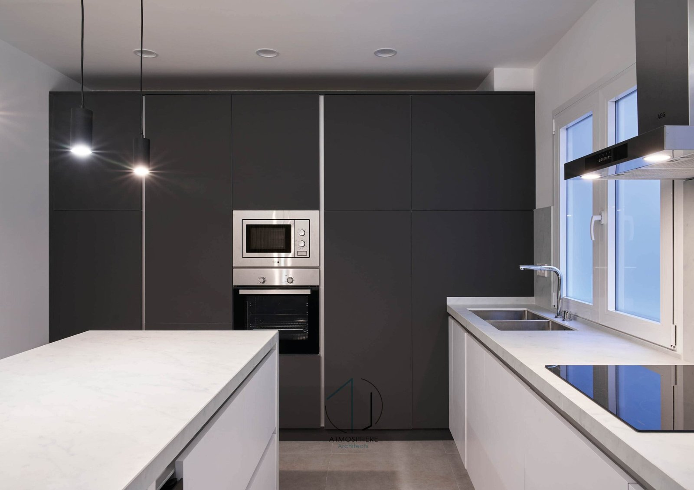

Reforma integral en el barrio de Goya dónde se rescata la esencia de materiales originales como el hormigón y la madera. Se apuesta por una materialidad con personalidad que sea capaz de organizar por si misma los espacios de distribución. Se apuesta por una  
arquitectura limpia con Palillería de madera que conforma un módulo central en el que todas las puertas quedan ocultas e integradas consiguiendo así un diseño único y minimalista del espacio.

Renovación completa de la distribución, ampliando el programa y readaptando espacios. Se apuesta por una materialidad con personalidad para conseguir un hogar con espacios únicos y agradables. Se diseña toda la instalación, con cálculo de iluminación para cada estancia, para conseguir una armonía entre los espacios. Igualmente se elige cuidadosamente todo el mobiliario.

## Anteproyecto

En esta fase se estudia la normativa urbanística, protección del edificio, elementos singulares, normas de la comunidad. También se realiza un estudio de detalle de las necesidades reales, almacenaje, estilo de vida, cocina abierta  
o semiabierta…

## Propuesta

En base a lo estudiado en la fase de Anteproyecto, se proporcionan propuestas de distribución adaptadas al propietario de la  
vivienda, junto una materialidad por cada estancia y un cálculo de instalaciones.

## Resultado

Una vez definido el proyecto, se ejecutan los trabajos con una dirección de obra exhaustiva hasta los repasos y detalles finales. Por  
último, con la implantación del mobiliario según el proyecto de interiorismo, el resultado es una vivienda única y personalizada para poder entrar a vivir y estrenar el nuevo hogar.

