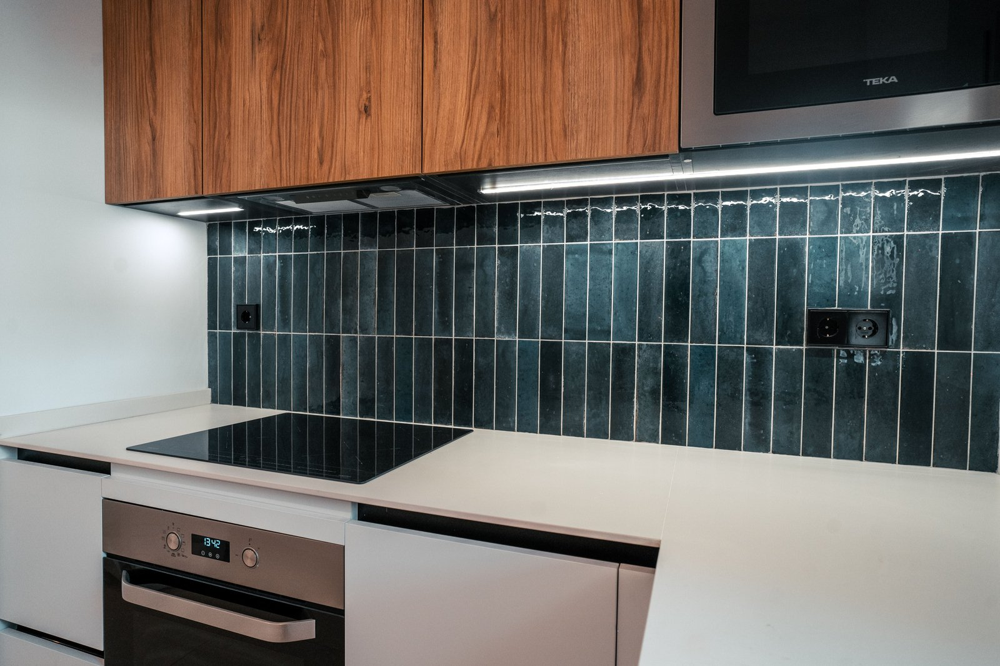
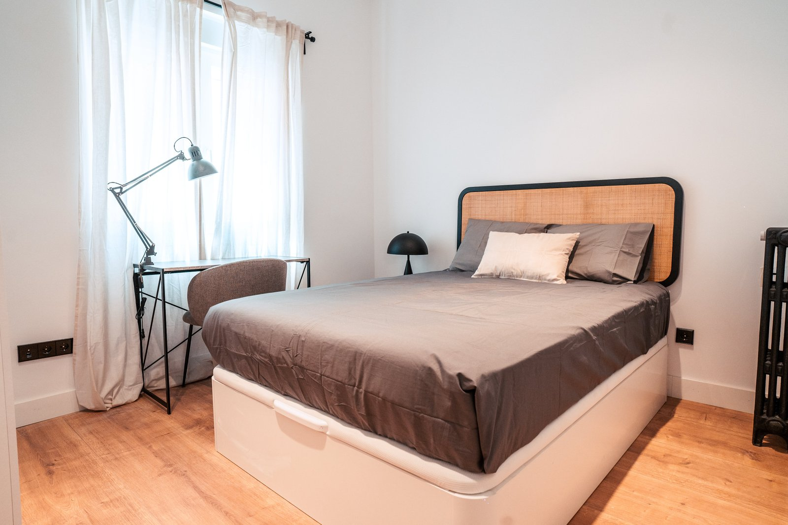

Reforma integral e interiorismo de una vivienda de carácter clásico en Madrid. El proyecto combina una nueva distribución, iluminación y mobiliario con elementos como las molduras, para relacionar las necesidades de uso con la identidad de la casa.

## Alcance y decisiones del proyecto

La intervención reorganiza la distribución y adapta los espacios al programa de la vivienda. El trabajo de interiorismo relaciona materiales, iluminación y mobiliario para dar continuidad al conjunto.

- **Distribución:** estudio de necesidades, almacenamiento y relación entre estancias.
- **Instalaciones e iluminación:** definición de la instalación y cálculo de iluminación por estancia.
- **Materiales y mobiliario:** selección por espacios y diseño de elementos concretos, como chimenea, mesa de recibidor y cocina.

## Anteproyecto

Antes de definir la distribución, se estudian la normativa urbanística, la protección del edificio, los elementos singulares y las normas de la comunidad. A partir de las necesidades de uso y almacenamiento se comparan opciones, incluida la relación abierta o semiabierta de la cocina con el resto de la casa.

## Propuesta

Las alternativas de distribución se desarrollan a partir del anteproyecto. La propuesta coordina los materiales de cada estancia con el cálculo de instalaciones, de modo que las decisiones de uso, iluminación y acabados formen parte de un mismo proyecto.

## Resultado

La ejecución se realiza a partir del proyecto, con dirección de obra y revisión de repasos y detalles finales. La implantación del mobiliario completa el trabajo de interiorismo.

Este caso muestra cómo distribución, iluminación y elementos a medida se relacionan dentro de una reforma integral. Cada vivienda necesita su propia valoración de alcance y condiciones.

[Conoce el servicio de reformas integrales en Madrid](/reformas-integrales-madrid/) o [cuéntanos tu proyecto](/tu-reforma-integral-en-madrid/#valoracion).

