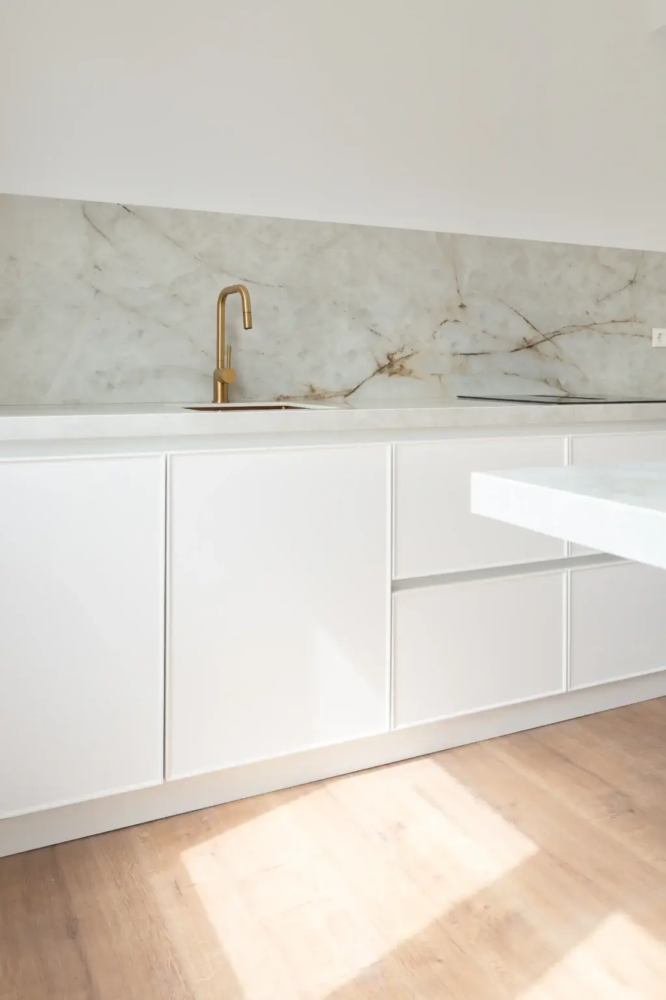
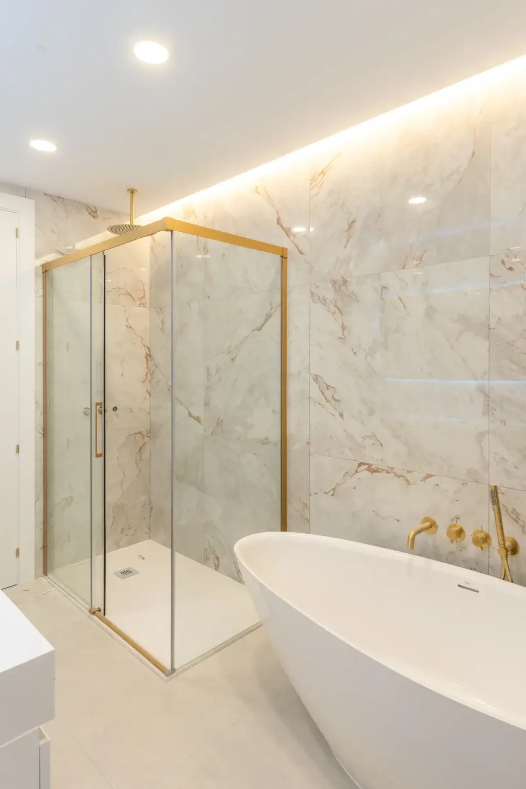
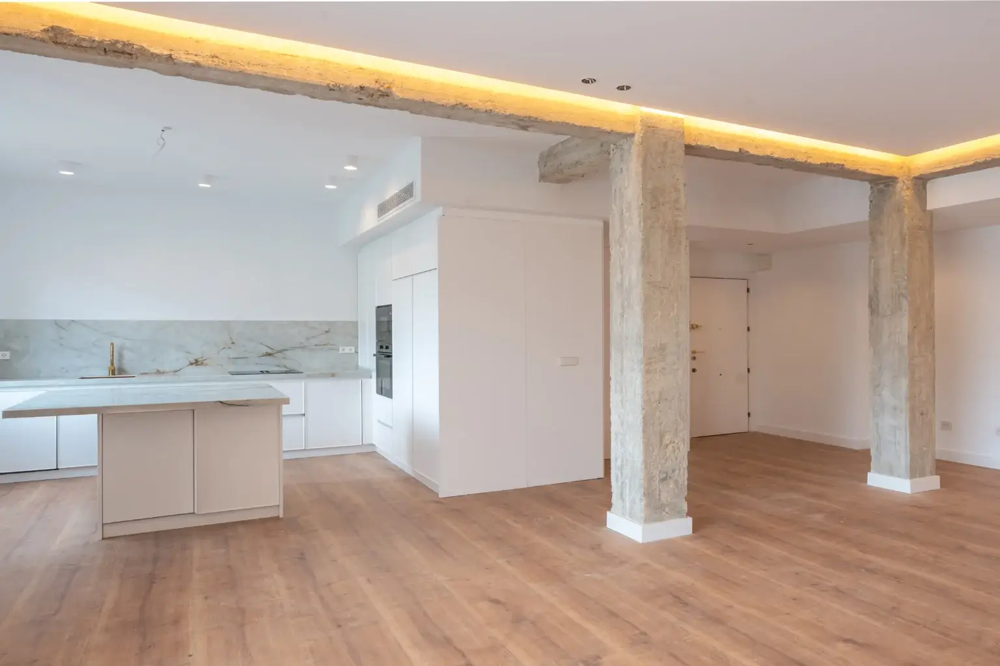
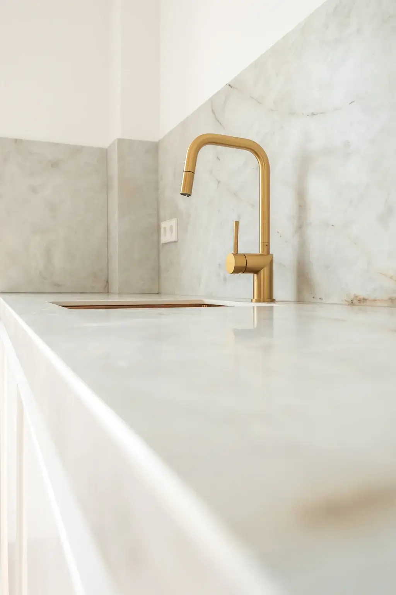

Una vivienda moderna y llena de luz en el exclusivo barrio de Salamanca, Madrid. Destaca por sus amplios espacios abiertos y una terraza perfecta para disfrutar y desconectar al aire libre.

Esta reforma integral es un claro ejemplo de cómo la arquitectura puede transformar un espacio en un hogar único y personalizado. Al combinar elementos de diseño minimalista con tecnología de vanguardia, hemos creado un ambiente sofisticado y funcional que se adapta a las necesidades de la vida moderna.

## Deseo del Cliente

La vivienda requería una reforma integral. El cliente solicitaba un proyecto funcional y cómodo para su familia, que incluyera tres habitaciones, cada una con su propio baño en suite, un aseo de cortesía, una lavandería y un espacio de salón-cocina integrado.

## Nuestra Propuesta

Reconfiguración de la distribución: se añadió un aseo de cortesía y un vestidor en la habitación principal. Además, se eliminó el espacio inutilizado del pasillo, aprovechando ese metraje para ampliar las habitaciones y realzar los ejes visuales hacia la terraza, lo que permitió crear un espacio más amplio para el salón-cocina. Finalmente, se desarrolló un proyecto de interiorismo, utilizando materiales con carácter para destacar la personalidad y majestuosidad de la vivienda.

## Ejecución y Resultado

La ejecución presentó una gran complejidad debido al estado deteriorado de la construcción, con bajantes de uralita, pavimentos desnivelados y la aparición de vicios ocultos. Sin embargo, al abordar el proyecto de reforma integral, todos estos problemas fueron solucionados, incorporando nuevas instalaciones y materiales de primera calidad. El resultado es un hogar pensado para que una familia disfrute de un proyecto cuidadosamente ejecutado.

