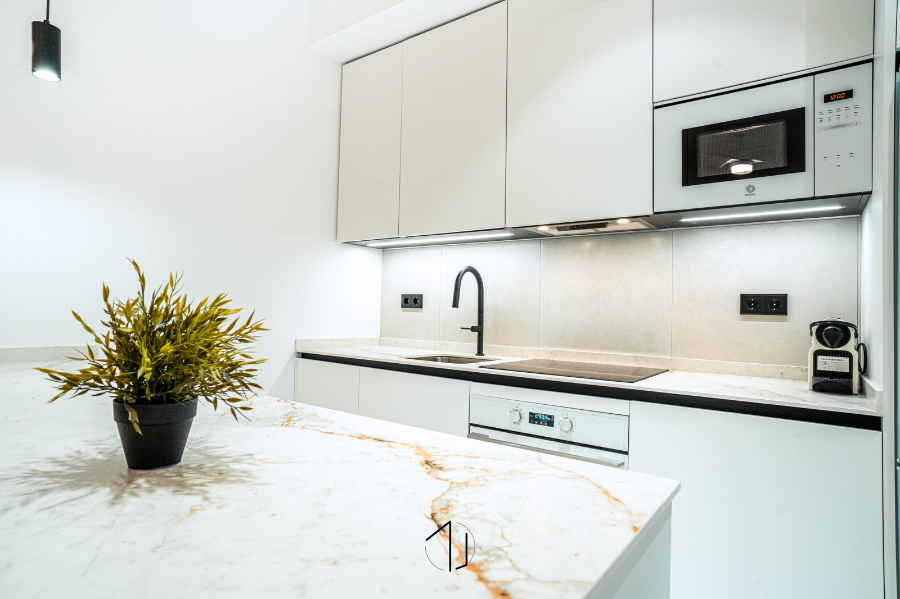
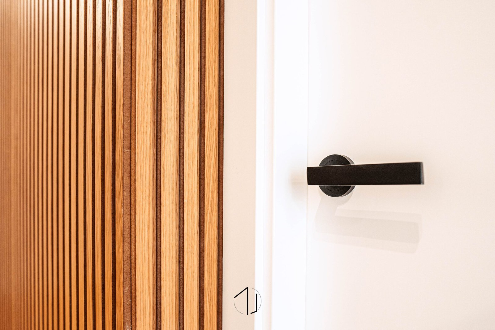

Un elegante y sofisticado equilibrio entre lo clásico y lo moderno, donde la renovación de este espacio combina muebles contemporáneos con elementos tradicionales como las molduras, creando una estética luminosa y amplia mediante una cuidada selección de colores claros y mobiliario

Renovación del estilo clásico con toques modernos. En esta vivienda se ha conseguido una estética elegante y sofisticada con la combinación de muebles de diseño contemporáneos y elementos clásicos como las molduras. La luminosidad y amplitud del espacio se ha mejorado con la elección de una paleta de colores claros y un amueblamiento cuidadosamente seleccionado.

## Anteproyecto

En esta fase se estudia la normativa urbanística, protección del edificio, elementos singulares, normas de la comunidad. También se realiza un estudio de detalle de las necesidades reales, almacenaje, estilo de vida, cocina abierta o semiabierta…

## Propuesta

En base a lo estudiado en la fase de Anteproyecto, se proporcionan propuestas de distribución adaptadas al propietario de la vivienda, junto con una materialidad por cada estancia y un cálculo de instalaciones.

## Resultado

Una vez definido el proyecto, se ejecutan los trabajos con una dirección de obra exhaustiva hasta los repasos y detalles finales. Por último, con la implantación del mobiliario según el proyecto de interiorismo, el resultado es una vivienda única y personalizada para poder entrar a vivir y estrenar el nuevo hogar.

