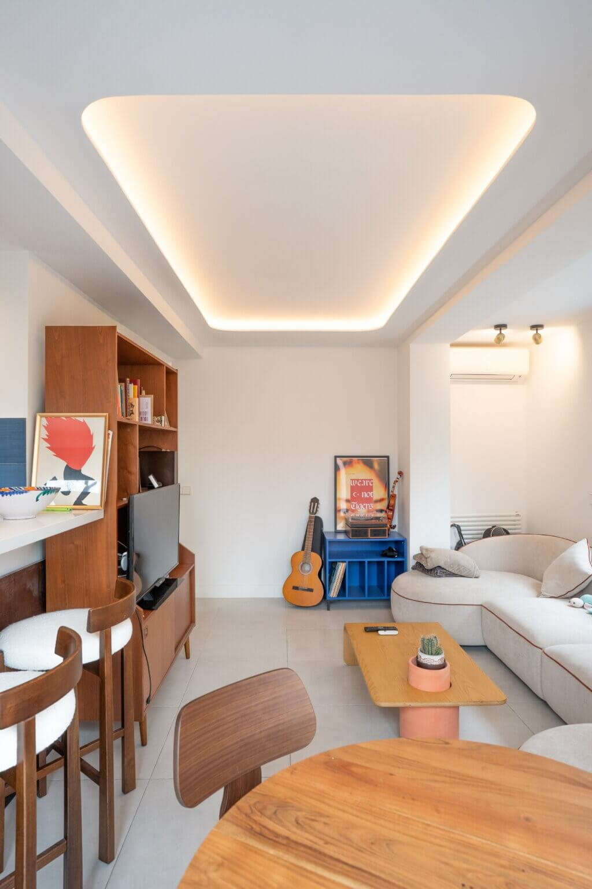
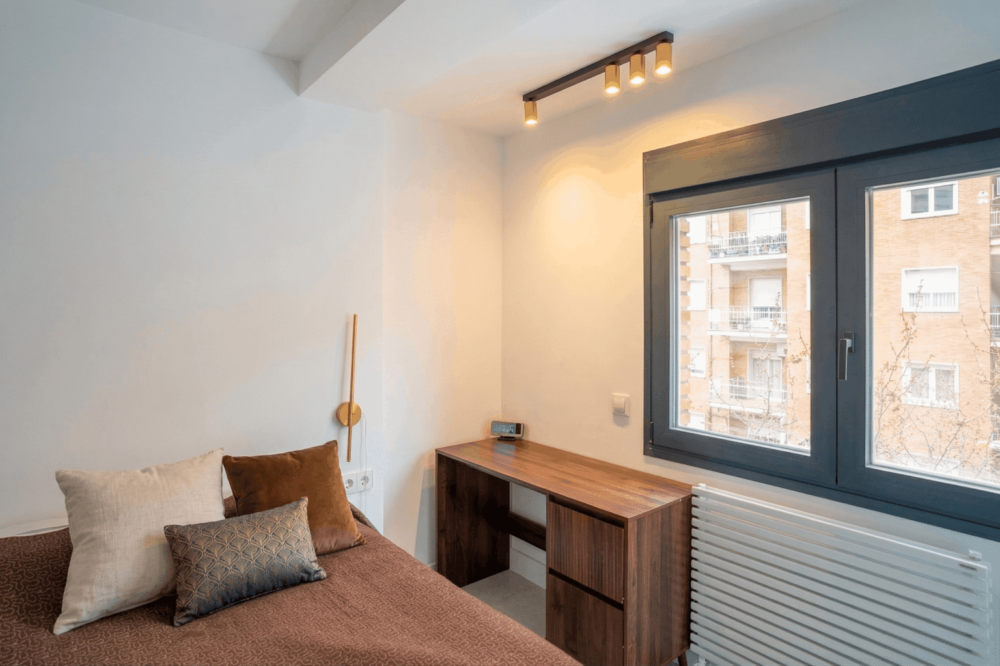

En Madrid Río, uno de los enclaves con mayor crecimiento y revalorización inmobiliaria de Madrid, nace **“Santos Dumont”**, un proyecto donde la arquitectura, la construcción y el interiorismo convergen con una inspiración clara: la esencia vibrante de Copacabana.

Este parque lineal de más de 10 kilómetros junto al río Manzanares ha transformado el tejido urbano en un espacio donde la naturaleza, el deporte y la calidad de vida elevan el valor de cada vivienda.

Concebido para un perfil joven, conectado y cosmopolita, el proyecto establece un diálogo entre Madrid y Río de Janeiro. La arquitectura apuesta por la apertura lumínica, la conexión directa con el exterior —donde las copas de los árboles forman parte del paisaje cotidiano— y una paleta cromática natural.

La vivienda se convierte así en un espacio social donde la música, la luz y la vida fluyen con naturalidad.

## Un barrio en constante revalorización urbanística

Madrid Río se ha consolidado como una de las mejores zonas para invertir en vivienda en Madrid gracias a su transformación urbana y su equilibrio entre naturaleza y ciudad.

- Revalorización constante del mercado inmobiliario
- Seguridad y consolidación como barrio tradicional
- Amplia oferta deportiva, cultural y social
- Desconexión del turismo masivo sin perder conectividad

Su evolución urbanística ha convertido la zona en un activo estratégico tanto para inversores como para usuarios finales que buscan calidad de vida sin renunciar a la ciudad.

## Diseño residencial con líneas curvas y funcionalidad

El proyecto recibe su nombre en honor al aviador brasileño Alberto Santos-Dumont, símbolo de innovación, ligereza y visión.

Como él mismo expresó:

**“Lo importante no es volar, sino saber aterrizar”.**

Esta filosofía se traduce en una arquitectura donde cada decisión responde al equilibrio entre estética y funcionalidad, evitando excesos y priorizando la experiencia real de habitar.

## Distribución optimizada de una vivienda de 87 m²

- Vivienda orientada a tres fachadas completamente iluminadas
- Ventanales de suelo a techo que maximizan la entrada de luz natural
- Eliminación del pasillo para optimizar la superficie útil
- Cocina con concepto abierto-cerrado adaptable
- Incorporación de un segundo baño
- Zona social como núcleo central de la vivienda

La zona privada se compone de tres dormitorios equilibrados, uno de ellos con balcón privado de suelo a techo. Todas las estancias cuentan con armarios empotrados y se incorpora un lavadero independiente que aporta funcionalidad al día a día.

## Una propuesta estética con identidad propia

El interiorismo de Santos Dumont construye una narrativa visual inspirada en la conexión entre Madrid y Río de Janeiro, donde cada elemento responde a una intención emocional y estética.

- **Paleta base:** añil, chocolate y dorado
- **Acentos:** rojo y naranja
- Mobiliario de líneas curvas en armonía con la arquitectura
- Porcelánico de Marazzi en cocina y dormitorio principal
- Pavimentos con mosaicos geométricos
- Baños inspirados en el mármol Carrara

El resultado es un espacio cálido, sofisticado y sensorial, donde los materiales dialogan con la luz natural y generan una experiencia envolvente.

## Diseño estratégico que aumenta el valor de la vivienda

El valor de una vivienda ya no depende únicamente de su ubicación, sino de la calidad del proyecto que la define. En Santos Dumont, cada decisión arquitectónica y constructiva está orientada a maximizar la rentabilidad y la experiencia de uso.

- Optimización de metros cuadrados sin pérdida de confort
- Diseño atemporal que evita la obsolescencia estética
- Materiales duraderos y de alta calidad
- Espacios flexibles adaptados a nuevos estilos de vida
- Mayor atractivo para alquiler o reventa

Este enfoque convierte la vivienda en un activo sólido, donde diseño y estrategia inmobiliaria trabajan en conjunto para generar valor a largo plazo.
