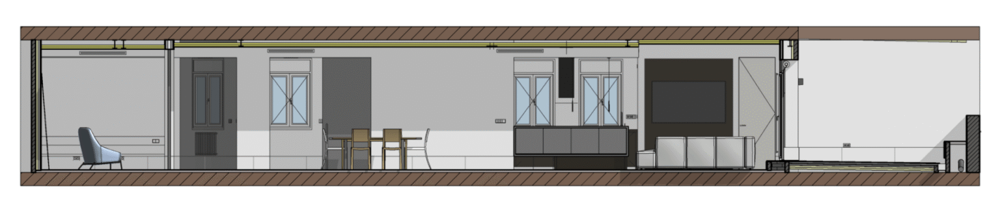
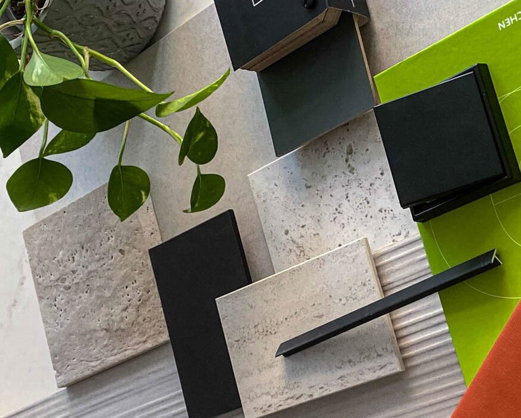
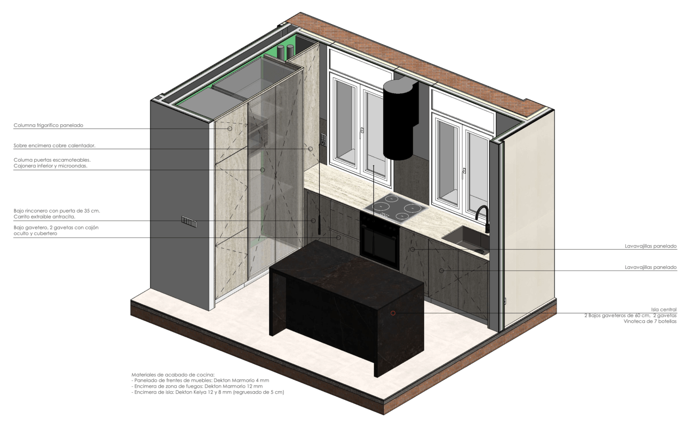
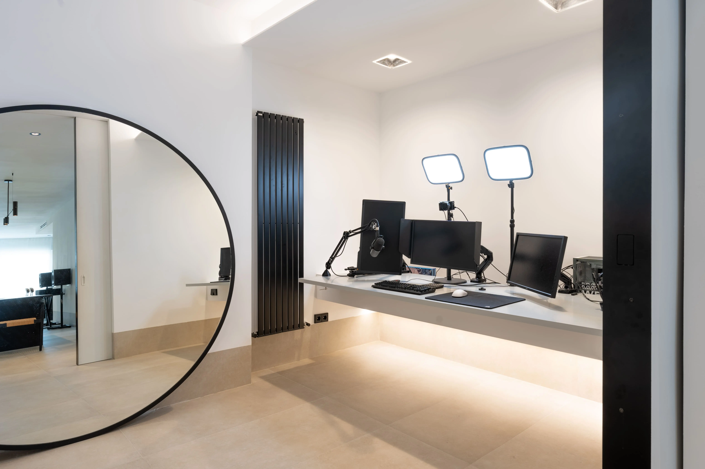
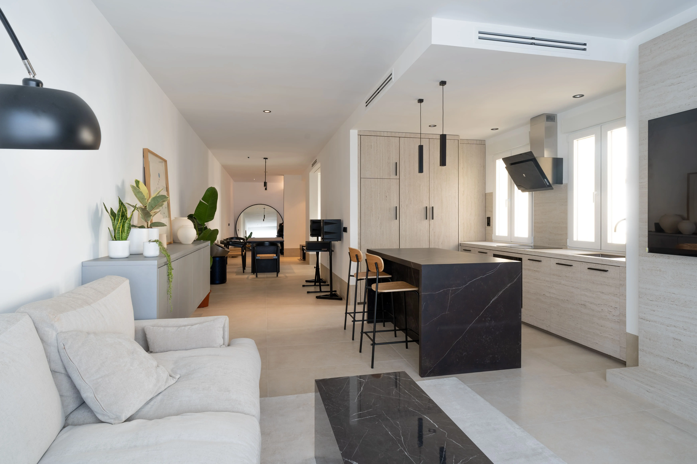

## El origen

Todo proyecto comienza con una forma de vivir.

Casa Werlyb nace de la necesidad de transformar un espacio en un hogar, funcional y alineado con quienes lo habitan. Un punto de partida basado en la escucha, la observación y el deseo de crear un espacio funcional y personal.

> “Necesito un espacio abierto que refleje mi estilo de vida”

## La idea

La intervención se articula a partir de una idea clara: ordenar el espacio para ganar fluidez, luz y equilibrio. La arquitectura se depura hasta lo esencial, permitiendo que cada estancia dialogue con el conjunto de forma natural.

## El ambiente

La nueva distribución tiene como objetivo abrir el espacio y crear una conexión continua entre las áreas sociales de la vivienda, transformando por completo la sensación de amplitud y circulación.  
Se optó por un salón-comedor amplio con una cocina integrada que fluye directamente hacia una gran terraza, pensada para aprovechar al máximo el espacio al aire libre.

Este espacio exterior se ha diseñado como un área polivalente que permite desde reuniones íntimas hasta eventos más amplios y funcionales para grabaciones al aire libre, aportando flexibilidad a las actividades de los habitantes.

## La materia

La materialidad acompaña al espacio sin imponerse. Tonos suaves, texturas contenidas y encuentros precisos refuerzan la sensación de serenidad y aportan durabilidad y coherencia al conjunto.

## La iluminación

La iluminación se relaciona con la nueva distribución abierta y con los accesos acristalados a la terraza. El proyecto busca aprovechar la conexión visual con el exterior y coordinar la luz con el uso de las distintas zonas de la vivienda.

## La cocina

La cocina se integra en la zona de salón-comedor, en continuidad con la terraza. La isla organiza el espacio de trabajo y la relación con la zona de estar; los frentes de madera y las superficies oscuras forman parte de la composición visible del proyecto.

## El Setup

El setup de grabación es el núcleo operativo de la vivienda y ha sido diseñado a medida para responder a las necesidades profesionales del cliente, un creador de contenido con gran presencia en redes sociales. Este espacio combina tecnología avanzada, funcionalidad y diseño minimalista, ofreciendo un entorno altamente optimizado para grabaciones en vivo, transmisiones y producción de contenido audiovisual de alta calidad.

El elemento central del setup es un escritorio de una sola pieza, diseñado completamente a medida. Este escritorio flotante no solo ofrece una superficie amplia y limpia, sino que además está pensado para mantener los cables fuera de la vista, garantizando un aspecto ordenado y libre de distracciones. La iluminación indirecta bajo el escritorio realza el diseño moderno, aportando un toque de elegancia y una sensación de ligereza visual en el espacio.

## El Resultado

## Decisiones que definen esta reforma

- **Distribución:** conexión entre salón, comedor, cocina y terraza frente a la compartimentación previa.
- **Luz:** relación de los espacios interiores con los accesos acristalados al exterior.
- **Uso:** integración de un espacio de trabajo con escritorio a medida y organización del cableado.
- **Materiales:** coordinación de tonos, texturas y mobiliario dentro del conjunto.

Estas decisiones responden a este proyecto; el alcance de otra vivienda debe estudiarse según sus necesidades y condiciones.

> "Quería poder confiar en alguien. Que me ayudase a tomar decisiones”

## Vivienda y espacio de trabajo

La vivienda combina espacios domésticos y una zona de trabajo para creación audiovisual. El proyecto relaciona ambos usos mediante la distribución, el mobiliario a medida y la organización de las instalaciones del puesto de trabajo.
